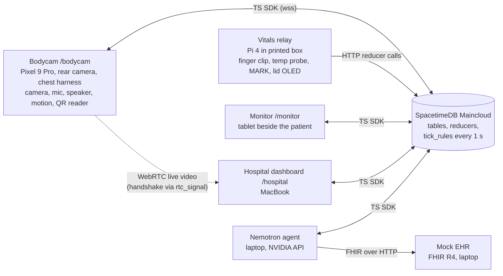

# Handoff — project context for coding agents

Read this first. It is the shared brief for everyone's agent (Claude Code, Codex, Cursor, etc.).
Drop it in your repo root as `AGENTS.md` / `CLAUDE.md` if your tool wants that name.

**Ground truth:** [`docs/context/Handoff Product Spec (Copy).md`](docs/context/Handoff%20Product%20Spec%20(Copy).md)
(version 1, updated after the team meeting, Sat 2026-11-07 15:36). This file is a working summary of it. If
they conflict, **the spec wins**, except for the **team decisions in section 0**, which override the spec.
Fix this file when you notice a conflict. Section numbers like "spec §15" point into the spec.

Last updated: 2026-11-07 (HackUTD 2026, UT Dallas, ECSW). Facts marked **[OPEN]** are not decided. Do not
treat them as settled, and do not silently pick one. Ask the human or add it to section 10.

---

## 0. Team decisions that override the spec (2026-11-07)

1. **Video to the hospital is a live WebRTC stream, never snapshots.** No low-frame snapshot mode. (Snapshots
   for the vision model, if built later, are separate from the video.)
2. **Agent workflow W6** (patient identified → EHR pull → `patient_record` + spoken summary) **belongs to the
   bodycam lane**, not the hospital lane.
3. **No ER Acknowledge.** The hospital dashboard's only button is **Generate Handoff**. The pre-arrival alert is
   display-only; the "ER acknowledged" callout is dropped. No hidden demo controls on `/hospital`; demo controls
   live on `/monitor` (D1).
4. **Mock EHR is a FHIR R4 server** (spec X2 as written).
5. **Keep it simple.** Build the smallest version that meets the "done when" check. Don't overengineer.

## Lanes (three people build in parallel)

| Lane | Owner | Owns (folders) | Spec IDs |
| --- | --- | --- | --- |
| **Hospital node** | Josh | `spacetime/` (module, seed, `tick_rules`), `web/` scaffold + `web/src/db/` (connection + bindings) + `web/src/routes/hospital/`, `ehr/` (mock FHIR R4 server), `agent/` (W1, W4), report route | H1–H5, H7, H9, W1, W4, X2, E1 (no ack), §15 rules, §22 |
| **Relay** | relay owner | `relay/` (Pi sender, OLED, temp probe), hardware | R1–R8 |
| **Chest camera** | camera owner | `web/src/routes/bodycam/`, WebRTC sender, W6 | B1–B10, RB1–RB7, X1, X3–X7, W6 |
| **Unassigned** | team decides | `web/src/routes/monitor/` (M1–M6, D1 demo controls), Devpost/video | — |

- One owner per folder. Stay inside your lane's folders.
- **Only the hospital lane changes `spacetime/`.** Need a table, column or reducer? Ask Josh.
- Small commits, pull often on `main`. Regenerate bindings after each schema change and announce it.

Who calls what in SpacetimeDB (details and examples in `spacetime/README.md`):

| Caller | Reducers it calls | Subscribes to |
| --- | --- | --- |
| Relay (HTTP) | `push_vitals`, `push_waveform`, `mark`, `toggle_incident` (2 s hold) | `incident` (optional) |
| Bodycam (TS SDK) | `push_cpr`, `add_transcript`, `send_rtc_signal`, `identify_patient`, `log_event`, `set_event_status`, `mark`, `callout_spoken`, `heartbeat`; for W6: `save_patient_record`, `add_callout`, `log_agent_step` | `callout` (unspoken), `rtc_signal`, `patient_record`, `incident` |
| Monitor (TS SDK) | `monitor_tap`, `demo_control` | vitals, waveform, cpr_state, timer, patient_record, incident |
| Hospital + agent | `send_rtc_signal`, `set_destination`, `er_message_out`, `log_agent_step`, `request_report`, `save_report` | everything |

WebRTC signaling goes through the `rtc_signal` table: `{sender: "bodycam"|"hospital", kind:
"offer"|"answer"|"ice", payload: JSON string}`. The camera lane owns the sender; the hospital lane owns the
receiver tile.

## 1. What we are building

**Handoff is an AI partner for paramedics.** It watches, listens and measures on scene, coaches the medic out
loud, documents everything automatically, and briefs the hospital before the patient arrives. On arrival, one
click produces a handoff report in which every line cites where it came from.

Three acts, in the order a paramedic works:
1. **Assist:** the chest bodycam coaches out loud: CPR rate, pauses, medication read-back, timers.
2. **Relay:** the finger clip goes on; the relay box streams real vitals that the assistant uses.
3. **Handoff:** everything flows to the hospital live, and one click produces the sourced MIST report.

What the judges should remember (spec §1):
- **The judge wears it and it talks to them:** they do CPR on the manikin and hear "Push faster" or
  "Resume compressions" from their own chest.
- **Say a drug, hear it back:** "Administering one milligram of epi IO" → "Copy. Epinephrine, one milligram, I-O."
  within a second.
- **The record pulls itself:** the patient ID card's QR code → mock FHIR EHR → allergies, meds, history to the
  medic and the ER. Then an amiodarone dose triggers an allergy warning in the read-back.
- **One click, a sourced handoff:** every report line carries its voice line, sensor reading, tap or frame.
- **Real hardware:** live heart rate and temperature from a volunteer's finger.

Three people build in lanes (see **Lanes** above): hospital node, relay, chest camera.
The demo uses a **CPR manikin** (or a firm cushion). **All medical data is synthetic. Never perform
compressions on a person.**

**Not building:** smart glasses, mass-casualty mode, compression depth. **Paused:** Photon (after the MVP).
**Stretch only:** smart med kit, CPR puck, patient cam.

## 2. Status snapshot

| Area | State |
| --- | --- |
| Hardware parts | All bought. All 3D prints done (2026-11-05). Assembly and fit checks: ask Alan |
| Pi relay bring-up tools | Written and tested in simulation (pytest suite plus a 21-check self-test). Real-hardware verdicts: ask Alan |
| Phone test page | Written (camera/zoom probe, compression-rate detector, speaker, wake lock). Rear camera is decided (spec B8) |
| **Application** | `spacetime/` module and `web/` scaffold (Vite + React + TS, three routes) are built and live (hospital lane): schema, reducers, §15 callout rules in `tick_rules`, `/hospital` dashboard. Mock FHIR EHR and agent W1/W4 next. The `hardware/` folder is not in this repo yet; ask Alan |
| Pre-event prep | Enclosures were designed and printed and parts were bought before the event; all software is built at the event. Tell judges this plainly (spec §27) |

## 3. System



- **One web app:** Vite + React + TypeScript, three routes (`/bodycam`, `/hospital`, `/monitor`), hosted over
  HTTPS. The bodycam is this web page in Chrome on the Pixel, not a native app (Expo vs web page is still
  [OPEN], but the spec recommends the web page). Camera, motion sensor and wake lock need a **secure context**.
- **SpacetimeDB on Maincloud is the whole backend.** Every device reads and writes one live incident record.
  Browsers use the TypeScript SDK; the Pi calls reducers over plain HTTP. Callout rules and timers run inside the
  database as scheduled reducers (this is what qualifies us for the Spacetime track).
- **Live video** is WebRTC peer to peer from bodycam to hospital (~480p–720p, 15–30 fps). SpacetimeDB carries only
  the handshake (`rtc_signal` table). Fallbacks: phone hotspot → TURN relay. **No snapshot video** (section 0).
- **Agent** = Nemotron through NVIDIA's API with tool calling, running on the laptop as just another SpacetimeDB
  client. It wakes on triggers, calls tools and writes trace steps.
- **Mock EHR** = small FHIR R4 server on the laptop with five synthetic patients.
- **Relay OLED** shows HR, SpO2, temperature and link status locally over I2C, with no network needed.
- **Network:** Maincloud needs internet. Hotspot vs venue Wi-Fi is [OPEN]. Every link needs reconnect and buffering.

## 4. Data contracts

### 4.1 Relay → SpacetimeDB (app path, new)

The relay's new sender calls reducers over HTTP: vitals **once a second**, waveform in **200 ms batches**
(5 per second), plus MARK and incident start/stop. Reducer arguments are a JSON array; edge reducers take
one JSON string. Spec §22 has the full example:

```bash
curl -X POST https://maincloud.spacetimedb.com/v1/identity          # once per device: get a token
curl -X POST https://maincloud.spacetimedb.com/v1/database/handoff-hackutd26/call/push_vitals \
  -H "Authorization: Bearer $TOKEN" -H "Content-Type: application/json" \
  -d '["relay-1", "{\"hr\":72,\"spo2\":97.5,\"temp_c\":36.4,\"status\":\"pulse\"}"]'
```

Confirm endpoint shapes against the SpacetimeDB CLI version you install.
No valid reading → send an empty value plus a status, **never a stale number** (spec R4).

### 4.2 Relay → Mac WebSocket (bring-up path, existing; must keep working, spec R8)

`ws://<mac-ip>:8765`, one JSON object per text message, version `v: 1`:

```json
{"type":"hello","device":"handoff-relay","fs":100,"rate_hz":25,"simulate":false,"v":1}
{"type":"vitals","seq":17,"ts":1234.567,"ir":109876,"red":79123,"hr":72.1,"finger":true,"spo2_exp":98.4,"status":"pulse","n":4}
{"type":"button","seq":18,"ts":1234.612,"event":"press","held_s":0.21}
```

- About 25 Hz. `ir`/`red` are the mean of `n` raw samples, so the pulse **waveform** is `ir` over time.
- `hr` and `spo2_exp` are `null` unless a beat was seen in the last 5 s. `status`: `calibrating`, `no finger`,
  `saturated`, `acquiring`, `pulse` (only `pulse` means `hr` is valid).
- `event` is `press`, `release` or `hold`. Short press = MARK; hold 2 s = start or end the incident.
- `ts` is the **Pi's monotonic clock**, not wall time. `seq` lets you detect drops.
- Reference: sender `hardware/software/pi/stream_test.py`, receiver `hardware/software/mac/receiver.py`.
  `python3 stream_test.py <mac-ip> --simulate` emits realistic fake vitals with no Pi.

### 4.3 Bodycam phone page (reference code to port)

`hardware/software/phone/index.html` has working, self-tested logic worth porting into `/bodycam`:
- camera enumeration and a zoom/ultra-wide probe via `getUserMedia`
- **chest-compression detector** from `DeviceMotionEvent.accelerationIncludingGravity`: band-pass, peak detection,
  then `{rate, count, sinceLast, paused, compressing}`. Self-tests in `dsp_selftest.js`
- Web Speech API speaker test, screen wake lock, a 100–120/min metronome

### 4.4 Data model (spec §22)

**Built and live:** `spacetime/` is published on Maincloud as `handoff-hackutd26`. The contract, curl examples and
differences from spec §22 are in [`spacetime/README.md`](spacetime/README.md), which wins over this summary.

Tables: `incident`, `device`, `vitals`, `waveform`, `cpr_state`, `transcript`, `rtc_signal`, `event` (timeline,
typed `sources` + `merged_count` + `status`), `timer`, `callout`, `er_message`, `agent_step`, `hospital`
(fictional, seeded), `patient_record`, `report`. No `frame`/`snapshot` (section 0). `kit_slot` only if the
med kit is built.

Reducers: `start_incident`, `set_status`, `toggle_incident`, `heartbeat`, `push_vitals`, `push_waveform`,
`push_cpr`, `add_transcript`, `send_rtc_signal`, `identify_patient`, `log_event`, `set_event_status`, `mark`,
`monitor_tap`, `demo_control`, `add_callout`, `callout_spoken`, `save_patient_record`, `log_agent_step`,
`set_destination`, `er_message_out`, `request_report`, `save_report`. Scheduled (private): `tick_rules`
every second, which also handles due timers. Same-kind events merge within 60 s, or 20 s with DEMO TIMING on
(so two demo epi doses 45 s apart stay separate).

Incident status drives which rules run: `standby → on_scene → arrest ⇄ rosc → en_route → arrived → closed`
(spec §9). CPR rules only run in `arrest`; vitals alarms are off in `arrest`.

### 4.5 Feature → source of truth

| Feature | Comes from |
| --- | --- |
| Live video | Bodycam rear camera, WebRTC to `/hospital` |
| Transcript | Bodycam continuous speech-to-text with auto-restart |
| Heart rate, pulse waveform | Relay finger clip (MAX30101), real |
| SpO2 | Relay, **experimental**. Always label it |
| Temperature | Relay 18B20 probe, every 2 s |
| CPR rate, count, pauses | Bodycam motion sensor. **No depth claims**. Demo control override "CPR slow / CPR good" |
| Medication read-back | **On the phone**: local parser + on-device voice, no AI and no server round trip (spec §16) |
| Callouts (CPR, timers, vitals) | `tick_rules` in SpacetimeDB, spoken on the phone; Mac speakers as fallback |
| Patient identification | QR code on the synthetic ID card; fallbacks: spoken name + birth date, or "Identify patient" demo control |
| Patient record | Bodycam lane's W6 pulls it from the mock FHIR R4 EHR, every field marked "from EHR" |
| Scene understanding | Vision on a frame every 5 s: AED pads, airway device, IV/IO, vial label. Logged only at confidence ≥ 0.7 |
| Timeline marks | Relay MARK button, voice "Handoff, mark", monitor MARK tap |
| Destination, ETA, pre-arrival alert | Agent W1 (`choose_hospital` from the seeded hospitals) |
| Handoff report | Agent W4, MIST format; drops any sentence without a source |

## 5. The demo (spec §7–8)

Hands-on: **a judge wears the harness**. Four teammate roles: narrator, fitter/spotter, demo operator (runs hidden
demo controls on the tablet), ER host. Versions: full 5 min, standard 3 min, quick 60 s, hands-off.

1. **Hook:** the handoff problem in one breath; "Today you're the paramedic."
2. **Suit up:** harness on the judge; live video appears on the hospital screen.
3. **Your vitals:** judge clips their own finger; their HR shows on the OLED and tablet within ~10 s.
4. **Who is it?** Judge holds the ID card from the manikin's pocket to the chest camera → "Record found. Jordan
   Avery, fifty-eight. Allergy: amiodarone. On warfarin." Record panel fills on the tablet and hospital screen.
5. **Arrest and CPR:** demo operator triggers the simulated arrest → "Push faster" if under 100/min; pre-arrival
   alert posts to the hospital (Avon Heart Institute, ETA 9).
6. **Pause:** hands off for 10 s → "Resume compressions."
7. **Drugs:** "Administering one milligram of epi IO" → read-back. "Giving three hundred milligrams of amiodarone"
   → allergy warning, then "Correction".
8. **Hospital screen:** live video, EHR record, agent trace, alert → judge clicks **Generate Handoff**, reads a
   report built from their own CPR numbers, scans its QR code to keep it.

Demo timing is compressed and labelled **DEMO TIMING**: epi every 45 s, CPR cycle 30 s.
Demo patient: Jordan Avery, 58, born 1968-03-14, ID `pt-0001`, amiodarone allergy, warfarin + metoprolol,
CAD with MI in 2021, full code. Four more synthetic patients make the search real.

Demo requirements D1–D6 (spec §8): hidden demo controls including **Reset for the next judge** (under 10 s,
devices stay connected); every callout also shown as big text; the report uses the judge's own run; QR on the report.

## 6. Build order and schedule (spec §26)

Lanes own the packages (see **Lanes**). Spec work board, in priority order (each package has a "done when"):
1. **SpacetimeDB module + seed data** (start here)
2. Bodycam page (snapshots, STT, CPR, read-back, ID-card QR)
3. Live video (WebRTC + handshake + fallbacks)
4. Monitor page
5. Hospital dashboard (live view, record panel, alert, report + QR)
6. Nemotron agent (EHR pull, alert, report)
7. Mock EHR (no dependencies; can start any time)
8. Relay software (OLED, temperature probe, SpacetimeDB sender)
9. Relay hardware (OLED wiring, temp probe, button)
10. Demo controls and reset
11. Devpost, demo video, README
12. Stretch, in order: polish → Photon → med kit → CPR puck or patient cam

**Simulated data first.** A working end-to-end path with simulated data beats a half-working path with real data.

**Deadlines:** Spacetime go/no-go **18:00 Saturday** (not syncing → switch to a plain Node WebSocket server and
drop the Spacetime track). Initial Devpost draft 23:00 Saturday. Feature freeze 09:00 Sunday. Submit by 11:30
Sunday (closes 12:00). Judging 13:00–16:00.

## 7. Repo map

```
hackutd26/                    git repo
  AGENTS.md                   this file
  README.md
  spacetime/                  SpacetimeDB module (hospital lane owns; README = contract)
  web/                        Vite + React + TS app: /hospital, /bodycam, /monitor (routes owned per Lanes)
  docs/context/
    Handoff Product Spec (Copy).md   GROUND TRUTH
    2026-10-29-ideation-meeting.md   history only
    chatgpt-requirements-doc.md      history only
```

The hardware folder (not in this repo yet; ask Alan) has this layout:

```
hardware/
  software/pi/       Pi setup + bring-up scripts, DSP/driver libs (incl. lib/oled.py), pytest suite
  software/mac/      receiver.py (WS receiver), serve_phone_test.sh (HTTP/HTTPS for the Pixel)
  software/phone/    phone test page + compression detector + selftest
  software/README.md exact setup steps and expected outputs
  cad/               OpenSCAD sources + STLs (verified, printed). Don't touch unless asked
  manual/  guide/    assembly manual / guide (HTML)
```

## 8. Hard rules and gotchas

**Honesty / safety (judges will probe this, spec §24 and §27):**
- All patient data is synthetic. The EHR is a mock. Hospitals are fictional. Not a medical device.
- A missing reading shows "no data". Never show a stale or made-up number. Anything simulated is labelled
  **SIMULATED**. SpO2 is **experimental** (optical sensors read less accurately on darker skin; say so if asked).
- No compression-depth claims. Demo timers are labelled DEMO TIMING.
- Never say "clinically accurate", "HIPAA compliant", anything about the FDA, or a number we didn't measure.
- No faces of the public in saved snapshots. Dummy vials are marked DEMO.

**Callouts (spec §15):**
- Time-critical callouts are **plain rules in `tick_rules`**, not AI calls.
- At most one callout every 4 s. P1 jumps the queue but never cuts off another P1. The same words are never
  queued twice. Read-backs are exempt from the spacing and run on the phone.
- Defaults: "Push faster" if rate < 100 for 5 s; "Slow down" if > 120 for 5 s; "Resume compressions" after 10 s
  without compressions; 2-minute cycle prompt; "Epi due" (4 min default, 45 s in demo); SpO2 < 90 for 10 s and
  HR < 50 or > 150 for 10 s (not in arrest); "Check finger sensor". Full table with repeat intervals in the spec.
- Agent callouts: 8 words or fewer, at most one every 20 s, advisory wording, never orders.

**Read-back (spec §16):** echo guard (listen only for "correction"/"cancel"/"confirm" while speaking and 0.7 s
after); dose check (epinephrine 0.3–1 mg, amiodarone 150–300 mg); allergy check against the pulled record;
"Correction" within 10 s cancels. Questions and plans ("did we give epi?", "get the epi ready") never trigger.

**Agent (spec §19):** uses only facts stored in SpacetimeDB; never invents vitals, times, names, allergies or
doses; every step goes to `agent_step`; the report self-check drops uncited sentences.

**Hardware (don't fry the Pi):**
- Everything on the Pi runs at **3.3 V**. Nothing in the build uses the 5 V pins.
- Relay pins: MAX30101 via Qwiic SHIM on header pins 1–6 (I2C **0x57**); MARK switch GPIO17 (pin 11) + GND (pin 9);
  RGB ring common to 3.3 V (pin 17) with 220 Ω to pins 15/16/18, driven **LOW to light**.
- **OLED** (0.96", GME12864, I2C **0x3C**): VCC → breadboard row 7 (3.3 V), GND → row 5, SDA → row 16 + Pi pin 3,
  SCL → row 17 + Pi pin 5. Leads through lid vent 1. `i2c_scan.py` should list 0x57 and 0x3C.
- **Temperature probe** (18B20): S → Pi pin 7, + → row 7 (3.3 V), − → row 5. Add `dtoverlay=w1-gpio` to
  `config.txt`. No `28-` device folder → add a 4.7–5.1 kΩ resistor between S and 3.3 V. Leads through lid vent 3.
- The LCD1602 stays in the bag; the OLED replaces it. Full breadboard row map and ring colours: spec §11.
- Parts are printed PLA/PETG. Be gentle, there are no spares.

**Software:**
- Pi: host `handoff-relay.local`, user `handoff`, setup via `bash setup_pi.sh`, then
  `source ~/handoff-venv/bin/activate`. The password is in `hardware/software/README.md`.
- iPhone hotspot: names with a curly apostrophe break Wi-Fi joins; turn on "Maximize Compatibility".
- Browsers need a user tap before camera, mic, motion and audio work: one tap-to-start screen, then hold a wake lock.
- Venue Wi-Fi often blocks device-to-device traffic, which breaks WebRTC: use the hotspot or a TURN relay.

**Fallbacks (spec §23):** every input has one so the demo never depends on one device.

| If this fails | Keep going by |
| --- | --- |
| Live video | Hotspot or TURN relay (no snapshot mode) |
| Wi-Fi drops | Clients buffer and reconnect (B9: 30 s offline loses no transcript lines); demo controls force the next beat |
| Finger clip | Relay simulated mode |
| CPR from phone motion | Demo control "CPR slow / CPR good" |
| Speech-to-text | Camera, MARK and monitor taps still log events; demo operator taps EPI |
| Nemotron slow or down | Rules still speak; report falls back to a template filled from the tables |
| ID card not read | "Identify patient" demo control |
| Mock EHR down | Cached synthetic record, labelled "cached" |
| Pi dies | Relay simulated mode on the Mac |
| SpacetimeDB not syncing by 18:00 Sat | Plain Node WebSocket server; drop the Spacetime track |

## 9. How agents should work here

- **The spec is ground truth.** Build to its requirement IDs (B1–B10, R1–R8, M1–M6, H1–H9, RB1–RB7, X1–X7,
  E1–E5, D1–D6) and their "done when" checks.
- **Run the spec check after every feature.** When you finish implementing a feature (before reporting it
  done or committing), run the `spec-checker` subagent (`.claude/agents/spec-checker.md`) on the files you
  changed. Fix its blocking findings, then report the rest to the human. Tools without subagents (Codex,
  Cursor) should follow that file's checklist by hand.
- **Boring and demo-safe beats clever.** Pick the simplest thing that survives a live demo.
- **Short summaries.** Alan prefers a few lines to a long plan. Lead with the result.
- **Honest pushback.** If a requirement is unrealistic in the time left, say so and propose the smaller version.
- **Explain electronics plainly.** The team aren't hardware experts.
- **Don't change contracts silently.** The SpacetimeDB schema and reducers, the relay WebSocket format (4.2) and
  the phone detector output (4.3) are shared. If you change one, tell everyone and update the spec and this file.
- **Don't edit `hardware/cad/` or `hardware/manual/`** unless asked. They are verified and printed.
- Keep secrets (API keys) in env files, never in the repo (it will be public for the Spacetime track) or this doc.
- Keep app code separate from the hardware bring-up scripts. The latter are checks, not the app.

## 10. Open decisions (from spec §28)

| Decision | Status |
| --- | --- |
| Phone: Expo app or web page | **[OPEN]** spec recommends the web page (tested camera, CPR detector, speech, wake lock; Chrome STT with no build) |
| Exact Nemotron model name; vision provider (Gemini or NVIDIA) | **[OPEN]** |
| Hotspot or venue Wi-Fi for the demo | **[OPEN]** |
| Judging format (time per team, do judges come to the table) | **[OPEN]** ask the help desk; decides 5-min / 3-min / quick |
| Who plays which demo role | **[OPEN]** |
| Do MLH prizes count toward the 3-track limit | **[OPEN]** ask the help desk. Tracks: Spacetime, NVIDIA Nemotron; Photon paused |
| Privacy story ("keep it local") | **[OPEN]** pitch line in the spec: open-weight Nemotron + self-hosted SpacetimeDB on the ambulance laptop |
| EHR demo patient (keep Jordan Avery / amiodarone?) and how to show the ID card (print or spare phone) | **[OPEN]** |
| Pins 3 and 5 clearance above the SHIM for the OLED jumpers | **[OPEN]** Alan. If too short: second I2C bus on GPIO5/6 |
| Whose tablet runs `/monitor` | **[OPEN]** |
| Which data is live vs simulated in the demo, and how screens show it | **[OPEN]** decide at the end |
| UNO Q or ESP32-S3 for the med kit (only if built) | **[OPEN]** after a 45-minute UNO Q try |
| Where the `hardware/` folder lives and how it joins this repo | **[OPEN]** ask Alan |

## 11. Cheat sheet

```bash
# Mac: receive the relay WebSocket stream (bring-up; --log saves JSONL)
cd hardware/software/mac && python3 receiver.py --port 8765 --log stream.jsonl

# Anywhere: fake relay data, no hardware needed
cd hardware/software/pi && python3 stream_test.py <mac-ip> --simulate

# Mac: serve the phone test page to the Pixel (HTTPS needs `brew install mkcert`)
cd hardware/software/mac && bash serve_phone_test.sh --https

# Pi: copy scripts over, then on the Pi
rsync -av --exclude __pycache__ hardware/software/pi/ handoff@handoff-relay.local:~/handoff-pi/
source ~/handoff-venv/bin/activate && cd ~/handoff-pi && python3 -m lib.selftest
python3 i2c_scan.py      # expect 0x57 (finger clip) and 0x3C (OLED)
python3 test_oled.py

# Pi unit tests (run anywhere with the repo)
cd hardware/software/pi && python3 -m pytest tests -q    # needs pytest installed
```

## Background

`docs/context/Handoff Product Spec (Copy).md` is the ground truth. The other files in `docs/context/` are raw
meeting notes and brainstorm chats from 2026-10-29; read them only for history. The spec wins over everything,
including this file.
