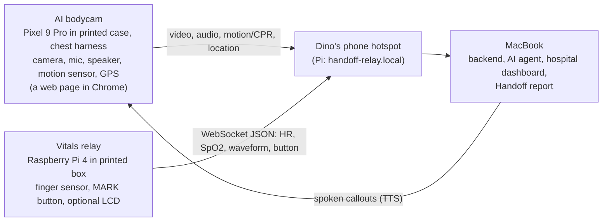

# Handoff — project context for coding agents

Read this first. It is the shared brief for everyone's agent (Claude Code, Codex, Cursor, etc.).
Drop it in your repo root as `AGENTS.md` / `CLAUDE.md` if your tool wants that name.

Last updated: 2026-11-07 (HackUTD 2026, UT Dallas, ECSW). Facts marked **[OPEN]** are not decided. Do not
treat them as settled, and do not silently pick one. Ask the human or add it to section 9.

---

## 1. What we are building

**Handoff is an AI bodycam for paramedics.** A phone worn on the paramedic's chest watches, listens, feels
the paramedic's motion and speaks to them. It streams everything to a hospital dashboard. A small box
beside the patient adds the one thing a camera cannot sense: real vitals from a finger sensor.

The AI agent coaches the paramedic out loud (CPR rate too slow, SpO2 dropping, a missed step), builds an
incident timeline, and produces a **"Generate Handoff"** report for the receiving ER team in which every
statement links back to its source (transcript line, video moment or sensor reading).

Team: Alan and Dino, plus whoever else is on this. The demo uses a **CPR mannequin**
(or a firm cushion). **All medical data is synthetic. Never perform compressions on a person.**

The judges should read it as an **AI bodycam**, not a CPR gadget. When in doubt, put effort into the agent,
the video and the handoff report, not into hardware extras.

## 2. Status snapshot (as of the dates shown)

| Area | State |
| --- | --- |
| Hardware parts | All bought. All 3D prints done (2026-11-05). Physical assembly and fit checks: **ask Alan** for the current state |
| Pi relay bring-up tools | Written and tested in simulation (pytest suite plus a 21-check self-test). Real-hardware verdicts: ask Alan |
| Phone test page | Written (camera/zoom probe, compression-rate detector, speaker, wake lock). Stage 1 verdict (rear vs front camera) **[OPEN]** |
| **Application (dashboard, agent, backend)** | **Not started in this repo.** `hardware/` is all there is. This is what the team is building now |
| Organizer rule on pre-built hardware / prep before noon Saturday | **[OPEN]**: answer not recorded. Ask Alan before assuming anything is allowed |

## 3. System



- **Bodycam = a web page**, served from the Mac over HTTPS, opened in Chrome on the Pixel 9 Pro. No native app.
  Camera, motion sensor and wake lock only work in a **secure context** (HTTPS with an mkcert certificate,
  or Chrome's "insecure origins treated as secure" flag). `hardware/software/mac/serve_phone_test.sh --https`
  shows how.
- **Relay** sends JSON over WebSocket to the Mac. Contract in section 4.
- **Network** is Dino's phone hotspot. It is flaky by nature, so every link needs reconnect and a fallback (section 7).
- The Mac is the hub: it runs the backend and the agent and serves the dashboard.

## 4. Data contracts that already exist

### 4.1 Relay → Mac (`ws://<mac-ip>:8765`, one JSON object per text message, version `v: 1`)

```json
{"type":"hello","device":"handoff-relay","fs":100,"rate_hz":25,"simulate":false,"v":1}
{"type":"vitals","seq":17,"ts":1234.567,"ir":109876,"red":79123,"hr":72.1,"finger":true,"spo2_exp":98.4,"status":"pulse","n":4}
{"type":"button","seq":18,"ts":1234.612,"event":"press","held_s":0.21}
```

- Vitals arrive at about 25 Hz. `ir`/`red` are the mean of `n` raw samples since the last message, so the
  pulse **waveform** is `ir` over time.
- `hr` and `spo2_exp` are `null` unless a beat was seen in the last 5 s. `status` says why: `calibrating`,
  `no finger`, `saturated`, `acquiring`, `pulse` (only `pulse` means `hr` is valid).
- `event` is `press`, `release` or `hold`. Long press is meant to start/stop the incident, a short press is
  the "MARK" event.
- `ts` is the **Pi's monotonic clock**, not wall time. Stamp arrival time on the Mac for anything that has to
  line up with video/transcript. `seq` lets you detect drops.
- Reference implementations: sender `hardware/software/pi/stream_test.py`, receiver
  `hardware/software/mac/receiver.py` (also logs JSONL). The app's relay input should accept exactly this.
- **No Pi? No problem.** `python3 stream_test.py <mac-ip> --simulate` (needs `pip install websockets`) runs
  on any machine and emits realistic fake vitals.

### 4.2 Bodycam phone page (reference code, not yet a product)

`hardware/software/phone/index.html` already has working, self-tested logic worth reusing or porting:

- camera enumeration and a zoom/ultra-wide probe via `getUserMedia`
- **chest-compression detector** from `DeviceMotionEvent.accelerationIncludingGravity`: band-pass, peak
  detection, then `{rate, count, sinceLast, paused, compressing}` (rate is the median interval of recent
  compressions, `paused` after a gap). Self-tests in `dsp_selftest.js`
- speaker test with the Web Speech API, screen wake lock, and a metronome for rehearsing 100–120/min

There is **no** WebRTC, STT, LLM or TTS code in the repo yet. That is the app work.

### 4.3 Feature → source of truth

| Feature | Comes from |
| --- | --- |
| Live POV video and audio | Bodycam page (camera + mic) |
| Live heart rate and pulse waveform | Relay finger sensor (real) |
| SpO2 | Relay, **experimental**. Always label it |
| BP, respiratory rate, ECG | **Simulated**, always labelled SIMULATED |
| Scene understanding | Bodycam video frames (a frame every few seconds) + transcript to a multimodal LLM |
| CPR rate and pauses | Bodycam motion sensor (+ video confirmation). **No depth claims** |
| Dangerous-vitals callouts | Relay data, plus a hotkey-triggered simulated deterioration (labelled) |
| Missed-step / timer callouts | Transcript |
| Agent speaks to the paramedic | TTS played from the phone speaker. Mac speakers are the baseline fallback |
| Timeline marks | Voice ("Handoff, mark") on the bodycam, and the relay MARK button |
| ETA map | Phone geolocation |
| Generate Handoff report | Mac; every statement cites its source |

## 5. The demo is the spec (3 minutes)

1. Dispatch → paramedic clips on the bodycam → live video appears on the dashboard.
2. Paramedic sets down the relay, puts the finger clip on a volunteer → real heart rate and waveform appear.
3. Paramedic narrates the assessment → the AI builds the timeline.
4. Simulated deterioration is triggered → the bodycam calls out the SpO2 drop.
5. CPR on the mannequin, deliberately too slow → bodycam says "faster" → paramedic corrects.
6. Paramedic announces a treatment, presses MARK → click **Generate Handoff** → sourced report.

**Build order** (each step must work before the next starts):
(1) bodycam page + dashboard + simulated vitals → (2) real relay data → (3) CPR detection from phone motion →
(4) polish. A working end-to-end path with simulated data beats a half-working path with real data.

## 6. Repo map

```
HackUTD-2026/
  HANDOFF_CONTEXT.md          this file
  hardware/
    software/pi/              Pi setup + bring-up scripts, DSP/driver libs, pytest suite
    software/mac/             receiver.py (WS receiver), serve_phone_test.sh (HTTP/HTTPS for the Pixel)
    software/phone/           phone test page + compression detector + selftest
    software/README.md        exact setup steps and expected outputs
    cad/                      OpenSCAD sources + STLs (parametric, verified). Don't touch unless asked
    manual/  guide/           assembly manual / guide (HTML)
    renders/ diagrams/ illustrations/   images
```

The folder is **not a git repo**. Decide how code gets shared (section 9) before several people edit at once.

## 7. Hard rules and gotchas (these have already bitten us or will)

**Honesty / safety (judges will probe this):**
- All patient data is synthetic. This is a demo, not a medical device. Don't claim clinical accuracy.
- Never show a fake number as if it were real. If the sensor has no valid reading, show "no data".
  Anything simulated is labelled **SIMULATED** in the UI. SpO2 from the MAX30101 is **experimental**.
- Don't claim compression **depth**. We only measure rate and pauses.
- Agent callouts must be short, spoken, and rate-limited (don't talk over the paramedic or repeat the same
  callout every second).

**Hardware (don't fry the Pi):**
- The Pi's I2C runs at **3.3 V**. Never connect 5 V to SDA/SCL or any GPIO. The SunFounder kit docs wire the
  LCD at 5 V; that is wrong for this build.
- Relay pins: MAX30101 via Qwiic SHIM on header pins 1–6 (I2C addr **0x57**); MARK switch GPIO17 (pin 11) +
  GND (pin 9); RGB ring common to 3.3 V (pin 17) with 220 Ω to GPIO22/23/24 (pins 15/16/18), driven **LOW to
  light**. Full table: `hardware/software/README.md`.
- The optional LCD1602 (I2C 0x27/0x3F) is an add-on pod; software treats any display as optional.
- Parts are printed PLA/PETG. Be gentle, there are no spares.

**Software:**
- Pi: host `handoff-relay.local`, user `handoff`, setup via `bash setup_pi.sh`, then
  `source ~/handoff-venv/bin/activate`. The password is in `hardware/software/README.md`.
- iPhone hotspot: names with a curly apostrophe break Wi-Fi joins; turn on "Maximize Compatibility".
- Chrome on Android doesn't always expose the Pixel's ultra-wide rear camera to web pages; that is why the
  front-camera fallback exists. Test with the phone page before relying on it.
- Browsers block camera/audio autoplay and need a user tap to start. Design a "tap to start" screen. Keep
  the screen awake with the wake lock.

**Fallbacks to build in from the start (the hotspot will be bad):**
- Every input has a simulated mode (relay `--simulate`, simulated vitals deterioration hotkey).
- Pre-generate / cache the TTS audio for the standard callouts so they work if the network drops.
- The phone records locally in parallel with streaming.
- Stage-0 fallback if hardware fails entirely: the bodycam web page alone on the phone, with simulated vitals.

## 8. How agents should work here

- **Boring and demo-safe beats clever.** Pick the simplest thing that survives a 3-minute live demo.
- **Main track is Healthcare; max 3 sponsor challenges.** Every sponsor-specific integration should serve one
  of the three chosen sponsor challenges (section 9). If it doesn't, skip it.
- **Short summaries.** Alan prefers a few lines to a long plan. Lead with the result.
- **Honest pushback.** If an idea is bad or a requirement is unrealistic for 24 hours, say so and propose
  the smaller version. Don't just agree.
- **Explain electronics plainly.** Alan and Dino aren't hardware experts.
- **Don't change contracts silently.** The relay JSON format (4.1) and the phone detector output (4.2) are
  shared. If you change them, tell everyone and update this file.
- **Don't edit `hardware/cad/` or `hardware/manual/`** unless asked. They are verified and printed.
- Keep secrets (API keys) in env files, never in the repo or this doc.
- Keep the app code separate from the hardware bring-up scripts. The latter are checks, not the app.

## 9. Open decisions (fill these in; delete the [OPEN] tags as they get settled)

| Decision | Status |
| --- | --- |
| App stack. The original brief says: Next.js dashboard, WebRTC for video, streaming speech-to-text, a multimodal LLM, real-time TTS | **[OPEN]** confirm; no app code exists yet |
| Providers and keys for STT / LLM / TTS | **[OPEN]** nothing chosen in the repo |
| Who owns what (dashboard / agent+backend / phone page / relay integration / demo+pitch) | **[OPEN]** |
| How code is shared (git repo? where? branch rules?) | **[OPEN]** this folder isn't a git repo |
| Bodycam camera mode: rear ultra-wide vs front | **[OPEN]** pending the phone test |
| Organizer answer on what may be prepared before noon Saturday | **[OPEN]** ask Alan |
| **Main track** (a track is a theme, not a sponsor) | **Healthcare**: decided |
| **Sponsor challenges: the event allows at most 3.** Which three are we entering? | **[OPEN]** the list is in the opening ceremony slides; not yet recorded here. Until decided, don't add features or integrations just to chase a sponsor prize, and don't use a sponsor's API/service without checking with Alan first |
| Agent behavior spec (callout list, thresholds, wording) | **[OPEN]** (suggested start: CPR target 100–120/min, pause > ~10 s, SpO2 < 90 %, HR out of 50–150) |

## 10. Cheat sheet

```bash
# Mac: receive the relay stream (prints rate, HR, stalls; --log saves JSONL)
cd hardware/software/mac && python3 receiver.py --port 8765 --log stream.jsonl

# Anywhere: fake relay data, no hardware needed
cd hardware/software/pi && python3 stream_test.py <mac-ip> --simulate

# Mac: serve the phone page to the Pixel (HTTPS needs `brew install mkcert`)
cd hardware/software/mac && bash serve_phone_test.sh --https

# Pi: copy scripts over, then on the Pi
rsync -av --exclude __pycache__ hardware/software/pi/ handoff@handoff-relay.local:~/handoff-pi/
source ~/handoff-venv/bin/activate && cd ~/handoff-pi && python3 -m lib.selftest

# Pi unit tests (run anywhere with the repo)
cd hardware/software/pi && python3 -m pytest tests -q    # needs pytest installed
```

Deeper history (parts list, CAD decisions, fit tests) lives in the Traycer epic artifacts
`handoff-phase1-hardware-plan` and `handoff-phase2-build-spec`. You do **not** need them to build the app.
