# Handoff

Product spec · HackUTD 2026

Version 1 · Sat 7 Nov, 14:45 Status: proposal until the team agrees Team of 4 Tracks: Spacetime · NVIDIA (Photon after the MVP) Prototype · synthetic data · not a medical device

Handoff is an AI partner for paramedics. It watches, listens and measures on scene, coaches the medic out loud, documents everything automatically, and briefs the hospital before the patient arrives. On arrival, one click produces a handoff report in which every line cites where it came from.

[1Overview](#overview) [2Users](#users) [3Goals and non-goals](#goals) [4System map](#system) [5Every part and where it goes](#parts) [6The demo station](#table) [7Demo storyboard](#storyboard) [8Running the demo](#rundemo) [9Incident lifecycle](#lifecycle) [10Bodycam](#bodycam) [11Vitals relay and wiring](#relay) [12Relay screen (LCD1602)](#monitor) [13Smart med kit (stretch)](#medkit) [14Hospital dashboard](#hospital) [15Callout rules](#rules) [16Medication read-back](#readback) [17Pulling the patient's record (EHR)](#ehr) [18Event fusion](#fusion) [19AI agent](#agent) [20Handoff report](#report) [21Pre-arrival alert (ER chat optional)](#er) [22Data model](#data) [23When things fail](#reliability) [24Safety and honesty](#safety) [25Sponsor tracks (limit 3)](#sponsors) [26Schedule](#schedule) [27Judge Q&A: questions to expect](#qa) [28Open questions](#questions) [29Glossary](#glossary)

**Updated after the team meeting, Sat 15:36**

- **Settled:** the Pixel bodycam on the harness, with the universal plate as the backup for other phones; the relay box stays off the harness (clip it to the jump bag by its carry loop); the finger sensor is the MVP; all data goes to SpacetimeDB Maincloud; the Nemotron agent runs in the cloud or on a laptop ("ambulances have laptops"); the hospital dashboard stays, with live view and timeline; medications are logged from the voice read-back and the camera reading the vial label; the sensor med kit is a stretch goal, built only if there's time (decided right after the meeting); encryption is an extra, not core.
- **After the meeting:** the med kit is a stretch goal, and **Photon is paused for the MVP**. The hospital side shows the pre-arrival alert and the patient's record **pulled from a mock EHR** ([section 17](#ehr)); a typed ER chat is optional. Photon can be added later. The demo is hands-on: a judge wears the harness ([section 8](#rundemo)).
- **Not building:** smart glasses. Paramedics don't have them and they fall off.
- **Still open:** phone app (Expo app or the web page) and the privacy story. Both are in [open questions](#questions). Prepared answers for judges are in [judge Q&A](#qa).

**Part A**The product

## 1Overview

The problem

Details get lost at the handoff: the paramedic recites from memory while the ER team takes over. Information doesn't reach the hospital until the patient does, so the ER can't prepare. Paramedics are trained generalists, while the specialist knowledge for cardiology, stroke and trauma sits at the hospital.

The promise

Every detail is recorded as it happens, the ER sees the patient live while the crew is still on scene, and the hospital's specialists can see the patient early; the bodycam reminds the crew of protocol and never diagnoses.

### Three acts, in the order a paramedic works

1 · Assist

The bodycam is on from the ambulance. On arrival it coaches out loud: CPR rate, pauses, medication read-back, timers.

2 · Relay

First thing at the patient: the finger clip goes on. The relay streams real vitals, and the assistant uses them.

3 · Handoff

Everything flows to the hospital live, the ER can ask questions, and one click produces the sourced report.

### What the judges should remember

01

**The judge wears it, and it talks to them.**A judge puts on the harness, mimes CPR above a teammate lying on a mat, and hears "Push faster" or "Resume compressions" from their own chest.

02

**Say a drug, hear it back.**"Administering one milligram of epi" and the bodycam answers "Copy. Epinephrine, one milligram, I-O." within a second. The voice line and the camera's view of the label become one timeline event: logged from the voice, confirmed by the camera.

03

**The record pulls itself.**The judge shows the patient's ID card to the bodycam. The AI reads the name and birth date, finds the patient in the (mock) EHR and shows allergies, medications and history to the medic and the ER. Then say an amiodarone dose and the read-back warns about the recorded allergy.

04

**One click, a sourced handoff.**A MIST report where every line carries the voice line, sensor reading or camera frame it came from.

05

**Real hardware.**Live heart rate and temperature from the patient teammate's finger and wrist.

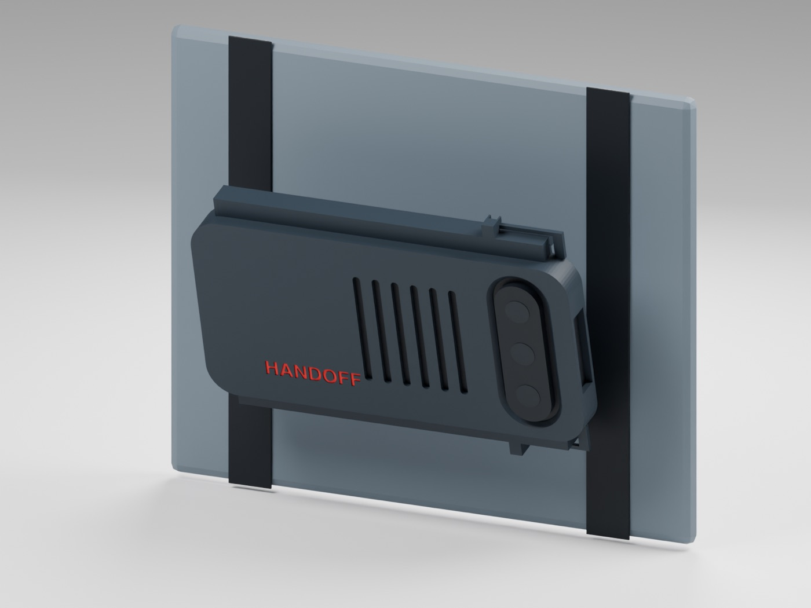

Bodycam: Pixel 9 Pro in the printed case on a GoPro-style chest harness.

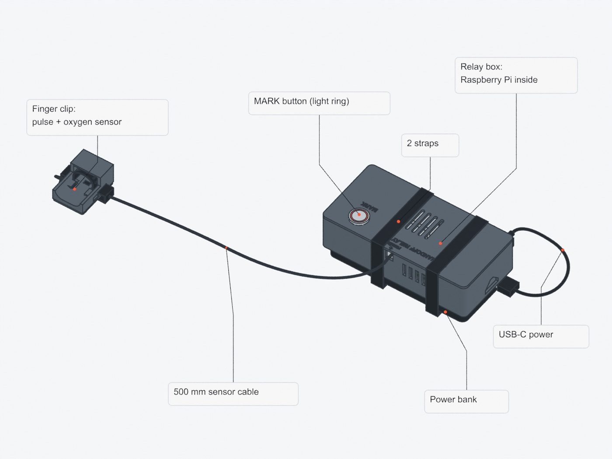

Vitals relay: Pi 4 in the printed box, MARK button, finger clip, power bank and straps.

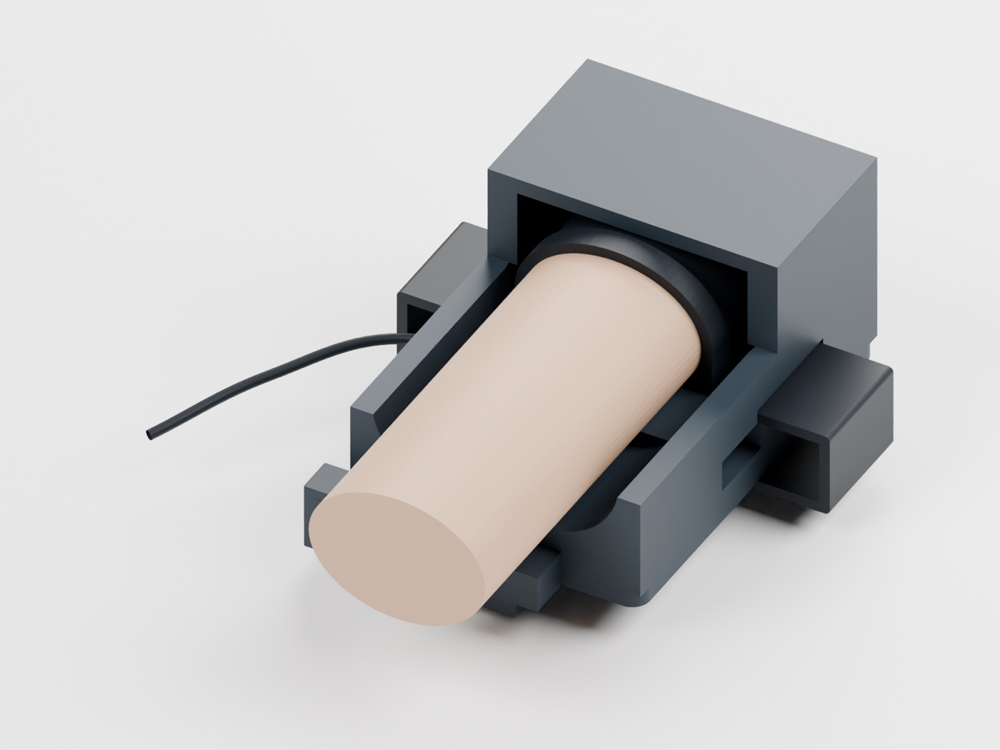

Finger clip: MAX30101 pulse and oxygen sensor in the printed clip.

## 2Users

#### Paramedic

Wears the bodycam. Hands on the patient.

Needs

- Short spoken coaching
- Charting that happens by itself
- Nothing to read: the bodycam speaks everything
- A glance at the LCD on the relay box for the key numbers

Must never get

- Chatter, long sentences, the same callout every second

#### ER charge nurse or physician

At the hospital, preparing the bay.

Needs

- An early alert and a live picture
- The patient's history (allergies, medications) before arrival
- A report they can trust

Must never get

- Invented facts

#### Judges

At the table for three to five minutes.

Needs

- A clear story with real hardware
- AI reasoning they can see happening

Must never get

- A demo that depends on luck

## 3Goals and non-goals

#### Goals for the weekend

1. One cardiac-arrest incident runs end to end, live, with real hardware where that is safe.
2. Every action is captured automatically from at least one source, and the sources fuse into one timeline.
3. The ER is alerted, sees the patient's record pulled from the EHR, and receives a sourced report.
4. The hospital watches continuous live video from the bodycam.
5. Any device can be missing and the demo still runs.

#### Non-goals (say so if asked)

- Not a medical device. No diagnosis, no treatment orders, no accuracy claims.
- No compression depth. We measure rate and pauses only.
- No real patient data. The EHR is a mock server with synthetic patients in the standard FHIR format; connecting to a real hospital or health information exchange is a next step.
- No mass-casualty mode (cut with the State Farm track).

**Part B**How it fits together

## 4System map

Where each physical part sits and what it plugs into is in [section 5](#parts). This map shows how the devices talk.

Everything shares one live record in SpacetimeDB. Browsers use its TypeScript SDK; the Pi (and the med kit, if it gets built) call it over plain HTTP. The agent is just another client that reads triggers and writes results.

| # | Between | How | What flows (↑ into the database, ↓ out of it) |
| --- | --- | --- | --- |
| – | Relay → its own LCD | I2C, 4 wires | The Pi draws HR, SpO₂, temperature and link status on the small screen on its lid. Works with no network. |
| 1 | Bodycam ↔ SpacetimeDB | TypeScript SDK (wss) | ↑ a snapshot frame every 5 s (and on "Handoff, look"), transcript lines, CPR state twice a second, MARK/LOOK, WebRTC handshake messages · ↓ callouts to speak, handshake replies |
| – | Bodycam → hospital dashboard | WebRTC video, handshake through SpacetimeDB | Continuous live video, peer to peer. SpacetimeDB carries only the handshake (offer, answer, ICE). |
| 2 | Relay → SpacetimeDB | HTTP reducer calls | ↑ vitals once a second, waveform batches 5 times a second, MARK, incident start/stop |
| 3 | Demo controls ↔ SpacetimeDB | TypeScript SDK | ↑ start, simulated arrest, overrides, identify patient, reset |
| 4 | Med kit ↔ SpacetimeDB (stretch) | HTTP (reducers + SQL) | ↑ slot changes, storage temperature every 10 s · ↓ epi countdown, read once a second |
| 5 | Hospital ↔ SpacetimeDB | TypeScript SDK | ↓ everything · ↑ Generate Handoff, demo controls, WebRTC handshake |
| 6 | Agent ↔ SpacetimeDB | TypeScript SDK | ↓ triggers (status, transcript, ER messages) · ↑ events, callouts, trace steps, report |
| 7 | Agent ↔ Mock EHR | FHIR R4 over HTTP | ↓ the identified patient's record: allergies, medications, conditions, code status |
| – | Bodycam → agent | Camera frames and speech | The agent spots a name and birth date (on the ID card or spoken) and decides to search the EHR |
| – | Photon (after the MVP) | Photon API | Not wired in the MVP |

The web app is one Vite + React + TypeScript project with three routes (`/bodycam`, `/hospital`, `/controls`), hosted with HTTPS so the phone can use its camera and motion sensor. SpacetimeDB runs on Maincloud, which gives the phone the secure `wss://` connection it needs.

Live video is WebRTC straight from the bodycam page to the hospital page: about 480p–720p, 15–30 fps, a few hundred milliseconds of delay. SpacetimeDB carries only the handshake, in an `rtc_signal` table, so the database is still the backbone. If the video link can't be made (venue Wi-Fi often blocks device-to-device traffic), switch to the phone hotspot or a TURN relay. As a last resort the dashboard shows 1–2 frames per second, marked "low-frame mode". Separately, the phone saves a frame every 5 s (and on "Handoff, look") for the vision model and as evidence snapshots.

## 5Every part and where it goes

Every part from your Harp and MLH pickups, plus what you'd already built. Each one sits at one of five places. Colour shows whether it's in the demo, a stretch goal, or staying in the bag.

**New, in the demo** **Already built** **Optional, cheap** **Stretch, only if time** **Not used**

*A*On the medic

chest harness

**Pixel 9 Pro**in the printed case, rear camera

**Chest harness**GoPro-style mount

No new parts here. The phone gains speech-to-text, live video and spoken callouts in software.

*B*Relay box

beside the patient

**Raspberry Pi 4 in the box**with breadboard and power bank · clips to the jump bag by its carry loop (carabiner)

**Finger clip (MAX30101)**Qwiic SHIM, pins 1–6

**MARK button**in the lid, breadboard rows 3–13

**I2C LCD1602 (GeeekPi)**in the printed LCD pod on the lid · I2C at 3.3 V · leads through lid vent 3

**18B20 Temp**taped to the patient teammate's wrist · pin 7 · leads out through lid vent 2

**Raspberry Pi Camera Module**patient cam clipped near the relay · camera port · ribbon through vent 1

*C*Med kit tray (stretch)

only if there's time after the core works

**Arduino UNO Q**under or behind the tray · Wi-Fi · USB-C power

**IR sensor (Grove)**under the EPI slot · D2

**Light sensor (Grove)**under the AMIO slot · A0

**Temperature/barometer (Grove)**inside the tray · I2C

**Alphanumeric display (Grove)**front edge, facing the medic · I2C

**7 Color Flash**on the tray · lights when a dose is due · D6

*D*On the patient

a teammate lying on a mat

**Patient ID card**printed name, birth date and a photo, like a driver's licence · synthetic · in the patient teammate's pocket

**GY-521 module**not used (no manikin, no contact)

**ESP32 S3 DevKitC**med-kit backup host only (no CPR puck)

The finger clip and the temperature probe also go on the patient (relay box, station B). CPR is mimed above the chest, so the phone on the judge measures it.

*E*Hospital table

a few steps away

**MacBook**dashboard and agent

**Mock EHR server**on the laptop · FHIR R4 · five synthetic patients

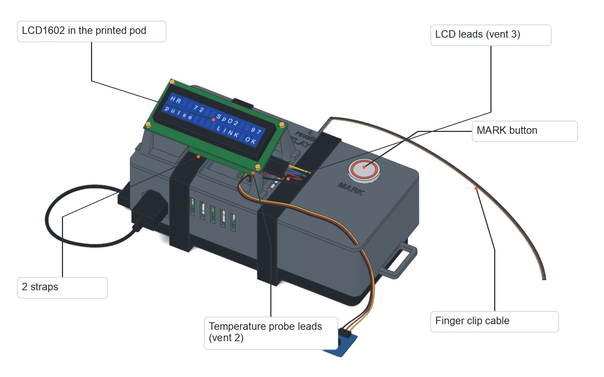

**Place B.** The relay box with the LCD1602 in its printed pod on the lid. LCD leads go in through vent 3, the temperature probe leads come out of vent 2, and the left strap passes over the pod's spine. Concept render.


**Place C (stretch).** The med kit: sensors at each vial slot, the countdown display facing the medic, a bare UNO Q (no shield) and a small breadboard that shares 3.3 V, ground and I2C. Concept render: tray and boards are approximate.

### Staying in the bag

**HC SR04**no job; its 5 V echo pin would need a voltage divider

**HC SR501**no reliable job; it fires on anyone walking by

**Metal Touch**no job

**Digital Temperature**the 18B20 does this better; the Pi can't read analog

**Soil moisture sensor**no job

**LED Lights**the button ring and the display already show status

**LCD 1602 (16-pin)**the bare 16-pin version needs about 12 wires and 5 V; we use the I2C version instead

**Pi 5 camera cable**doesn't fit a Pi 4; use the cable in the camera box

### The full list

| Part (as on your list) | Status | Plugs into | Its job in the demo | Code to write | Effort |
| --- | --- | --- | --- | --- | --- |
| **I2C LCD1602** (GeeekPi, 16×2, blue backlight, 4-pin backpack) | core | Pi pins 3 and 5 via breadboard rows 16 and 17 · row 7 (3.3 V) · row 5 (GND) · I2C address 0x27 or 0x3F | Small vitals screen on the relay box, in the printed LCD pod | Exists: `lib/lcd1602.py` and `test_lcd.py`; add temperature and link status | 30 min |
| **Patient ID card** (synthetic) | core | None: the vision model reads the printed name and birth date from a bodycam frame | Identifies the patient so the record can be pulled | A card with name, birth date and a photo; the agent decides when to search the EHR | 30 min |
| **Mock EHR server** | core | Laptop, HTTP | Returns the patient's FHIR record (allergies, medications, history) | Small FHIR-shaped server + five synthetic patients | 2 h |
| **18B20 Temp** | core | Pi pin 7 · row 7 (3.3 V) · row 5 (GND) | Third live vital: temperature | Read the 1-Wire file in the relay sender | 45 min |
| **Arduino UNO Q** | stretch | USB-C power; Grove sensors | Brain of the med kit; sends slot events over Wi-Fi | Sketch (sensors, display) + Python (network) | 2–3 h |
| **IR sensor** (MLH, Grove) | stretch | UNO Q D2 | Sees when the EPI vial is lifted | In the med kit sketch | in the 2–3 h |
| **Light sensor** (MLH, Grove) | stretch | UNO Q A0 | Sees when the AMIO vial is lifted | In the med kit sketch | in the 2–3 h |
| **Temperature/barometer** (MLH, Grove) | stretch | UNO Q I2C | Drug-storage temperature warning | In the med kit sketch | in the 2–3 h |
| **Alphanumeric display** (MLH, Grove 0.54" quad) | stretch | UNO Q I2C | Shows `EPI`, the countdown and `DUE` | In the med kit sketch | in the 2–3 h |
| **7 Color Flash** | stretch | UNO Q D6 + GND | Flashes when a dose is due | One pin set HIGH | 15 min |
| **GY-521 Module** | not used | — | Not used (no manikin, no contact) | — | — |
| **ESP S3 DevKitC** | stretch | USB-C power bank | Med-kit backup host only (no CPR puck) | Same sketch | — |
| **Raspberry Pi Camera Module** + cable | stretch | Pi camera port (cable from the camera box) | A fixed second view for the hospital | A still every second, shown beside the live video | 1.5 h |
| HC SR04 · HC SR501 · Metal Touch · Digital Temperature · Soil moisture · LED Lights · LCD 1602 | not used | — | — | — | — |

### How each add-on gets built

#### Relay LCD in the printed pod

6 jumperscode: exists (lib/lcd1602.py)

1. Check the backpack is the 4-pin kind: GND, VCC, SDA, SCL (GeeekPi I2C 1602, blue backlight).
2. Seat the LCD on the pod's 4 pegs and put a tiny hot-glue cap on each of the 4 mounting holes. No glue on the Pi.
3. **VCC → row 7** (3.3 V) and **GND → row 5**. Never 5 V: the backpack pulls SDA and SCL up to its VCC.
4. **SDA → row 16** with a second jumper from **Pi pin 3** into row 16; **SCL → row 17** with **Pi pin 5** into row 17. Pins 3 and 5 are reached above the SHIM.
5. Leads down through **lid vent 3**. Set the pod at the lid's left end, display facing the USB-C side and tilted 20°, and pass the left strap over the pod's centre spine.
6. Run `python3 i2c_scan.py`: it should list 0x57 (finger clip) and 0x27 (or 0x3F). Then `python3 test_lcd.py`. At 3.3 V it may look faint: turn the blue contrast screw (loosen the left strap and lift the pod).

Works when: the relay's stream shows HR on the LCD. If it's unreadable at 3.3 V, swap in the 0.96" OLED (same four wires, same rows; the code exists). If pins 3 and 5 don't show about 4 mm of bare metal above the SHIM, use a second I2C bus on GPIO5/6 (one `config.txt` line plus a small code flag).

#### Demo controls on a phone

no hardwarecode: /controls page

1. Use the demo operator's phone on the same Wi-Fi.
2. Open `/controls`. It is a hidden page, so no other page links to it.
3. Big buttons: Start, simulated arrest, CPR slow / good, epi due now, identify patient, Reset for the next judge.
4. The page keeps the screen awake while it's open.

Works when: Reset clears every screen in under 10 seconds.

#### Patient ID card and mock EHR

no wiringcode: vision read + FHIR server

1. Make a synthetic ID card like a driver's licence: printed name, birth date and a photo. Print it, or show it on a spare phone like a digital ID.
2. Tuck it in the patient teammate's pocket.
3. The bodycam sends a frame to the vision model about every 5 s, and at once on "Handoff, look". The model reads the name and birth date, and the agent decides to search the EHR. Fallbacks: the medic says the name and birth date, or the demo operator picks the patient with "Identify patient" on `/controls`.
4. On the laptop, a small FHIR-shaped server holds five synthetic patients: Patient, AllergyIntolerance, MedicationStatement and Condition records.

Works when: holding the card 20–50 cm from the chest camera shows "Jordan Avery, 58" with the allergy on the hospital screen within about 8 seconds (about 3 s after "Handoff, look" or the spoken name).

#### Temperature probe (18B20)

3 jumperscode: 20 lines in the relay sender

1. Three female–male jumpers, long enough to reach outside the box.
2. Module **S** → Pi **pin 7**. Module **middle (+)** → breadboard **row 7** (3.3 V). Module **−** → **row 5** (ground).
3. Leads out through **lid vent 2**; tape the module to the patient teammate's wrist, sensor side down.
4. Add `dtoverlay=w1-gpio` to `config.txt` and reboot. The probe appears as a folder starting `28-` under `/sys/bus/w1/devices`.

Works when: holding the probe warms the reading toward body temperature. No folder? Add a 4.7–5.1 kΩ resistor between S and 3.3 V.

#### Smart med kit (stretch)

only if timecode: sketch + Python

1. Make a tray (cardboard or foam) with two vial holes; mark dummy vials "EPI DEMO" and "AMIO DEMO".
2. IR sensor under the EPI hole, light sensor under the AMIO hole, both facing up; temperature module inside the tray; display on the front edge.
3. No Base Shield, and the UNO Q has only one 3.3 V pin, so power goes through a small breadboard: one 3.3 V jumper and one GND jumper from the UNO Q to the breadboard.
4. Push male–male jumper pins into the free end of each Grove cable. All four modules' **red** (3.3 V) and **black** (GND) wires go to the breadboard.
5. IR sensor: **yellow → D2**. Light sensor: **yellow → A0**. Both go straight to the UNO Q, and their white wires stay unconnected.
6. The two I2C modules (temperature and display): join their **SDA (white)** and **SCL (yellow)** wires on the breadboard, then one jumper from the SDA row to the UNO Q's SDA and one from the SCL row to its SCL.
7. Set up the UNO Q with Arduino App Lab, join Wi-Fi, load the sketch (sensors, display) and the Python part (sends to SpacetimeDB).

Works when: lifting the EPI vial logs a dose on the Mac and the display starts counting down. Timebox the UNO Q to 45 minutes; the ESP32-S3 can run the same sensors.

#### Patient cam (stretch)

only after the core workscode: 30 lines of Python

1. Use the ribbon that came **in the camera box** (the Pi 5 cable doesn't fit a Pi 4).
2. Seat it in the Pi's camera port (between the HDMI ports and the audio jack), run it out through **lid vent 1**, and clip the camera beside the relay box, facing the patient.
3. A small script takes a still every second and sends it to be shown beside the live video.

Works when: the hospital screen shows the still beside the live video.

## 6The demo station

The demo mixes explaining with hands-on. One judge becomes the paramedic and wears the harness; a teammate lies on a mat as the patient. The ER host walks that judge through the hospital screen at the handoff. If more judges come, they watch the hospital screen with the ER host. Each teammate has one job and one spot, and one of them also lies down as the patient.

Not to scale. Orange: the judge. Blue: teammates. The patient is a teammate on a mat, wearing the finger clip and the temperature probe, with the ID card in a pocket. The judge mimes CPR with hands above the chest and never touches it. The med kit (stretch) would sit by the fitter if it gets built. If more than one judge comes, the others watch the hospital screen with the ER host. A CPR manikin could replace the teammate if one is available.


The demo station: the patient is a teammate on a mat with the finger clip; the judge mimes CPR above his chest (no contact); the demo operator holds the controls phone; the hospital dashboard runs on a laptop a few steps away. Generated illustration.

## 7Demo storyboard

About three to five minutes, read left to right. Each column is one beat; each row is who does what. EXPLAIN columns are shaded: the team talks and shows. HANDS-ON columns are the judge doing it. **★** marks a wow moment.

### In pictures

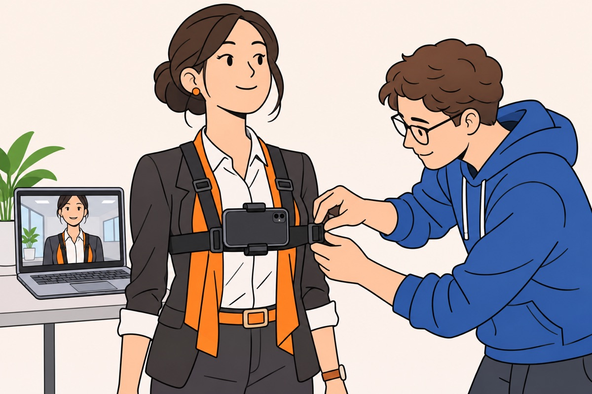

**1 · Suit up.** A teammate fits the harness; the judge appears live on the hospital screen.

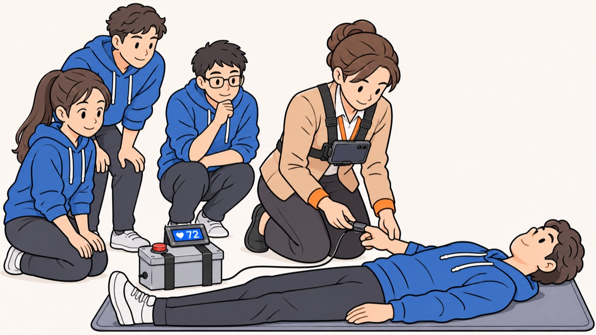

**2 · Your vitals.** She clips the finger sensor onto the patient teammate's finger and tapes the probe to their wrist; the heart rate appears on the relay's LCD.

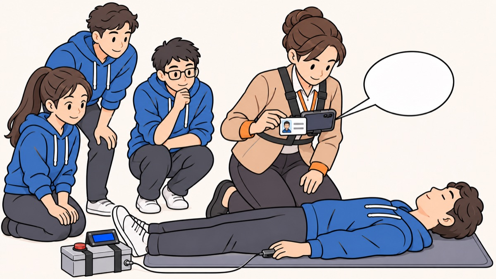

**3 · Who is it?** She holds the patient's ID card to the chest camera; the AI reads the name and pulls the record. Bodycam: "Record found. Jordan Avery, fifty-eight. Allergy: amiodarone."

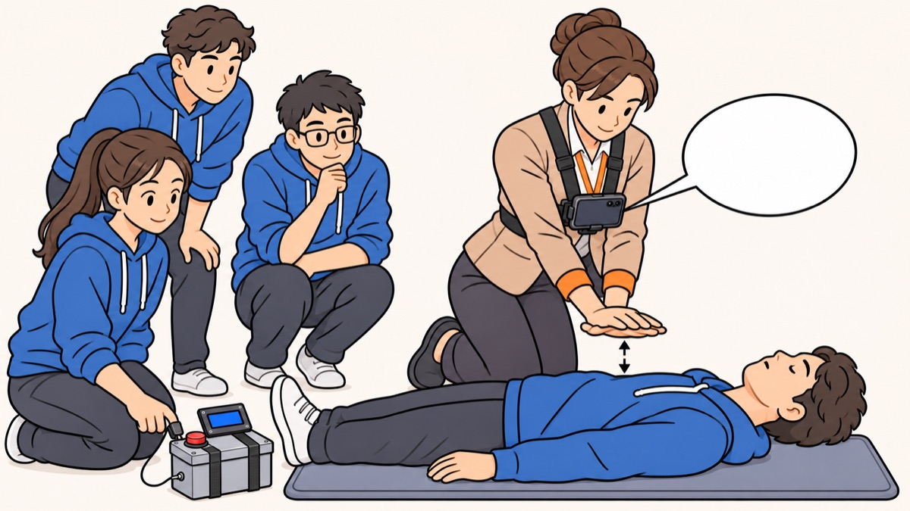

**4 · CPR.** Mimed compressions: her hands hover above the teammate's chest, no contact. Bodycam: "Push faster." Then the pause: "Resume compressions."

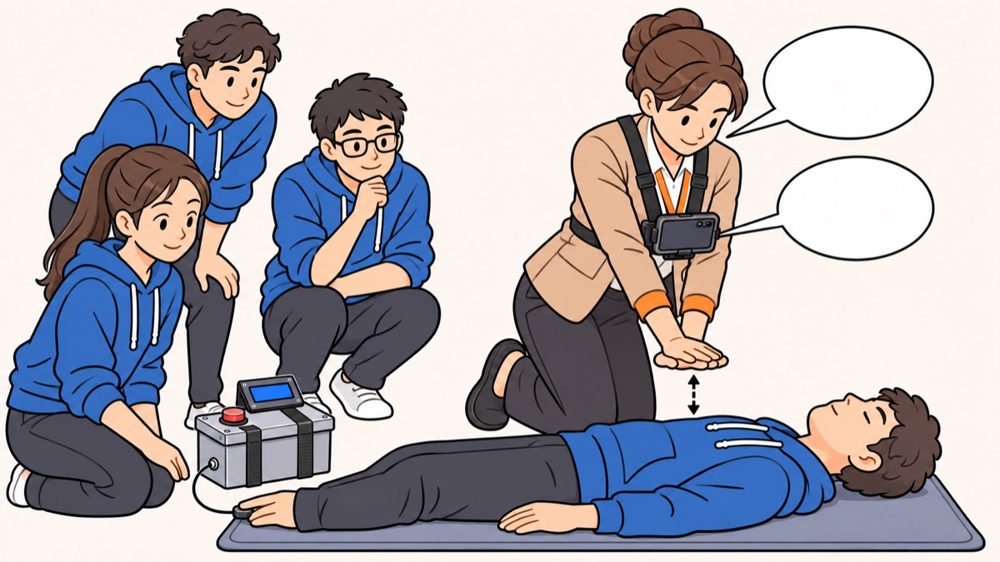

**5 · Drugs.** Judge: "Administering one milligram of epi IO." Bodycam: "Copy. Epinephrine, one milligram, I-O."

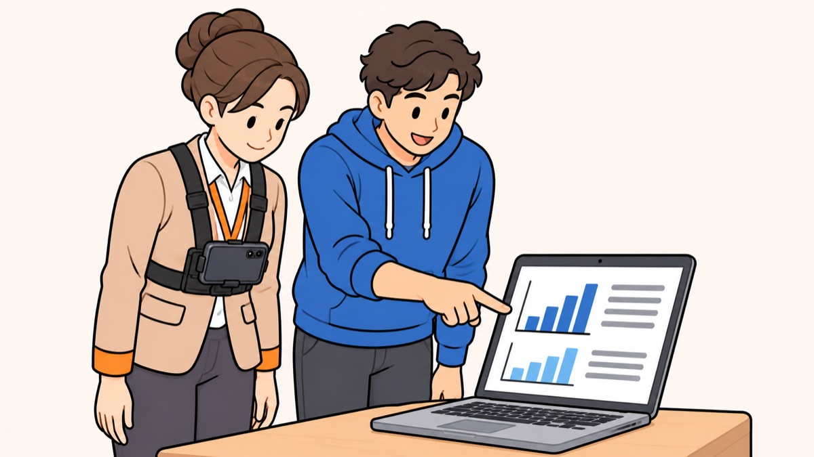

**6 · Handoff.** At the hospital screen she reads her own handoff report, with her real CPR numbers and every line's source.

Generated illustrations for the team; the speech bubbles are left blank and the lines are in the captions.

**Demo timing is compressed and says so**Real epinephrine is every 3–5 minutes and CPR cycles are 2 minutes. In demo mode the epi interval is 45 s and the cycle is 30 s, and the screens show a "DEMO TIMING" tag.

|  | EXPLAIN 0:00 · Hook | HANDS-ON 0:40 · Suit up | HANDS-ON 1:00 · Your vitals | HANDS-ON 1:20 · Who is it? | HANDS-ON 1:45 · Arrest and CPR | HANDS-ON 2:10 · Pause | HANDS-ON 2:20 · Drugs | EXPLAIN 2:40 · Hospital screen | EXPLAIN 3:30 · How it works | BUFFER 4:15 · Q&A |
| --- | --- | --- | --- | --- | --- | --- | --- | --- | --- | --- |
| Team | Narrator: the handoff problem and Handoff in one breath. Shows the harness and the relay box. "Today you're the paramedic." | Patient teammate lies down on the mat. Fitter puts the harness on the judge. Demo operator starts the incident from /controls. | Fitter hands the judge the finger clip and the temperature probe. | Narrator: "Find out who your patient is: check their pocket, show the card to your camera, and say 'Handoff, look'." | Demo operator triggers the simulated arrest from /controls. Narrator: "Your patient's heart just stopped. Hands above the chest, don't touch. Start compressions." | Narrator: "Stop, check for a pulse." | Narrator hands over the line card. | Narrator: "Transport." ER host walks the judge through the screen: the live video, the record from the EHR, the agent trace and the pre-arrival alert. Then points out the CPR numbers, the record's history and the source chips on the report. | Narrator shows the system map: SpacetimeDB as the live backbone, the Nemotron agent, the read-back on the phone, the mock FHIR EHR. | Narrator takes questions. |
| Judge | Listens and looks at the harness. | Wears the harness; the hospital screen shows live video from the chest camera. | Clips the finger sensor onto the patient teammate's finger and tapes the temperature probe to their wrist. The patient's real heart rate appears on the LCD and the hospital screen within about 10 s. | Takes the ID card from the patient teammate's pocket, holds it 20–50 cm from the chest camera and says "Handoff, look" (or reads the name and birth date aloud). Hears the record summary. | Kneels beside the patient and mimes compressions: stacked hands hover a few centimetres above the chest, no contact. | Stops and lifts their hands away. | Says "Administering one milligram of epi IO." Then "Giving three hundred milligrams of amiodarone." | ★ Clicks Generate Handoff and reads their own report on the hospital screen. | Listens. | Asks questions. |
| Bodycam |  | Goes live; video flows to the hospital. |  | After about 3 s: ★ "Record found. Jordan Avery, fifty-eight. Allergy: amiodarone. On warfarin." | ★ "Push faster" if under 100/min; silent if in range. | ★ After 10 s: "Resume compressions." | ★ "Copy. Epinephrine, one milligram, I-O." Then: "Amiodarone, three hundred milligrams. Warning: the record lists an amiodarone allergy. Say confirm or correction." | "ER acknowledged." Then "Epi due" when the 45 s DEMO TIMING countdown ends. |  |  |
| Relay LCD |  |  | Shows the patient's HR, SpO₂ and temperature, with LINK OK. |  |  |  |  |  |  |  |
| Hospital screen | Dashboard waiting. | Status ON SCENE. Live video from the chest camera starts. | Vitals tiles fill with the patient's real numbers. | ★ The patient banner and record panel fill from the EHR: name, age, allergies, medications, history, code status. | Status ARREST; CPR gauge live. Pre-arrival alert: arrest, Avon Heart Institute, ETA 9. The ER host clicks Acknowledge; the agent trace shows its steps. | Timeline: "Compressions paused 10 s". Pause timer counts up. | Epi countdown starts when the dose is logged (DEMO TIMING). Epi event with two source chips (voice, label); the amiodarone attempt is flagged in red. | Status ARRIVED. The report shows the judge's own CPR numbers and the record's history, with a source chip on every line. | Stays on the agent trace. |  |
| Agent |  |  |  | Reads the name and birth date off the card (or hears them), decides to search the EHR, pulls the record and queues the spoken alert; asks if more than one patient matches. | Picks the hospital, posts the alert. |  | Merges voice + label into one event; logs the allergy flag. | Writes the sourced report, with the EHR as a source. |  |  |

The 3-minute Standard cut runs Explain 0:00–0:25, Hands-on 0:25–2:05 (every beat, just faster), Hospital screen 2:05–2:40 and Q&A 2:40–3:00. It drops the "How it works" segment. The 5-minute run above keeps it.

## 8Running the demo

### Roles

#### Narrator

Stands facing the judge. Tells the story in plain words, explains the system, and gives the cues ("Check their pocket", "Hands above the chest, don't touch", "Start compressions", "Stop, check for a pulse", "Transport"). Keeps time.

#### Fitter and spotter

Puts the harness on the judge in under 30 seconds (pre-sized to medium). Keeps the judge safe: CPR is mimed above the patient's chest and never touches it; harness off right away if it's uncomfortable.

#### Demo operator

Holds a phone with the hidden `/controls` page and runs the demo controls: Start, the simulated arrest, CPR overrides, identify patient, epi due now and reset. Quietly rescues any beat that misfires. Does not play a paramedic.

#### Patient (a teammate)

Lies on a mat with the finger clip on a finger, the temperature probe on the wrist and the ID card in a pocket. Can stop the demo at any time. Any free teammate, or the fitter once the harness is on.

#### ER host

Sits at the hospital table. Walks the judge through the hospital screen at the handoff: the live video, the record pulled from the EHR, the agent trace and the alert. If more judges come, plays host to them and any extra ER role.

### Three versions

\\1Explain 0:00–0:25 (problem and product in one breath), hands-on 0:25–2:05 (suit up, vitals from the patient teammate, the ID card with "Handoff, look" and the EHR pull, mimed CPR with "Push faster", pause, epi read-back and amiodarone warning: nothing dropped, just faster), hospital screen 2:05–2:40 (record, live video, Generate Handoff), then Q&A 2:40–3:00. No architecture segment.\\2 \\1A teammate already wears the harness. The judge shows the ID card and says "Handoff, look", hears the record, says the amiodarone line, hears the allergy warning, then clicks Generate Handoff.\\2

| Version | When | What happens |
| --- | --- | --- |
| **Full** (5 min) | The judge has time | The whole storyboard: explain, hands-on, hospital screen, how it works, then Q&A. |
| **Hands-off** | A judge declines the harness | A teammate wears it; the judge watches the hospital screen with the ER host and clicks Acknowledge and Generate Handoff. |

### Line card for the judge

Say these, in order

"Handoff, look." (after showing the ID card)

Or say: "Patient is Jordan Avery, born March 14, 1968."

"Administering one milligram of epi IO."

"Giving three hundred milligrams of amiodarone." (then say "Correction")

Bonus lines

"Giving ten milligrams of epi." (dose check)

"Shock delivered, two hundred joules."

### What this adds to the build

| ID | Requirement | Done when |
| --- | --- | --- |
| D1 | Hidden demo controls page (`/controls`) on the demo operator's phone: Start, simulated arrest, CPR slow / CPR good override, epi due now, identify patient manually, **Reset for the next judge** | Reset clears every screen in under 10 s, devices stay connected |
| D2 | Every spoken callout also appears in big text on the hospital screen | Readable in a noisy hall |
| D3 | The agent identifies the patient from the ID card or the spoken name and pulls the record (section 17) | Record on the hospital screen within about 8 s of showing the card (about 3 s after "Handoff, look" or the spoken name) |
| D4 | The report uses the judge's own run (average CPR rate, longest pause, compressions, doses) plus the record's history | Numbers match what the hospital screen showed |
| D5 | Demo timing switch: epi every 45 s, cycle 30 s, with a DEMO TIMING tag | Visible on every timer |

#### Reset between judges (60 seconds)

1. The demo operator opens `/controls` and taps **Reset for the next judge**.
2. Put the ID card back in the patient teammate's pocket.
3. Wipe the harness straps with alcohol wipes.
4. Loosen the harness back to medium.
5. Phone: bodycam page full screen, volume up, battery above 50% (charge between groups).
6. `/controls` open on the operator's phone, laptop on `/hospital`, mock EHR running, all connection dots green.

#### Packing list

- Harness with the Pixel case; Pixel, charger, long cable
- Relay box, power bank, wall charger, finger clip
- Laptop and charger; power strip
- A mat (and a pillow) for the patient teammate; a mat for the judge's knees; the patient ID card (and a spare)
- Alcohol wipes, gloves, line cards, a "Prototype · synthetic data" sign
- Optional: a JBL Go 3 Bluetooth speaker from the MLH hardware lab, clipped to the harness, so callouts are loud enough in the hall

### If something misfires during a demo

| What happens | Who fixes it | How |
| --- | --- | --- |
| The AI can't read the card | Demo operator | Hold it closer and still, or say the name and birth date; last resort: Identify patient on `/controls`. |
| The mock EHR doesn't answer | Demo operator | The agent falls back to the cached copy of the synthetic record; say so honestly if asked. |
| The judge's CPR is already in range, so "Push faster" never fires | Narrator | That's fine: "you're in range, it stays quiet". The pause beat always triggers "Resume compressions". |
| Speech-to-text misses a drug line | Demo operator | Ask the judge to repeat once; otherwise the camera reading the vial label still logs the dose. |
| CPR isn't detected (phone loose, or the mimed motion is too small) | Demo operator | Ask the judge for bigger movements, or use the CPR override on `/controls` ("CPR slow" or "CPR good"); the fitter tightens the harness. |
| The hall is too loud to hear the bodycam | Narrator | Point at the big callout text on the hospital screen; use the Bluetooth speaker. |
| Wi-Fi drops | Demo operator | Switch to the hotspot; if it's still down, play the backup demo video. |

## 9Incident lifecycle

The incident's status decides which rules are active, so the bodycam never coaches CPR when nobody is doing it.

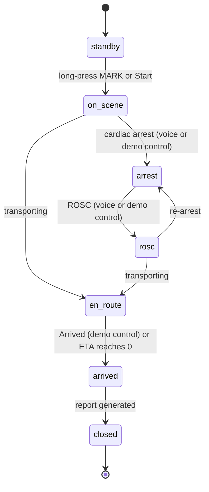

| Status | Active rules and timers | ER messaging |
| --- | --- | --- |
| standby | None. Screens show "no incident". | None |
| on_scene | Vitals alarms (SpO₂, HR), finger-sensor check | None yet |
| arrest | CPR rate and pause callouts, 2-minute cycle, epi timer. Vitals alarms off (no pulse expected). | Destination chosen, pre-arrival alert |
| rosc | Vitals alarms back on; CPR rules off | ROSC update |
| en_route | Vitals alarms; ETA countdown | Update if ETA moves by more than 3 minutes |
| arrived | None; report generation | Report summary |
| closed | None; the record is read-only | None |

**Part C**The pieces

## 10Bodycam

A web page in Chrome on the Pixel 9 Pro, in the printed case on the chest harness. It sees, hears, feels the rescuer's compression motion through the phone's motion sensor, and speaks.

LIVE · Medic 12ARREST 06:42

camera preview

CPR RATE**112**in range · 1:34 into the cycle

Speaking: "Epi due"

Heard: "…one milligram epi in through the IO…"

MARK

LOOK

| ID | Requirement | Done when |
| --- | --- | --- |
| B1 | Tap-to-start grants camera, mic and motion, then holds a screen wake lock | One tap; screen stays on 10 min |
| B2 | Streams continuous live video to the hospital (WebRTC); saves a frame every 5 s and on "Handoff, look" | Video plays on the dashboard within 3 s of tap-to-start; under 1 s delay |
| B3 | Continuous speech-to-text with auto-restart | A sentence appears on the dashboard within 3 s |
| B4 | CPR rate, count and pause from the rescuer's own motion, so mimed compressions count. If the mimed motion is too small to detect, the demo operator uses the CPR override on `/controls` | Within ±5/min of a 110 metronome |
| B5 | Speaks callouts from the queue | "Push faster" heard within 2 s of the rule firing |
| B6 | Voice shortcuts "Handoff, mark" and "Handoff, look" | Creates a MARK event or a snapshot |
| B7 | Glanceable screen (mockup) | Readable at arm's length |
| B8 | Rear camera (decided); front camera stays as a fallback | The case is set up for rear |
| B9 | Survives network drops: queues writes, reconnects | 30 s with Wi-Fi off loses no transcript lines |
| B10 | Medication read-back, on the phone ([section 16](#readback)) | "Copy. Epinephrine, one milligram, I-O." within 1 s |

## 11Vitals relay and wiring

The printed box beside the patient: a Raspberry Pi 4 with the finger clip, a new temperature probe, the MARK button and its light ring. Its existing sensor code stays; a small new sender batches readings to SpacetimeDB. An I2C LCD1602 in a printed pod on the lid shows the vitals right on the box.

### The box from above: what goes in and out

Drawn to scale from the CAD (158 × 78 mm). The lid's four vents and the MARK button are dashed because they're in the lid above the Pi. Every new wire leaves through a vent you already printed, so nothing gets reprinted.

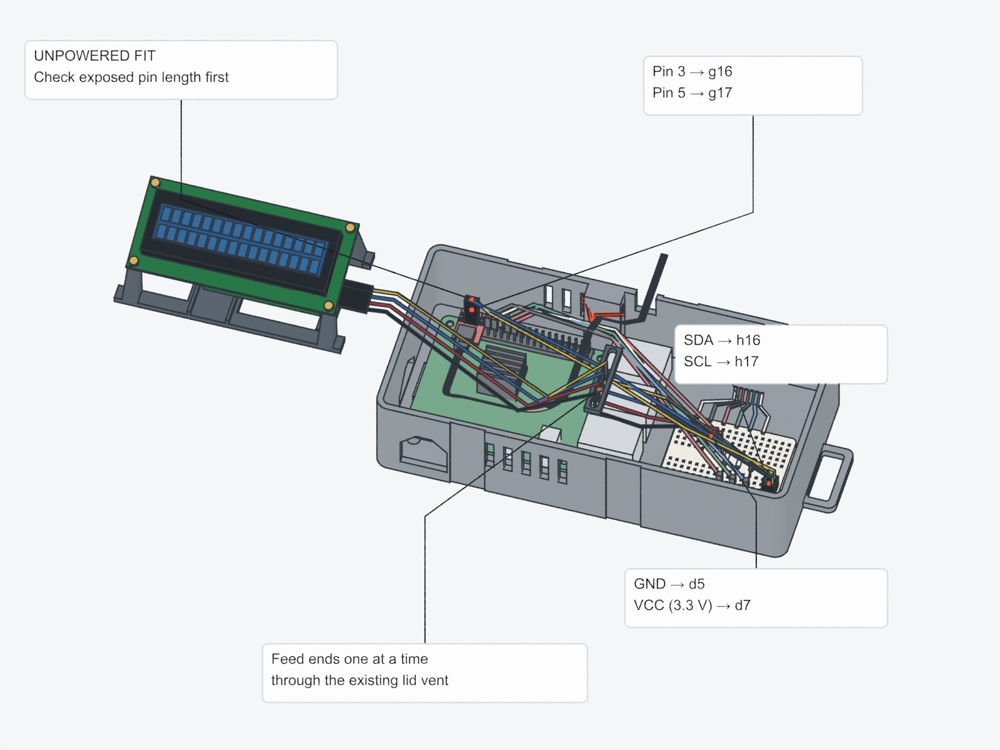

LCD wiring: four leads through vent 3 to the breadboard and Pi pins 3 and 5, all at 3.3 V.

### Pi header: every pin we use

### Mini breadboard row map

The breadboard has two halves (holes a–e and f–j) split by a center gap. Holes in the same row and half are connected. Exact holes are in manual step 5.25.

| Row | Left half (a–e) | Across the gap | Right half (f–j) | Meaning |
| --- | --- | --- | --- | --- |
| 3 | Button switch wire · Pi pin 11 | — | — | GPIO17 · MARK |
| 5 | Button switch wire · Pi pin 9 · probe − · LCD GND | — | — | ground |
| 7 | Button ring common + · Pi pin 17 · probe + · LCD VCC | — | — | 3.3 V |
| 9 | Button ring red | 220 Ω resistor | Pi pin 15 | red |
| 11 | Button ring green | 220 Ω resistor | Pi pin 16 | green |
| 13 | Button ring blue | 220 Ω resistor | Pi pin 18 | blue |
| 16 | — | — | LCD SDA · Pi pin 3 | I2C data |
| 17 | — | — | LCD SCL · Pi pin 5 | I2C clock |

#### Light ring meanings

- blue, pulsing connecting
- green streaming
- amber no finger in the clip
- red flashes alarm or error
- white blink MARK registered

#### Button

- Short press: MARK (a timestamped flag; say what it was for)
- Hold 2 s: start or end the incident
- Works with the lid closed

| ID | Requirement | Done when |
| --- | --- | --- |
| R1 | HR and SpO₂ from the finger clip; SpO₂ is always labelled experimental (optical sensors like ours read less accurately on darker skin, which the team noticed) | HR within ±5 bpm of a fingertip oximeter |
| R2 | Temperature from the probe every 2 s | Within ±0.5 °C of a reference |
| R3 | Sender batches to SpacetimeDB: numbers once a second, waveform in 200 ms batches | Waveform scrolls smoothly with under 1 s lag |
| R4 | No valid reading sends an empty value plus a status, never a stale number | Finger off: tiles show "no data" within 5 s |
| R5 | MARK short press and 2 s hold as above | Both work with the lid on |
| R6 | Ring colours as above | Visible from 2 m |
| R7 | Simulated mode (exists today) | The demo runs with no Pi |
| R8 | The existing WebSocket stream to `receiver.py` keeps working for bring-up | Old tools still pass |

## 12Relay screen (LCD1602)

The relay box has one small screen: an I2C LCD1602 (16 characters by 2 lines) in a printed pod on its lid. It gives the paramedic a quick readout of the key numbers, even with no network. The hospital screen is the big display, and the bodycam speaks everything else.

HR 72 SpO2 97 pulse LINK OK

The relay LCD1602: about 64 × 14 mm of visible screen on an 80 × 36 mm board. It's a glance-at-the-box readout; the hospital screen is the big display.

| ID | Requirement | Done when |
| --- | --- | --- |
| L1 | Shows HR, SpO₂, temperature or status, and link; updates twice a second and rewrites only the lines that changed | Numbers change within 1 s of the sensor |
| L2 | Wiring at 3.3 V: VCC to row 7, GND to row 5, SDA to row 16 and SCL to row 17 (Pi pins 3 and 5); leads through lid vent 3 | `i2c_scan.py` shows 0x27 (or 0x3F) |
| L3 | Fallback: the 0.96-inch OLED on the same four wires, or leave the screen out. Never 5 V | The relay still runs without a screen |

Wiring is in section 11 and the build card in section 5.

## 13Smart med kit (stretch)

A tray with two vial slots that documents medication draws on its own. Lifting a vial is the event; nobody touches a screen. It also watches drug-storage temperature, a real problem in hot ambulances, and counts down to the next dose.

**Stretch goal: only if there's time**Decided Sat 15:55. Without the kit, every dose is still logged by the spoken read-back and the camera reading the label. Build it only after the core demo works end to end.

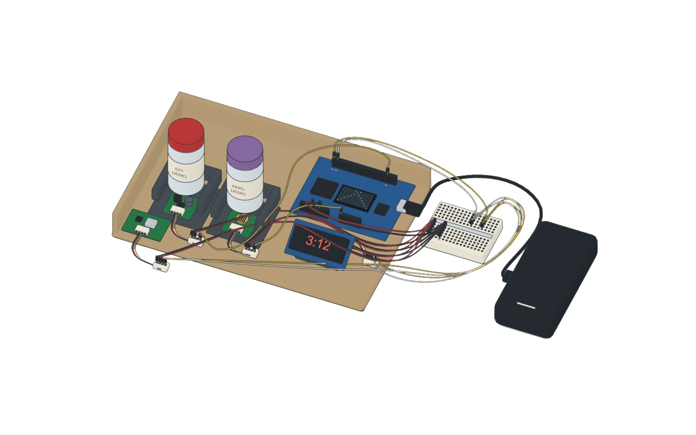

Concept render of the med kit. The countdown shows minutes and seconds.

**No Base Shield (confirmed)**The UNO Q has only one 3.3 V pin, so power goes through a small breadboard: one 3.3 V jumper and one GND jumper from the UNO Q to the breadboard. Push male–male jumper pins into the free end of each Grove cable. Grove wire colours: black = GND, red = power (use 3.3 V), yellow = signal (SCL on I2C), white = second signal (SDA on I2C). All four modules' red and black wires go to the breadboard. The IR and light sensors connect their yellow wire straight to D2 and A0, and their white wire stays unconnected. The temperature module and the display (both I2C) join their SDA (white) and SCL (yellow) wires on the breadboard, with a single jumper each to the UNO Q's SDA and SCL. The port labels in the drawing are the UNO Q pins to use.

### How a slot decides "dose drawn"

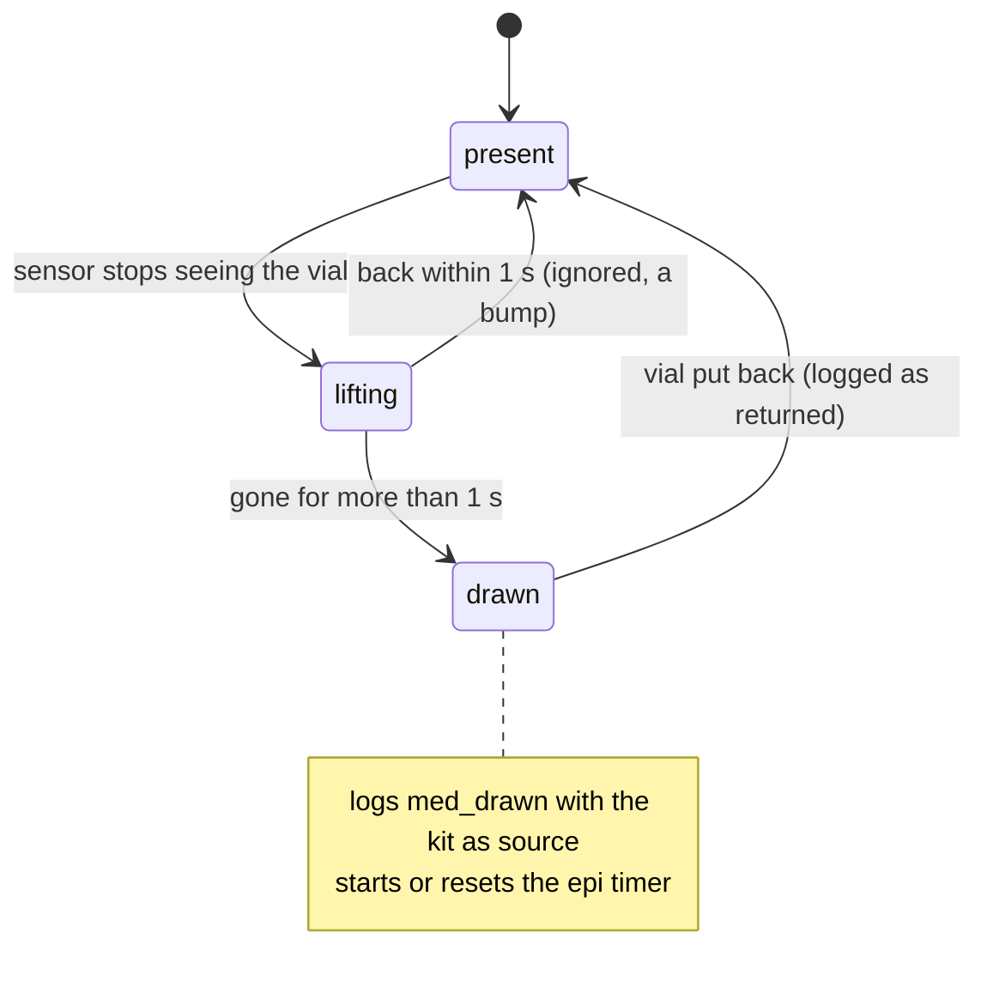

| ID | Requirement | Done when |
| --- | --- | --- |
| K1 | EPI slot: vial lifted for more than 1 s logs "Epinephrine 1 mg drawn" (source: kit) | Logged within 2 s; putting it back logs "returned", not a second dose |
| K2 | AMIO slot: same (amiodarone 300 mg first, 150 mg second) | Same |
| K3 | Storage temperature every 10 s; outside 15–30 °C shows a warning on the dashboard (not spoken) | Warming the sensor in a hand triggers it |
| K4 | Display shows the shared epi countdown (`3:12`), `DUE` when due, `----` with no incident | Matches the hospital screen |
| K5 | Dose due: display blinks `DUE`. Optional: the 7-colour flash LED on a free port | — |
| K6 | If offline, buffers events and replays them with their original times | 20 s with no network: events still land at the right times |
| K7 | Fallback host: ESP32-S3 if the UNO Q setup stalls for more than 45 min | — |

Physical build: a cardboard or foam tray, two dummy vials marked "DEMO", sensors under the slots, the display facing the medic.

## 14Hospital dashboard

What the ER sees, on the Mac and any second screen. It's also where judges watch the agent think.

**Medic 12 → Avon Heart Institute**ARREST 06:42ETA 9 minER ACK · bay 3Prototype · synthetic data

##### Live view

live video · 0.4 s delay

HR**--**no pulse

SpO₂**82**

Temp**36.4**°C

CPR**112**/min

Next epi**0:48**demo

Cycle**1:12**

##### Timeline

14:01:30Patient identified: Jordan Avery; record pulledID cardEHR

14:02:05Cardiac arrest recognised, CPR startedvoiceframe

14:03:40CPR rate low (92/min), coachedmotioncallout

14:04:31**Epinephrine 1 mg IO**voicelabel

14:05:10Destination: Avon Heart Institute (cath lab)agent

14:06:02MARK: "pill bottle found by the bed"MARKvoice

##### Agent trace

Trigger: status became ARREST

Plan: pick a PCI hospital, alert the ER

choose_hospital → Avon Heart, 9 min

ehr_search (name + birth date from the ID card) → Jordan Avery, 58

post_er_message → pre-arrival alert

##### Patient record (mock EHR)

**Jordan Avery**, 58 · matched by ID card

Allergy: **amiodarone**

Medications: warfarin, metoprolol

History: coronary artery disease, prior MI

Code status: full code

Generate Handoff

| ID | Requirement | Done when |
| --- | --- | --- |
| H1 | Header: unit, status, destination, ETA, ER acknowledgement | — |
| H2 | Continuous live video from the bodycam with a "live / stale" indicator; falls back to low-frame mode on its own | Shows stale after 3 s without video |
| H3 | Vitals tiles with 5-minute trend lines, a pulse waveform, a CPR panel and dose timers | A missing reading shows "no data", never a stale number; "Epi due" matches the bodycam to the second |
| H4 | Timeline with source chips; clicking a chip shows the evidence (transcript line, snapshot, vitals at that moment) | Every demo event has a chip; the epi event has two |
| H5 | Agent trace: trigger → plan → tool → result in plain language | Judges can follow one workflow live |
| H6 | Pre-arrival alert panel with an Acknowledge button (a typed ER chat is optional) | Alert appears within 20 s of the arrest |
| H9 | Patient record panel: name, age, allergies (highlighted), medications, history, code status, each marked "from EHR" | Fills within about 8 s of showing the ID card |
| H7 | Generate Handoff opens the report (section 20) | Full report within 30 s |
| H8 | Demo controls (the `/controls` page): start, simulated arrest or deterioration, ROSC, en route, arrived, reset | Every demo beat can be forced if a sensor fails |

**Part D**The intelligence

## 15Callout rules

Anything time-critical is a plain rule that runs inside SpacetimeDB once a second, not an AI call, so it's instant and never flaky. These are proposed defaults to tune with a mimed run.

Illustrative data. The rate dips below 100 at about 7 s; the rule waits 5 s so a single slow beat doesn't trigger it. The medic corrects, so the 10-second repeat never fires. Compressions stop at 28 s; after 10 s of pause the bodycam says "Resume compressions".

| When | Spoken | Priority | Repeat no sooner than |
| --- | --- | --- | --- |
| Medication or shock statement heard (section 16) | "Copy. Epinephrine, one milligram, I-O." | P0 | once per statement |
| Patient record pulled (section 17) | "Record found. Jordan Avery, fifty-eight. Allergy: amiodarone. On warfarin." | P2 | once |
| Arrest and CPR rate under 100 for 5 s | "Push faster" | P1 | 10 s |
| Arrest and CPR rate over 120 for 5 s | "Slow down" | P2 | 10 s |
| Arrest and no compressions for 10 s | "Resume compressions" | P1 | 10 s |
| Two-minute cycle elapsed | "Two minutes. Rhythm check, switch compressors." | P2 | once per cycle |
| Epi timer due (4 min default, 3–5 settable; 45 s in demo mode) | "Epi due" | P2 | 60 s |
| Not in arrest, SpO₂ under 90 for 10 s | "Oxygen saturation eighty-eight" | P2 | 30 s |
| Not in arrest, HR under 50 or over 150 for 10 s | "Heart rate one fifty-five" | P2 | 30 s |
| Finger clip off while monitoring | "Check finger sensor" | P3 | 60 s |
| ER acknowledges | "ER acknowledged, bay three" | P3 | once |
| ER asks something the record can't answer | "ER asks: allergies?" | P3 | once |

Across all rules: at most one callout every 4 seconds (read-backs are exempt and run on the phone itself); P1 jumps the queue but never cuts off another P1; the same words are never queued twice. Callouts also appear on the bodycam screen, and the Mac speakers are the fallback if the phone can't speak.

## 16Medication read-back

When the paramedic says a medication out loud, the bodycam repeats it back right away, like a "roger that". Resuscitation teams already do this with each other (closed-loop communication): it catches wrong drugs, wrong doses and milligram/microgram mix-ups before they're charted.

#### What the medic hears

"Administering one milligram of epi IO."

**→ "Copy. Epinephrine, one milligram, I-O."**

Starts within about a second of the medic finishing. Units are always said in full and numbers in words, so "micrograms" can never sound like "milligrams".

#### Why it's fast

- Runs entirely **on the phone**: a small built-in parser, no AI call and no server round trip before speaking.
- Speaks with the phone's **on-device voice**, warmed up at tap-to-start.
- Fires as soon as the recognizer's words have been stable for 0.4 s with a full drug + dose match, instead of waiting for it to finish.
- Saving the event and the agent's checks happen **after** it speaks.

### The flow

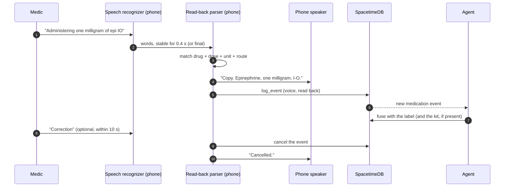

### Latency budget

Estimates drawn to scale; measure them on the Pixel. If the recognizer is too slow on the hotspot, swap in a streaming speech-to-text service with short end-of-speech detection; the parser and voice stay the same.

### Examples

| Medic says | Bodycam says | Logged |
| --- | --- | --- |
| "Administering one milligram of epi IO" | "Copy. Epinephrine, one milligram, I-O." | Epinephrine 1 mg IO read back |
| "Giving three hundred of amio" | "Copy. Amiodarone, three hundred milligrams." | Amiodarone 300 mg unit assumed |
| "Pushed point four of Narcan intranasal" | "Copy. Naloxone, zero point four milligrams, intranasal." | Naloxone 0.4 mg IN |
| "Shock delivered, two hundred joules" | "Copy. Shock, two hundred joules." | Shock 200 J |
| "Giving three hundred milligrams of amiodarone" | "Amiodarone, three hundred milligrams. Warning: the record lists an amiodarone allergy. Say confirm or correction." | Flagged until "confirm" or "correction" |
| "Epi ten milligrams" | "Epinephrine, ten milligrams. Outside the protocol range. Say confirm or correction." | Flagged until "confirm" |
| "Giving epi" | "Epinephrine. Say again the dose." | Nothing yet |
| "Did we give epi yet?" · "Get the epi ready" | (silent: a question or a plan, not a dose) | Nothing |
| "Correction" (within 10 s) | "Cancelled." | The last read-back is cancelled (kept in the audit trail) |

#### The parser

- **Verb:** administering, giving, given, gave, pushing, pushed, "… in" ("epi in").
- **Drug list with nicknames:** epi/adrenaline → epinephrine, amio → amiodarone, Narcan → naloxone, nitro, D50, bicarb, and so on. Common mishearings map too.
- **Dose:** digits or words ("one", "point four", "three hundred").
- **Unit:** mg, micrograms, grams, mL, units, joules. If missing, the drug's usual unit is assumed and said aloud so the medic can correct it.
- **Route (optional):** IV, IO, IM, intranasal, sublingual.
- Questions ("did", "should", "do we") and plans ("get ready", "draw up") never trigger.

#### Guards

- **Echo guard:** while the phone is speaking and for 0.7 s after, it only listens for "correction", "cancel" and "confirm", so it never logs its own read-back.
- **Dose check** against a small demo table (epinephrine 0.3–1 mg, amiodarone 150–300 mg). Outside it, the read-back asks for confirm or correction. Other drugs are read back without a check.
- **Priority:** read-backs jump the callout queue and skip the 4-second spacing, but never cut off a "Push faster".
- **Kit cross-check** (only if the med kit is built; agent, after the fact): voice says amiodarone but the kit saw the EPI vial lifted → a quiet flag on the dashboard.

| ID | Requirement | Done when |
| --- | --- | --- |
| RB1 | Detects medication statements (verb + drug + dose), ignores questions and plans | 9 of 10 test sentences trigger; 0 of 10 questions do |
| RB2 | Reads back on the phone with no network wait: "Copy. Drug, dose in words, unit in full, route." | Audio starts within 1 s of the sentence ending (Wi-Fi off still works if recognition already returned) |
| RB3 | "Correction", "cancel that" or "scratch that" within 10 s cancels; "confirm" confirms | Spoken "Cancelled." / "Confirmed." |
| RB4 | Dose check for epinephrine and amiodarone | "Epi ten milligrams" asks for confirm |
| RB5 | Echo guard | The read-back never creates a second event |
| RB7 | Allergy check against the pulled record: if the drug matches a recorded allergy, the read-back says so and asks for confirm or correction | The amiodarone line triggers the warning |
| RB6 | Shows a big read-back card on the bodycam screen and a "read back" chip on the hospital timeline | Visible on both within 1 s |

## 17Pulling the patient's record (EHR)

Paramedics often arrive knowing nothing about the patient. Handoff identifies the patient from their ID card or the spoken name and birth date, and pulls their record from an electronic health record (EHR): allergies, medications, history and code status. The medic hears the key facts, the ER sees the record before arrival, and the read-back checks every drug against the allergy list.

**What's real and what's mock**The EHR is a small server we run on the laptop, holding five synthetic patients in FHIR R4, the standard format real EHRs exchange. The query and the data shapes are the ones a real integration would use. In real life this would go through a hospital or a regional health information exchange, which some EMS agencies can already query.

### The flow

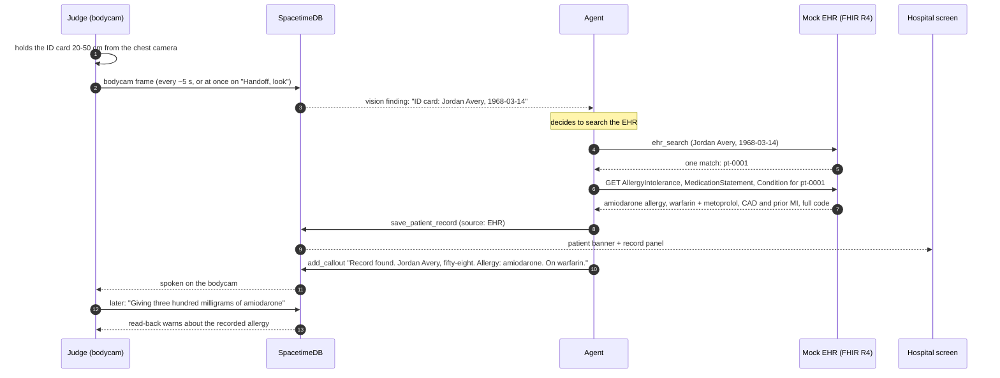

Alternate path: the medic says "Patient is Jordan Avery, born March 14, 1968". The words arrive in the transcript and the agent searches the same way. If several patients match, the agent asks for confirmation instead of guessing.

#### The demo patient (synthetic)

- **Jordan Avery**, 58, born 1968-03-14, ID `pt-0001`
- **Allergy:** amiodarone
- **Medications:** warfarin, metoprolol
- **History:** coronary artery disease, heart attack in 2021
- **Code status:** full code; emergency contact on file

Four more synthetic patients make the search real (and let a judge pick a different card).

#### How the patient is identified

1. **ID card seen by the camera:** a frame goes to the vision model, which reads the printed name and birth date.
2. **Name and birth date spoken** ("Patient is Jordan Avery, born March 14, 1968"): the words arrive in the transcript.
3. **Manual backup:** "Identify patient" on the `/controls` page.

From either source, the agent decides to call `ehr_search`. If several patients match, it asks for confirmation instead of guessing.

| ID | Requirement | Done when |
| --- | --- | --- |
| X1 | The vision model reads a printed name and birth date from a card held 20–50 cm from the chest camera, or the spoken name and birth date are parsed from the transcript | Name and birth date found within about 5 s of showing the card (at once on "Handoff, look") |
| X2 | The mock EHR answers FHIR R4 queries for Patient, AllergyIntolerance, MedicationStatement and Condition; five synthetic patients | Responds locally in under 300 ms |
| X3 | The agent (W6) pulls and summarizes the record into `patient_record`, every field marked "from EHR" | Record on the hospital screen within about 8 s of showing the card (about 3 s after "Handoff, look" or the spoken name) |
| X4 | Spoken summary: name, age, allergies, one key medication; facts only, under 12 words after the name | Heard on the bodycam |
| X5 | The read-back checks each drug against the allergy list (RB7) | Amiodarone triggers the warning |
| X6 | The report's history lines cite the EHR as their source | "EHR" chips in the report |
| X7 | If the EHR doesn't answer, use a cached copy of the synthetic record and label it "cached" | The demo never stalls on the EHR |
| X8 | The agent only searches when it has a name and birth date; with multiple matches it asks, and never guesses | Two patients with the same name: the agent asks which one |

## 18Event fusion

The same intervention can arrive from several places: the medic says it, the camera reads the label, and the med kit can add the vial lift. Handoff keeps one event and attaches every source, which is what makes the report trustworthy.

Drawn to scale (12 px per second). The first source opens the window; a later report of the same kind inside it attaches to the same event. Doses of epinephrine are minutes apart, so a real second dose never falls inside the window. The med kit (lifting the vial) can add a third source.

## 19AI agent

Rules handle anything urgent. The agent handles judgement, language and paperwork, and it only runs when something triggers it. Every step it takes is written down and shown in the trace panel. Model: Nemotron through NVIDIA's API, which supports tool calling. The agent decides for itself when to call a tool, such as the EHR search.

| Workflow | Trigger | Steps (tools) | Done when |
| --- | --- | --- | --- |
| W1 | Status becomes arrest or en route | `get_incident` → `choose_hospital` (capability, ETA, beds) → `set_destination` → `post_er_message` | The alert appears on the hospital dashboard within 20 s |
| W2 | Every 5 s of new transcript | `get_recent_transcript` → pull out procedures and findings (medications are already read back and logged by the phone) → `log_event` (fuses with vision and the kit if built) | "One milligram epi in" becomes one event, not a duplicate |
| W6 | A vision finding of an ID card, or a spoken name and birth date in the transcript; the agent decides to search | `ehr_search` (name + birth date; several matches → ask for confirmation, never guess) → `ehr_get_record` (allergies, medications, conditions, code status) → summarize → `save_patient_record` → `add_callout` ("Record found…") | Record on screens within about 8 s of showing the card (about 3 s after "Handoff, look" or the spoken name); spoken summary is facts only |
| W3 | Optional: the ER doctor types a question in the ER chat | `get_timeline`, `get_vitals_summary` → answer in two sentences, facts and times only → `post_er_message`; unknown → "Not documented yet, asking crew" + `add_callout` | Answer within 20 s; nothing invented |
| W4 | Generate Handoff, or status arrived | gather → draft MIST → self-check drops any sentence without a source → `save_report` → `post_er_message` | No uncited claims in the report |
| W5 | After the MVP, with Photon | the same alerts and answers to a real phone; then a 30-second spoken MIST report → `place_er_call` | The phone rings and hears it |

### W1 · Destination and pre-arrival alert

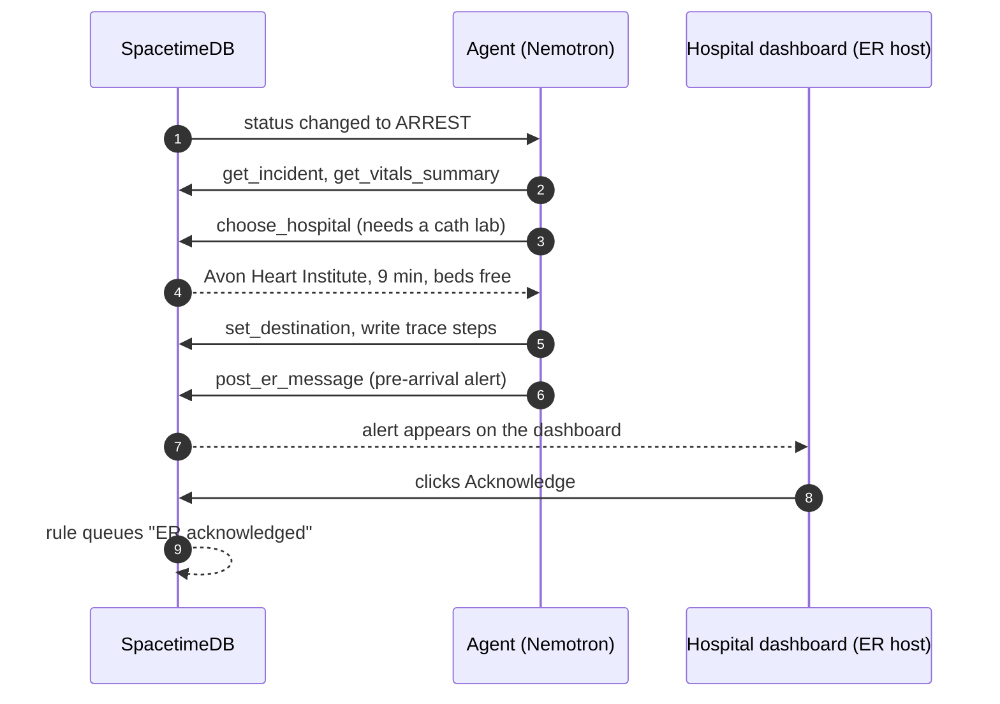

### W3 · Optional: the ER asks, the agent answers

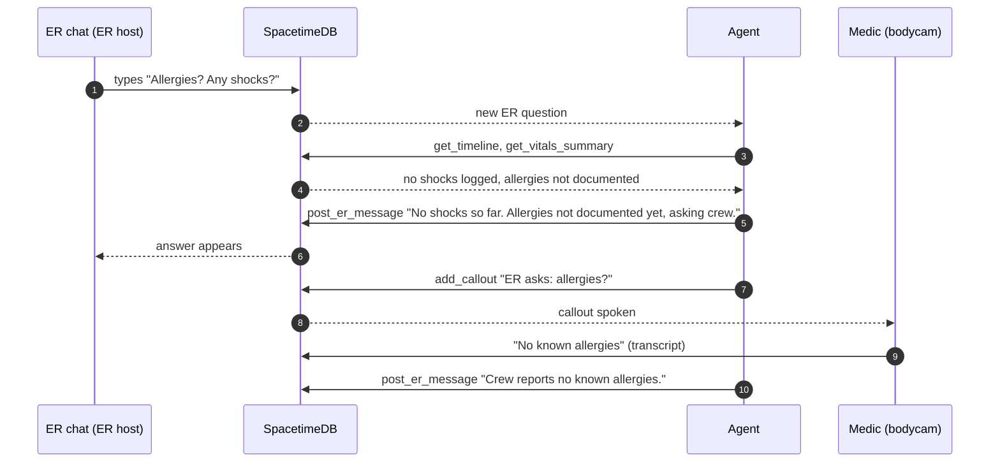

### W4 · Generate Handoff

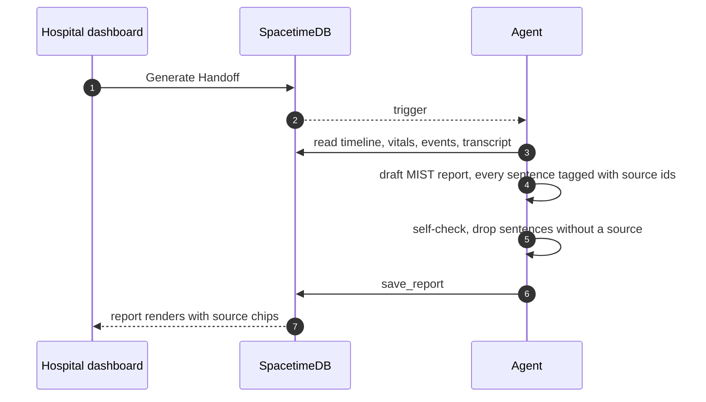

#### Agent rules

- Uses only facts stored in SpacetimeDB. Never invents vitals, times, names, allergies or doses.
- Its own callouts are 8 words or fewer, at most one every 20 s.
- Advisory, protocol wording ("Epi due", "Consider…"), never orders.
- Every step goes to the trace.

#### Vision

- Checks a frame every 5 s and on "Handoff, look".
- Looks for AED pads on, an airway device, IV/IO, vial label text, and an ID card (it reads the printed name and birth date).
- Returns a finding and a confidence; only 0.7 or higher is logged, with the frame saved as evidence.
- Provider: Gemini or an NVIDIA vision model OPEN

## 20Handoff report

MIST is a common EMS handover structure: Mechanism, Injuries or information, Signs, Treatment. Every line carries its sources. The header always says it's a prototype.

**HANDOFF** · Medic 12 → Avon Heart Institute · 14:15Prototype · synthetic data · not for clinical use

| M | Jordan Avery, 58 (identified by ID card). Witnessed collapse at home, unresponsive on arrival. ID cardEHRvoice 14:01:48 |
| --- | --- |
| I | History from the record: coronary artery disease, prior MI; takes warfarin and metoprolol; **allergy: amiodarone** (amiodarone was not given). EHRread-back flag Pill bottle found by the bed (MARK). MARK 14:06:02voice 14:06:04frame #14 |
| S | Arrest 14:02. ROSC 14:11. After ROSC: HR 104 (live), SpO₂ 93 (experimental), temperature 36.4 °C. relay HRrelay SpO₂relay temp |
| T | CPR 14:02–14:11, average rate 111/min, longest pause 7 s. bodycam motion Epinephrine 1 mg IO at 14:04 and 14:08. voicelabel Airway: i-gel at 14:05. voiceframe |
| ! | Outstanding: on warfarin per the record; family bringing the current medication list. EHRvoice 14:09:30 |

Example content from a synthetic run. In the demo, the numbers come from the judge's own CPR. Shown on the hospital screen.

## 21Pre-arrival alert (ER chat optional)

The hospital learns about the patient before the doors open. For the MVP the alert appears on the hospital dashboard with an Acknowledge button. A typed ER chat, where the ER can ask questions and the agent answers, is optional. Photon (the same alerts on a real phone) is paused until after the MVP.

| ID | Requirement | Done when |
| --- | --- | --- |
| E1 | Pre-arrival alert: unit, patient name and age from the record, problem, key treatments, ETA; an Acknowledge button that triggers "ER acknowledged" on the bodycam | Appears within 20 s of the arrest |
| E2 | Updates only on big changes (ROSC, ETA moves 3+ min, re-arrest); one every 2 min at most | No spam |
| E3 | Optional: a text box for the ER; W3 answers from the record only | Answer within 20 s |
| E4 | The report summary posts when the handoff is generated | — |
| E5 | After the MVP: Photon sends the same alerts to a real phone, then a voice call (W5) | Paused |

**Part E**Data

## 22Data model

Everything lives in SpacetimeDB tables, written through reducers (functions that run inside the database). Rules and timers are scheduled reducers, which is what qualifies us for the Spacetime track: the database runs the logic, not just stores it.

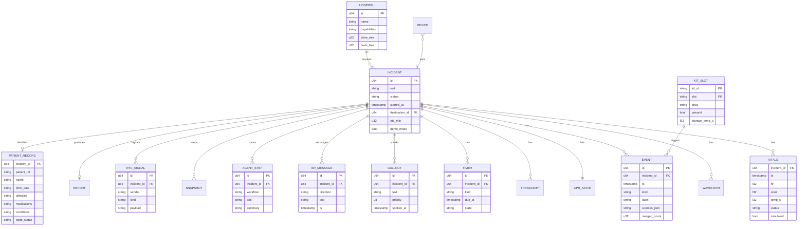

| Table | Holds | Written by |
| --- | --- | --- |
| `incident` | One emergency: status, destination, ETA, demo mode | dashboard, relay (long press), agent |
| `device` | Who's connected (bodycam, relay, controls, hospital, kit) and when they were last seen | every client on connect |
| `vitals` · `waveform` | HR, SpO₂, temperature once a second; the last 30 s of pulse waveform | relay |
| `cpr_state` | Rate, count, pause, cycle start | bodycam |
| `transcript` | One row per spoken sentence | bodycam |
| `frame` · `snapshot` | The latest snapshot for vision; saved frames used as evidence | bodycam, agent |
| `rtc_signal` | WebRTC handshake messages (offer, answer, ICE candidates) between the bodycam and the dashboard | bodycam, dashboard |
| `event` | The timeline: kind, label, sources, merge count | everything, through `log_event` |
| `timer` · `callout` | Epi and cycle timers; what to say and when it was said | rules, agent; bodycam marks spoken |
| `hospital` | Fictional hospitals: Avon General, Avon Heart Institute (cath lab), Northside Community | seed data |
| `patient_record` | The summary pulled from the mock EHR for this incident (allergies, medications, conditions, code status, source) | agent |
| `er_message` · `agent_step` · `report` | The alert (and optional ER chat), the agent trace, the final report | agent |
| `kit_slot` (stretch) | Each vial slot's state and the storage temperature | med kit, if built |

### Reducers

`start_incident`, `set_status`, `push_vitals`, `push_waveform`, `push_cpr`, `add_transcript`, `push_frame`, `save_snapshot`, `send_rtc_signal`, `log_event` (merges same-kind events within 60 s), `demo_control`, `mark`, `kit_update` (stretch), `add_callout`, `callout_spoken`, `er_message_in`, `er_message_out`, `agent_step`, `save_report`, `identify_patient`, `save_patient_record`, `demo_control`. Scheduled: `tick_rules` every second, `timer_fire` when a timer is due.

### How the Pi (and the med kit, if built) talk to it (no SDK needed)

```
# once per device: get an identity token
curl -X POST https://maincloud.spacetimedb.com/v1/identity

# relay: one vitals sample (arguments are a JSON array; edge reducers take one JSON string)
curl -X POST https://maincloud.spacetimedb.com/v1/database/handoff/call/push_vitals \
  -H "Authorization: Bearer $TOKEN" -H "Content-Type: application/json" \
  -d '["relay-1", "{\"hr\":72,\"spo2\":97.5,\"temp_c\":36.4,\"status\":\"pulse\"}"]'

# med kit (stretch): read the epi countdown once a second
curl -X POST https://maincloud.spacetimedb.com/v1/database/handoff/sql \
  -H "Authorization: Bearer $TOKEN" \
  -d "SELECT due_at FROM timer WHERE kind = 'epi' AND state = 'running'"
```

Endpoint shapes follow SpacetimeDB's HTTP API docs; confirm them against the CLI version you install.

**Part F**Running it

## 23When things fail

Every input has a fallback so the demo never depends on one device. Targets: sensor to screen under 1 s, live video under 1 s, rule to spoken under 2 s, ER question to answer under 20 s, report under 30 s.

| If this fails | You'll see | Keep going by |
| --- | --- | --- |
| Live video won't connect | "connecting…" on the video tile | Switch to the hotspot or a TURN relay; else low-frame mode |
| Wi-Fi or hotspot drops | Grey connection dots, "stale" on the live view | Clients buffer and reconnect; switch networks; demo controls force the next beat |
| Finger clip gives no reading | "no data" tiles, amber ring | Switch the relay to simulated vitals |
| Phone motion misreads CPR | CPR gauge shows "--" | Demo control "CPR slow / CPR good" |
| Speech-to-text misses words | No voice chips on events | The camera and MARK still log events |
| Nemotron slow or down | Trace shows retries | Rules still speak; the report falls back to a template filled straight from the tables |
| The AI can't read the card | "Scanning…" on the bodycam | Say the name and birth date, or "Identify patient" on `/controls` |
| Mock EHR down | "Record unavailable" | Use the cached synthetic record, labelled "cached" |
| Med kit not built (stretch) | No "kit" chips | Expected: the read-back and the camera log every dose |
| No phone free for the demo operator | — | Open `/controls` on the laptop; the relay LCD still shows the numbers |
| Pi dies | Relay offline | Run the relay in simulated mode on the Mac |
| SpacetimeDB not syncing by 18:00 Saturday | — | Switch to a plain Node WebSocket server and drop the Spacetime track |

## 24Safety and honesty

#### Honesty (judges will probe this)

- All patient data is synthetic. Not a medical device.
- A missing reading shows "no data", and SpO₂ is marked experimental.
- Fingertip oxygen readings are less accurate on darker skin, a known problem with pulse oximeters. Say so if asked; it's one reason SpO₂ stays "experimental".
- Never show a stale or made-up number.
- No compression-depth claims.
- Demo timers are compressed and labelled DEMO TIMING.
- Hospitals are fictional.

#### Physical safety

- CPR in the demo is mimed: hands hover above the teammate's chest and never touch or press. The teammate can stop the demo at any time.
- Everything on the Pi runs on 3.3 V. Nothing in the build uses its 5 V pins.
- Dummy vials marked DEMO; no real drugs.
- API keys live in env files and never enter the public repo.
- No faces of the public in saved snapshots.

## 25Sponsor tracks (limit 3)

| Track | Prize | What qualifies us | Show the judges |
| --- | --- | --- | --- |
| **Spacetime** | $2,048 / $1,024 / $512 | All state, rules (`tick_rules`), timers and live sync run in SpacetimeDB. Public GitHub repo. | Four devices and a phone updating one record in real time; a rule firing from inside the database |
| **NVIDIA Nemotron** | 2× RTX 5080 | Triggered multi-step workflows with tool calls: the agent decides when to search the EHR from a vision finding or a spoken name (W6), then destination and alert (W1) and report (W4). That is agentic tool use | The trace panel during the EHR pull and the alert |
| **Photon** (paused) | $700 track · $400 voice | Not in the MVP. If we add it after the core works, the alerts also go to a real phone, then a voice call | A judge's own phone, later |

General tracks (Hardware, Design) don't count toward the limit. With Photon paused, the third slot stays open until submission: Photon if it gets built, otherwise leave it empty rather than chase a track we don't fit. Still to confirm at the help desk: whether MLH prizes do. State Farm is the backup only if Spacetime is dropped.

## 26Schedule

The team works flexibly. Whoever is free picks up the next item on the work board below. There are no fixed owners. Claude and the coding agents write code for every package in parallel, and Astra does renders.

### Work board

Rows are in priority order.

| Package | What "done" means | Needs first |
| --- | --- | --- |
| **SpacetimeDB module and seed data** | Tables, reducers, rules and timers run; hospitals and demo patients are seeded; one client syncs live. | Nothing. Start here. |
| **Bodycam page (snapshot frames, speech-to-text, CPR, read-back)** | Speaks the read-back and the callouts, detects CPR, sends frames for vision; each works on the Pixel. | SpacetimeDB module |
| **Live video (WebRTC + SpacetimeDB handshake + fallback)** | Video plays on the dashboard within 3 s of tap-to-start, under 1 s delay; falls back to the hotspot, a TURN relay, then low-frame mode. | SpacetimeDB module (`rtc_signal`), bodycam page |
| **Hospital dashboard (live view, record panel, alert, report)** | Shows live video, timeline, patient record, pre-arrival alert and the report. | SpacetimeDB module, live video |
| **Nemotron agent (spots the patient on a card or by voice, EHR search, alert, report)** | Pulls the record, posts the alert, writes a sourced report, and shows its trace. | SpacetimeDB module, mock EHR |
| **Mock EHR (five synthetic FHIR patients)** | Answers FHIR R4 queries locally in under 300 ms. | Nothing |
| **Relay software (LCD, temperature probe, SpacetimeDB sender)** | Sender pushes real vitals once a second; the LCD shows them. | SpacetimeDB module; relay hardware for real data |
| **Relay hardware (LCD pod and wiring, temperature probe, button)** | Button plug works and the relay boots; the LCD shows HR; the probe reads within ±0.5 °C. | Nothing |
| **Demo controls page (/controls) and reset** | Big buttons for start, simulated arrest, CPR overrides, identify patient, epi due now and reset; every demo beat can be forced; reset clears every screen in under 10 s. | SpacetimeDB module |
| **Devpost, demo video, README** | Initial draft by 23:00 Saturday; final write-up and video by the 11:30 Sunday submit. | A working path end to end |
| **Stretch, in order: polish → Photon → med kit → patient cam** | Each one is cuttable without breaking the demo. | The core demo works end to end |

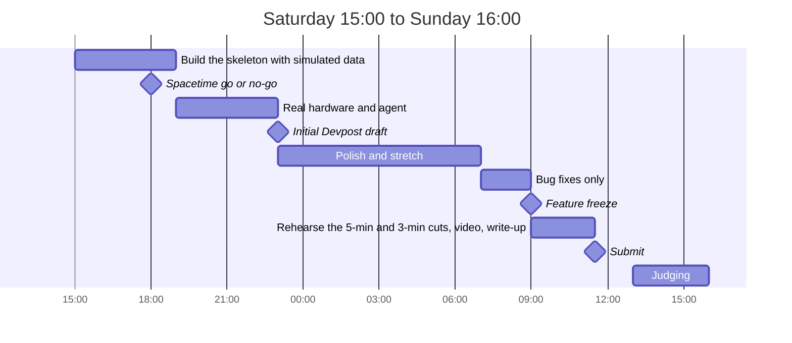

Rehearse with stand-in judges: both the 5-minute and the 3-minute cut.

**Hard deadlines**Initial Devpost draft by 23:00 Saturday. Feature freeze 09:00 Sunday. Submit by 11:30 (closes 12:00). Judging 13:00–16:00.

## 27Judge Q&A: questions to expect

Short, honest answers. If the true answer is "we didn't test that", say so; judges respect it more than a guess.

### The problem and the product

| They ask | We say |
| --- | --- |
| Why does the handoff matter? | Details get lost when the paramedic recites from memory while the ER takes over, so Handoff writes every detail down, timed and sourced, as it happens. The ER usually learns about the patient at the door, so live video, live vitals, the record from the EHR and a pre-arrival alert reach it during the call. Paramedics are trained generalists and the specialists are at the hospital, so those specialists can see the patient early, and the bodycam gives protocol reminders on scene (rate, pauses, dose timers, read-back, allergy checks), never a diagnosis. |
| Who would use or buy this? | EMS agencies (the crews) and the hospitals receiving them. It runs on a phone the medic already carries plus a small relay box. |
| Don't ambulances already have software for this? | They have patient care report apps, usually filled in after the call, and some defibrillators give CPR feedback. Handoff does the documentation live, hands-free, from voice, sensors and the camera, and streams it to the hospital as it happens. |
| Why a phone on a harness and not smart glasses or a real bodycam? | Every medic has a phone: camera, mic, speaker and motion sensor in one. Glasses fall off and aren't issued. A production version could use agency bodycams. |
| What did it cost? | The relay is roughly $100 of parts (Raspberry Pi, pulse sensor, button, cables) plus 3D-printed PLA. The phone is the medic's own. |
| What's next? | Testing with EMS instructors on real CPR training equipment; connecting to a real health information exchange; exporting to the national EMS data standard (NEMSIS); Photon alerts to the ER's phones. |

### Safety, accuracy and honesty

| They ask | We say |
| --- | --- |
| Is this a medical device? | No. It's a prototype that documents and reminds. It doesn't diagnose or order treatment. A real product would need regulatory review. |
| What if speech recognition gets the dose wrong? | That's why it reads back: the medic hears exactly what was logged, units spelled out, and can say "correction" within 10 seconds. Unusual doses and recorded allergies ask for confirmation. Nothing is acted on automatically. |
| What if the AI makes something up? | Time-critical callouts are plain rules, not AI. The agent may only use facts stored in the database, and the report drops any sentence without a source. Every line shows where it came from. |
| Is the CPR real? | No, it's mimed above a teammate's chest, no contact. The bodycam reads the rescuer's movement, so the rate and pause coaching still work. |
| How accurate is the CPR rate? | Only quote what we measured against a metronome this weekend. We measure rate and pauses; we don't claim compression depth. |
| Is the heart rate real? | Yes, from the patient's finger. The oxygen reading is experimental: fingertip sensors like ours are less accurate on darker skin, a known problem, so we label it. |
| Is the patient record real? | No. The EHR is a mock with synthetic patients, but it speaks FHIR, the format real EHRs use. |

### Privacy and security

| They ask | We say |
| --- | --- |
| HIPAA? Recording patients? | Everything here is synthetic. Production would need patient-data agreements, role-based access, audit logs and retention rules; many agencies already run bodycams under such policies. We keep frames only as evidence for logged events. |
| Where does the data and the AI live? | For the demo: a hosted SpacetimeDB and NVIDIA's API. Both can run on-premises: SpacetimeDB can be self-hosted and Nemotron is an open model, so a hospital or the ambulance laptop could keep everything local. The medication read-back already runs on the phone. |
| Is it encrypted? | Connections use HTTPS and secure WebSockets. Deeper security work is a next step; we focused on the clinical flow. |
| How do paramedics get access to an EHR? | Through hospitals or regional health information exchanges, which some EMS agencies can already query. We mocked that endpoint with the standard FHIR format. |

### How it's built (and for sponsor judges)

| They ask | We say |
| --- | --- |
| Spacetime: what does SpacetimeDB do that a normal database wouldn't? | It's the whole backend. The phone, the Pi, the controls page and the hospital screen all subscribe to the same live incident. Our callout rules and dose timers run inside it as scheduled functions, so there's no separate server. |
| NVIDIA: how is this "beyond a chatbot"? | Nobody chats with it. It wakes on events (an ID card seen or a name spoken, arrest, Generate Handoff), plans, decides for itself when to call tools (EHR search, hospital choice, report writing) and leaves a visible trace. That is agentic tool use. |
| How fast is it? | The read-back starts within about a second because it runs on the phone; sensor to screen is under a second; the record pull is a few seconds. Quote measured numbers only. |
| How does it know who the patient is? | The agent reads the name and birth date off the ID card with the camera, or hears the medic say them, and decides to search the EHR. If it isn't sure, it asks. |
| How does the live video work? | WebRTC, the same tech as video calls, straight from the phone to the hospital screen. SpacetimeDB carries the connection handshake. |
| What happens without internet? | The read-back keeps working on the phone, devices buffer and catch up, and real ambulances have cellular. The AI and the hospital link need a connection. |
| What did you build this weekend? | All the software. We designed and printed the enclosures and bought the parts before the event. Say this plainly. |
| Who did what? | Four of us worked across hardware, the backend and agent, the phone pages and demo controls, and the hospital dashboard and EHR, picking up whatever was next on our work board. (Say who led what, honestly.) |

#### Say with confidence

- Real heart rate from the finger sensor
- Read-back runs on the phone, no AI in the loop
- Every report line has a source
- The patient and the EHR are synthetic

#### Don't say

- "Clinically accurate", "HIPAA compliant", "FDA"-anything
- Any accuracy or latency number we didn't measure
- That it measures compression depth
- That it diagnoses or decides treatment

## 28Open questions

| Question | Who |
| --- | --- |
| Do MLH prizes count toward the 3-track limit? (General tracks don't.) | Team, help desk |
| Photon after the MVP (account is done): add only once the core demo works | Team |
| Exact Nemotron model name; vision provider (Gemini or NVIDIA) | Team |
| Hotspot or venue Wi-Fi for the demo | Team |
| **Judging format:** how long per team, and do judges come to the table? It decides the 5-minute, 3-minute or quick demo. Ask the help desk. | Team |
| Who plays which demo role (narrator, fitter, demo operator, ER host) | Team |
| **Phone: Expo app or the web page?** Recommendation: keep the web page. It already has a tested camera, CPR detector, speech and wake lock, and Chrome does speech-to-text with no build step. Expo Go has camera, motion and text-to-speech, but speech-to-text needs a custom native build (20–40 minutes per build and an Android toolchain). Switch only if you need the ultra-wide lens or screen-off recording. | Team, before the bodycam work starts |
| **Which display goes where?** The I2C LCD1602 on the relay. The Grove quad alphanumeric only matters if the med kit gets built; the bare 16-pin LCD stays in the bag. | Team |
| **Privacy story ("keep it local")**: Pi and Arduino can't run an AI model. For the demo, the agent calls NVIDIA's API from a laptop. Pitch line: open-weight Nemotron and self-hosted SpacetimeDB can both run on the ambulance laptop, and the read-back already runs on the phone. Optional: try a small Nemotron model locally on a Mac and check tool calling first. | Team |
| **EHR demo patient:** keep Jordan Avery (amiodarone allergy) or pick another drug/allergy pair? Print the ID card at the help desk, or show it on a spare phone? | Team |
| UNO Q or ESP32-S3 for the med kit (only if it gets built) | Whoever builds it, after a 45-minute UNO Q try |
| Do pins 3 and 5 show about 4 mm of bare metal above the SHIM for the LCD jumpers? | Alan |
| Is the LCD readable at 3.3 V? If not, swap in the OLED. | Alan |
| Which data is live and which is simulated in the demo, and how the screens show it. Decide at the end. | Team |
| During the mock arrest the patient teammate's real heart rate keeps showing a normal pulse. Decide with the live-vs-simulated question at the end. | Team |

## 29Glossary

CPR rate

Chest compressions per minute. Guidelines target 100–120.

ROSC

Return of spontaneous circulation: the heart is beating on its own again.

Epi (epinephrine)

Drug given every 3–5 minutes during cardiac arrest.

Amio (amiodarone)

Drug for certain shockable heart rhythms: 300 mg, then 150 mg.

IO

Intraosseous: giving drugs through a needle into the bone when a vein is hard to reach.

SpO₂

Blood oxygen saturation from the finger sensor. Ours is experimental.

Pleth waveform

The pulse wave the finger sensor sees with each heartbeat.

i-gel

A common airway device placed in an unconscious patient's throat.

Cath lab / PCI

Hospital room for opening blocked heart arteries. Why the agent picks Avon Heart Institute.

MIST

EMS handover structure: Mechanism, Injuries or information, Signs, Treatment.

MARK

Our button and voice command for a timestamped flag on the timeline.

Reducer

A function that runs inside SpacetimeDB and changes its tables.

Scheduled reducer

A reducer SpacetimeDB runs on a timer; our rules and dose timers.

Maincloud

SpacetimeDB's hosted service. Code HACKUTD2026 gives credit.

Qwiic / Grove

Two plug-in connector systems for sensors. Qwiic on the Pi, Grove on the med kit.

I2C / 1-Wire

Ways sensors talk to a board: I2C for the finger clip, 1-Wire for the temperature probe.

LCD1602

A 16-character by 2-line text screen on I2C.

Handoff · HackUTD 2026 · a team of four. Prototype for a hackathon demo; all patient data is synthetic and nothing here is medical advice.