# Handoff: product spec (HackUTD 2026)

**Version 2 · Sat Nov 7 · source of truth · prototype, synthetic data, not a medical device**

Handoff is an AI partner for paramedics. It watches, listens and measures on scene, coaches the medic out loud,
documents everything automatically, and briefs the hospital before the patient arrives. On arrival, one click
produces a handoff report in which every line cites where it came from.

This file is the single source of truth. It replaces the claude.ai spec page, the 15:36 markdown copy and the
content of `AGENTS.md`. Other files cite it as "spec §N"; the section numbers are stable. `spacetime/README.md`
stays the detailed backend contract and wins for exact reducer signatures (§22). Items marked **[OPEN]** are not
decided: don't treat them as settled and don't silently pick one; ask, or add them to §28.

## Change log

Newest first. Times are Saturday Nov 7, Central time. "~" means the time the spec page was updated, not
necessarily when the decision was made.

- **Sun ~01:45 (Josh): CPR assistance runs in `hub/phone.html`** (§0.1 decision 21).
  - **What it does:** once the incident is in `arrest` and the finger sensor reports a finger, the phone plays a
    110/min metronome, detects compressions from its motion sensor (the `hardware` branch's tested detector,
    ported) and measures how many land on the beat (within 120 ms, last 8). It speaks nothing itself.
  - **Cues:** two new §15 rules, "Place the finger sensor" and "Follow the beat", join "Push faster", "Slow down"
    and "Resume compressions". All go through the callout queue, so the voice worker speaks them: one voice.
  - **Contract:** a new reducer `push_cpr_assist(assist, bpm, onBeatPct?, phaseErrMs?)`, and `cpr_state` gains
    seven columns with defaults (the data migrates). `push_cpr` is unchanged. **All three binding copies** (`web/`,
    `agent/`, `voice/`) are regenerated in the same change: an SDK client with old bindings misreads the wider
    `cpr_state` rows, so pull before Maincloud is republished. The page itself calls Maincloud over plain HTTPS.
  - **Files:** source and tests in `web/src/cpr/` (`npm run test:cpr`), bundled into `hub/cpr.js`
    (`npm run build:hub-cpr`); a CPR card in `hub/phone.html`; `hub.py` serves `/cpr.js`; `hub/deploy.sh` copies it.
  - **Hospital side:** the CPR rate caption adds "% on beat"; the report adds the average.
- **Sun ~01:30 (Alan): no "experimental" label on SpO₂ on the hospital dashboard** (decision 10, §5, R1, §24.1).
  SpO₂ is still treated as experimental and the caveat is said if a judge asks; it's just not on screen.
- **Sun ~01:20 (Rishi): the bridge runs on the real Pi against Maincloud** (`bridge/`; no contract changes).
  - **What's running:** the `handoff-bridge` service on the Pi, next to the hub and the sensor service. Real
    finger-sensor readings reach `handoff-hackutd26` once a second as `relay-1`: HR 75–102, and the experimental SpO2
    98–100 once the sensor holds it steady; every row `simulated: false`.
  - **New check:** `bridge/check_vitals.py` answers "is the feed live and real?" in one command, from the laptop or
    the Pi. It exits 0 only when the newest `relay-1` row is at most 3 s old and there are no simulated rows, no rows
    from another device and no synthetic scenario (R4, §24).
  - **Still to test on the Pi:** MARK during an incident, the stale pause, a reboot. Test steps for PowerShell and
    bash are in `bridge/README.md`.
- **Sun ~01:00 (Alan): `/controls` built** (D1, H8, §5). A hidden phone page for the demo operator that forces
  any beat through the existing `demo_control` and `synthesize_seizure` reducers on Maincloud (the one source of
  truth): Start, Arrest, ROSC, En route, Arrived, Close; CPR slow / good / live; Epi due now; Seizure on/off;
  Demo timing; Identify patient (the five EHR patients); and Reset for the next judge (second tap to confirm). A
  card at the top reads back the live state. It replaces the `/monitor` placeholder route; nothing links to it.
  The Seizure button makes `/controls` a `synthesize_seizure` caller (Alan's call; agent/hotkey callers and the
  scenario's numbers stay open, §28). Pending Josh's OK: the `web/` routing change and the `/monitor` removal
  (hospital lane, §0.2). No module changes.
- **Sun ~00:30 (Alan): two touches from Canvas UI on the hospital dashboard** (§14). The vitals are stat cards (big
  number, small spaced monospace caption under it), and panel titles use the same caption style. Before the first
  video frame, the live view shows a slowly floating halftone heart (Canvas UI's Dithered Object, MIT + Commons
  Clause, copied into `web/src/routes/hospital/canvasui/` with its notice). It is lazy-loaded, so `three` only
  downloads on `/hospital` while it shows, and it holds still under reduced motion. Adds `three` to `web/`.
- **Sat ~23:30 (Alan): the two voice-agent PRs are merged into one worker on `main`** (§0.1 decision 20). PR #5
  (Alan: the `voice/` TypeScript brain and the Riva Pipecat worker, live-tested with a real mic) is the base. From
  Devin's PR #6 (for Rishi) came what it lacked: the **vision sampler** (now `voice/pipecat/vision.py`, same prompt,
  about one frame a second from the phone's video, findings → the brain's `POST /seen`), the **phone page's WebRTC
  link** (`hub/phone.html?voice=<worker>`: mic and camera to the worker, the agent's voice back), `GET /api/ice`
  and a TURN relay, the phone page served from the worker with the hub proxied (one https URL), the Pi-hub frame
  fallback, and `test_client.py`. **Not adopted:** PR #6's self-hosted Nemotron Omni (vLLM on a Brev H100) and
  Kokoro TTS; everything runs on NVIDIA's hosted API with the one key, which is one fewer machine and tunnel to
  keep alive at the table. **Vision model settled:** `nvidia/nemotron-3-nano-omni-30b-a3b-reasoning`, hosted (the
  same Nano Omni, so Devin's frame tests still apply); `nvidia/nemotron-3.5-super-vl-120b-a12b` works too. Verified
  with a key: a synthetic ID card read in 1.4–2.2 s, an empty frame → no findings in 0.6 s. **Where vision taps the
  video (§28, closed):** the worker's own WebRTC link from the phone, with the hub's `/frame.jpg` as the fallback;
  decision 1 amended. Camera-seen drugs (RB8–RB10) are now built end to end but still untested on real frames.
  Tests: 37 brain tests, bridge 12/12, vision 6/6. Live phone test still to do.
- **Sat ~22:15 (Alan): first live audio test of the voice agent** (laptop mic, Chrome, noisy room). The loop
  works: read-back audio 0.2–0.4 s after the medic stops, Nemotron answers in about 1 s, barge-in works. Riva
  mangled short drug names ("epi" → FEIO/EBI, "amiodarone" → "amino dirone"), so: the line card says the full
  names (§8), the ASR default is Parakeet with boosted clinical vocabulary, the parser maps mishearings and matches
  long names fuzzily, and the brain asks "Say again the drug." instead of guessing. Room chatter: stricter VAD,
  a relevance gate before Nemotron, 20 turns/min. Interrupted read-backs are not replayed. Details in
  `voice/README.md`.
- **Sat ~22:00 (Josh): Pi vitals reach SpacetimeDB through `bridge/`** (reviewed and rebased onto `main` Sun ~00:30, Alan).
  - **Why:** the relay's finger sensor (`chromatic/pi/pi_oximeter.py`) posts to kgand's hub (`hub/hub.py` on the Pi),
    not to SpacetimeDB.
  - **What it does:** `bridge/hub_bridge.py` long-polls the hub and calls `push_vitals` once a second, plus `mark`
    per MARK press. Hub state → relay status: `live`→`pulse`, `no_finger`→`no finger`, `saturated`→`saturated`,
    `sensor_error`→`sensor error` (a new status word, added to §22.3), everything else→`acquiring`.
  - **Honesty:** it never forwards stale or replayed values, and sends `simulated: false`.
  - **Not forwarded:** waveform and temperature (the hub doesn't carry them), and R5's 2 s hold → `toggle_incident`
    (the sensor publishes presses only; a hub `hold` message from the chromatic lane has to come first).
  - **How it runs:** a systemd service on the Pi (`bridge/deploy.sh`); the hub and sensor code are unchanged.
    One bridge per hub.
- **Sat ~21:40 (Alan): the Chromatic handheld is built, QR page included; open** (§28). The 19:31 meeting parked
  the ModRetro handheld and kept "no QR codes". After the meeting, kgand's 20:59 commit on `main` (`chromatic/`)
  turned the Chromatic into a Bluetooth vitals screen with a QR page that encodes a short readable summary. Whether
  it joins the demo, and whether its QR page is an exception to decision 8, is open. H4 fixed: with camera-seen drugs
  a stretch goal, the epi event has one source (read-back).
- **Sat ~21:30 (Alan): hospital dashboard is five panels** (§14 rewritten; no table or reducer changes). After four
  rejected passes on PR #2 (too much on screen, too much motion, reasoning text in the UI), the layout is Alan's
  sketch: live view and event timeline on the left; status, vitals and patient on the right.
  - **Removed from the screen:** route/ETA, agent tool trace (H5), source chips (kept in the report, H4), trend
    lines and pulse waveform (H3), big callout text (D2), and the simulated / demo-timing / prototype marks
    (§24.1 and D5 no longer require them on `/hospital`; the data still records them).
  - **Kept:** Generate Handoff is the only action (in the timeline header); stale readings show "—" (H3); HR and
    SpO₂ blank during an arrest (§9); report opens in the live-view panel (H7).
- **Sat ~20:15 (Josh): hospital dashboard redesign.**
  - **Layout:** a header with status, ETA and Generate Handoff; a fixed strip with the pre-arrival alert and "Bodycam said"; a full-width patient band with the allergy first; vitals and resuscitation rows (CPR first during an arrest); the timeline; and a side column with the live-video thumbnail (click to expand) and the agent trace.
  - **Decision 3 clarified:** Generate Handoff is the only action; view-only controls are fine.
  - **Mockup:** the §14 mockup predates this layout; the code in `web/src/routes/hospital/` is the reference.
- **Sat ~19:40 (Alan): voice agent worker built in `voice/`** (§0.1 decision 18; detailed contract in
  `voice/README.md`). A Node "brain" subscribes to SpacetimeDB and speaks only through `add_callout`, the same
  queue the §15 rules use: one queue, one spacing policy, one audit trail. Deterministic first (read-back with the
  dose and allergy checks, corrections, spoken name + birth date → EHR, camera-seen drugs, W6), Nemotron for
  judgement (W2 extraction, answering the medic, optional proactive advisories) through reconciled tools. Ear and
  mouth plug into a local API: `voice/mock/` (terminal bodycam, fake relay, scripted §7 storyboard) for testing
  without a phone or a Pi, `voice/pipecat/` (NVIDIA Riva STT/TTS, laptop mic or WebRTC) for real audio. Settles
  the folder, the when-to-speak policy, the read-back first hop, the failover trigger, the tool names, the
  state-summary format and the audio signaling (§28). Fast voice model: `nvidia/nemotron-3.5-lightning-30b-a3b`,
  verified ~21:30 with a real key: tool calling works, 1–4 s per voice turn (§28). NVIDIA's free tier is about
  40 requests/min per key (forum, unofficial): the 1 frame/s vision sampler would use most of it.
- **Sat 19:31 team meeting** (§0.1 decision 19). Build the core flow first: voice feedback, CPR coaching and
  logging; everything else comes after.
  - **Allergy:** the demo allergy stays amiodarone (Jordan Avery), not epinephrine.
  - **QR codes:** they came up again and stay out (decision 8). The need behind them, a way for the hospital to
    reach the paramedic, is now a §28 question under W3. (Since then the Chromatic gained a QR page; see ~21:40.)
  - **Camera-seen drugs** are a stretch goal (decision 16, RB8–RB10). The voice read-back is the MVP's
    medication source.
  - **Parked:** stroke detection from the face, and the ModRetro handheld (§3). (The handheld has since been
    built as a vitals screen; see ~21:40.)
- **Sat ~19:05 (Josh): only Josh runs the workflow agent against Maincloud** (§0.1 decision 17). A second copy, even
  without an NVIDIA key, duplicates alerts and reports. No lock in code; the team stays mindful of it.
- **Sat ~19:00 (Josh): agent verified with real Nemotron.** `nvidia/nemotron-3-ultra-550b-a55b`, thinking off.
  On a local DB the W1 alert landed in about 5 s and the W4 report in about 7.5 s. The real model added claims the
  facts don't support ("male", "transporting"), so alerts and report lines now also fail on unsupported claims
  (`agent/README.md`).
- **Sat ~18:45 (Josh): mock EHR and the workflow agent built.**
  - **Mock EHR:** `ehr/` is a read-only FHIR R4 server with five synthetic patients on port 4100. Two of them are
    named Jordan Avery, to show X8.
  - **Agent:** `agent/` is a Node SpacetimeDB client running W1 (destination + pre-arrival alert) and W4 (MIST
    report with source ids, self-check, E4 summary).
  - **No key:** it uses Nemotron tool calling through NVIDIA's API; without `NVIDIA_API_KEY` it uses the rule and
    the template.
  - **Dashboard:** `/hospital` shows the report in place of the video and tiles once it's ready.
  - See `ehr/README.md` and `agent/README.md`.
- **Sat ~18:30 (Alan): vision samples the live stream.** The vision model takes about one frame a second from
  the live video on the laptop (skipping a frame while the previous call is still running), instead of the phone
  sending a still every ~5 s. "Handoff, look" still grabs a frame at once. The phone uploads nothing extra and
  vision frames don't go through SpacetimeDB. ID-card target tightened to about 5 s. See §0.1 decision 1, §4,
  §10 (B2, B6), §16, §17, §19 Vision, §26, §28.
- **Sat ~18:20 (Alan): the camera logs drugs it sees being given.** If the vision model sees a medication
  being given (the vial or syringe label plus the push, injection or nebuliser), it logs a medication event with
  the frame as evidence, even when nobody says it. Inside the merge window it fuses with the spoken read-back.
  Seen-but-not-said doses stay flagged until the dose is spoken, and the dose and allergy checks still run. See
  §0.1 decision 16, §16 (RB8–RB10), §18, §19 Vision, §22.7.
- **Sat ~18:15 (Josh): synthetic seizure.** New reducer `synthesize_seizure(active)` replaces the relay's sensor
  data (HR, SpO₂, temperature, waveform) with a hardcoded seizure (`spacetime/src/scenarios.ts`) so the healthy
  teammate can look like they're deteriorating. New table `vitals_override`. Rule alarms now use separate event
  kinds `vitals_alarm_hr` / `vitals_alarm_spo2`. Where it's called from is [OPEN] (§28). See §0.1 decision 15, §22.
- **Sat evening:** moved from the claude.ai page to this file (Version 2) and merged `AGENTS.md` into it.
  `AGENTS.md` becomes a short pointer here. This replaces the quick SPEC.md (b5ddd6b) and Josh's synced spec
  copy and brief (365b14f), whose resolutions it keeps. Conflicts were resolved as listed in §0.1.
- **Sat evening: real-time voice agent replaces on-device voice (Alan approved).** A low-latency voice agent
  (streaming STT → Nemotron with tools → streaming TTS) talks to the medic over WebRTC audio and decides when to
  speak. The on-device layer (Web Speech STT, phone TTS, phone read-back parser, rule callouts spoken by the
  phone) stays only as the degraded-mode fallback. See §4, §10, §15, §16, §19, §22–§28.
- **17:42 (Josh, `AGENTS.md` §0):** video to the hospital is live WebRTC only, no snapshot video; W6 belongs to
  the bodycam lane; no ER Acknowledge (Generate Handoff is the dashboard's only button, the pre-arrival alert is
  display-only); the mock EHR is a FHIR R4 server; keep it simple. Lanes and folder ownership added.
- **17:26:** SpacetimeDB module published on Maincloud as `handoff-hackutd26`. §22 describes the built schema.
- **~17:00:** no manikin. One judge wears the harness and mimes CPR with hands above a teammate lying on a mat (no
  contact). Finger clip and temperature probe go on that teammate. No paramedic partner.
- **~16:58:** no QR codes anywhere. The vision model reads the ID card (name + birth date), or the medic says
  them; the agent decides to search the EHR. Fallback: "Identify patient" on `/controls`.
- **15:20 (spec page updated ~16:30–16:36):** no tablet and no monitor page. The relay's only screen is the
  GeeekPi I2C LCD1602 in the printed pod, at 3.3 V only; the 0.96" OLED is the fallback. Demo controls move to a hidden `/controls` page on
  the demo operator's phone. Routes are `/bodycam`, `/hospital`, `/controls`.
- **Sat afternoon:** which data is live vs simulated, and how screens show it, is deferred to the end (§28).
  SpO₂ stays "experimental" and demo timers stay "DEMO TIMING". The work board is flexible (no fixed owners).
- **16:20:** the EHR pull is the hospital-side moment; a typed ER chat is optional.
- **16:05:** Photon paused for the MVP. The demo is hands-on: a judge wears the harness.
- **15:55:** smart med kit moved to stretch.
- **15:36 team meeting:** Pixel bodycam on the harness (universal plate as backup for other phones); relay box
  off the harness, clipped to the jump bag; finger sensor is the MVP; all data in SpacetimeDB Maincloud; the
  Nemotron agent runs in the cloud or on a laptop; hospital dashboard stays (live view + timeline); medications
  logged from the voice read-back and the camera reading the vial label; encryption is an extra; no smart
  glasses.
- **15:00:** rear camera on the Pixel (front camera as fallback).
- **14:45:** Version 1 of the spec (claude.ai page).

## Contents

0 Team decisions and how we work · 1 Overview · 2 Users · 3 Goals and non-goals · 4 System map · 5 Every part
and where it goes · 6 The demo station · 7 Demo storyboard · 8 Running the demo · 9 Incident lifecycle ·
10 Bodycam · 11 Vitals relay and wiring · 12 Relay screen (LCD1602) · 13 Smart med kit (stretch) · 14 Hospital
dashboard · 15 Callout rules · 16 Medication read-back · 17 Pulling the patient's record (EHR) · 18 Event fusion
· 19 AI agent · 20 Handoff report · 21 Pre-arrival alert · 22 Data model and contracts · 23 When things fail ·
24 Safety and honesty · 25 Sponsor tracks · 26 Schedule and work board · 27 Judge Q&A · 28 Open questions ·
29 Glossary · 30 Developer reference

---

## 0. Team decisions and how we work

### 0.1 Binding decisions

These override anything else in this file that seems to disagree. If you find a disagreement, fix the other
section and add a change-log line.

1. **Video to the hospital is live WebRTC only.** No low-frame or snapshot video mode. If the link can't be made:
   phone hotspot, then a TURN relay. (Josh, 17:42) The vision model samples about one frame a second on the laptop;
   the phone uploads no separate frames to SpacetimeDB. (Alan, ~18:30) Amended ~23:30 (decision 20): the frames
   come from the phone's WebRTC link to the voice worker (its camera track rides along with the mic), or from the
   Pi hub's `/frame.jpg` when that link is down, not from the hospital's video.
2. **W6** (patient identified → EHR pull → `patient_record` + spoken summary) **belongs to the bodycam lane.**
   (Josh, 17:42) Superseded by decisions 18 and 20: the whole of W6 now runs in `voice/` (`VOICE_W6=on`): the
   vision sampler reads the ID card, the brain searches the EHR, calls `identify_patient`, pulls and saves the
   record and speaks the summary. The bodycam page only carries the camera to the worker.
3. **No ER Acknowledge.** The hospital dashboard's only *action* is **Generate Handoff**. View-only controls are
   fine, such as expanding the live-video thumbnail or a chip's evidence (Josh, ~20:15). The pre-arrival alert is
   display-only. There is no "ER acknowledged" callout. No demo controls on `/hospital`. (Josh, 17:42)
4. **The mock EHR is a FHIR R4 server** with five synthetic patients. (Josh, 17:42)
5. **Keep it simple.** Build the smallest version that meets the "done when" check. Simulated data first: a
   working end-to-end path with simulated data beats a half-working path with real data. (Josh, 17:42)
6. **No tablet, no monitor page.** The relay's only screen is the GeeekPi I2C LCD1602 in the printed pod on the
   lid, powered at **3.3 V only, never 5 V**. The 0.96" OLED is the fallback. The hospital screen is the big
   display. (Alan, ~16:30)
7. **Demo controls live on a hidden `/controls` page** on the demo operator's phone (the laptop if no phone is
   free). The app's routes are `/bodycam`, `/hospital` and `/controls`. (Alan, ~16:32)
8. **No QR codes anywhere** (not on the ID card, not on the report). The patient is identified by the vision
   model reading the ID card (name + birth date) or by speech; the agent decides to call the EHR search tool.
   Fallback: "Identify patient" on `/controls`. (Alan, ~16:58) Reaffirmed at the 19:31 meeting: a QR code linking
   to a live page stays out. The need behind it, a way for the hospital to reach the paramedic, is in §28 under W3.
   Open since ~21:40: the Chromatic vitals screen on `main` has a QR page (§28).
9. **Demo format:** one judge, hands-on, 3–5 minutes with explanation. The judge wears the harness and mimes CPR
   with hands above a teammate lying on a mat: no contact, no manikin. The finger clip and the temperature probe
   go on that teammate. No paramedic partner. Team roles: narrator, fitter/spotter, demo operator, ER host; the
   patient is any free teammate. (Alan, ~17:00)
10. **Labelling simulated data "SIMULATED" is not a commitment right now.** Which data is live vs simulated and how
    screens show it is decided at the end (§28). SpO₂ is labelled experimental everywhere except the hospital
    dashboard, which dropped the label (Alan, Sun ~01:30); the caveat is still said if asked. Compressed demo timers are
    always labelled DEMO TIMING, except on the hospital dashboard, which dropped the label for clarity (Alan, ~21:30);
    the narrator says it if a judge asks. (Alan)
11. **The work board is flexible** (§26): no fixed schedule owners. The lanes in §0.2 decide folder ownership so
    code doesn't collide. (Alan; lanes from Josh)
12. **Sponsor tracks:** Spacetime and NVIDIA Nemotron. Photon is paused for the MVP; the third slot stays open
    (§25). (16:05)
13. **Real-time voice agent replaces on-device voice** (Alan approved, Sat evening). The bodycam streams mic audio
    to a voice agent worker on the laptop and plays its audio back, over WebRTC. The on-device layer is the
    degraded-mode fallback. Doses and allergies are checked by deterministic tools, never by the model's own
    judgement. Details in §19.
14. **Settled at the 15:36 meeting:** the Pixel 9 Pro on the chest harness is the bodycam (rear camera; the
    universal plate is the backup for other phones); the relay box stays off the harness and clips to the jump
    bag by its carry loop; the finger sensor is the MVP; all data goes to SpacetimeDB Maincloud; the Nemotron
    agent runs in the cloud or on a laptop ("ambulances have laptops"); the med kit is a stretch goal; smart
    glasses are not being built; encryption is an extra, not core.

15. **Synthetic seizure** (Josh, Sat ~18:15). `synthesize_seizure(true)` overrides the relay's sensor data
    (HR, SpO₂, temperature, waveform) with a hardcoded seizure from `spacetime/src/scenarios.ts`: HR climbs to
    about 170 and SpO₂ falls to 80 over 30 s, then holds. Rows are stored with device `sim-seizure` and
    `simulated = true`. While it's on, the relay's calls succeed but aren't stored. `synthesize_seizure(false)`,
    closing the incident or reset ends it. It covers the deterioration beat; it does **not** settle the
    mock-arrest pulse question (§28). Where it's called from is [OPEN] (§28). The data is hardcoded on purpose,
    to be tuned later.
16. **The camera logs drugs it sees being given: stretch** (Alan, Sat ~18:20; made a stretch goal at the 19:31
    meeting). In the MVP, medications are logged from what the medic says, through the voice read-back. If the
    stretch is built, the camera also logs what it sees: a medication seen being given is logged even if nobody
    says it, with the frame as evidence, and it never gets a guessed dose. Build it only after the core flow
    works. As of ~23:30 both sides are built: the brain side in `voice/src` and the detection in
    `voice/pipecat/vision.py` (decision 20). Still a stretch for the demo until it has been tried on real frames of
    a syringe in a hand. Details in §16 "Drugs the camera sees" (RB8–RB10).
17. **Only Josh runs `agent/` against the shared database** (Josh, Sat ~19:05), on the hospital laptop. Every copy
    of the agent watches `handoff-hackutd26`, and nothing stops two copies running at once.
    - **A second copy duplicates everything:** two pre-arrival alerts, the destination set twice, every trace step
      twice, two reports (the last one overwrites the other), and double NVIDIA usage.
    - **The NVIDIA key doesn't prevent this.** Without a key the agent still runs W1 and W4 on its rule and
      template fallback.
    - **Testing:** to try the agent, point it at a local database (`SPACETIMEDB_HOST=ws://127.0.0.1:3000`,
      `SPACETIMEDB_DB_NAME=<your local db>`).
    - **No lock in code for now; the team stays mindful of it.** If it bites, add a lock (the first copy claims
      the database).
18. **Voice agent worker: `voice/`, Alan's lane** (Alan, Sat ~19:40). Contract in `voice/README.md`.
    - **One speech queue.** The brain speaks only through `add_callout`. Its speaker forwards the next unspoken
      callout (lowest priority number, then oldest) to whichever "mouth" is connected on its local API (the
      Pipecat worker, or the terminal bodycam mock) and calls `callout_spoken` when the mouth finishes. Rule
      callouts and agent speech share the 4 s spacing, the dedup and the trace. Agent advisories: 8 words or
      fewer, P2, at most one per 20 s, off by default (`VOICE_PROACTIVE`).
    - **Failover (B11):** with no mouth connected the brain marks nothing spoken, so the bodycam page speaks the
      rows itself as today. The bodycam stops speaking callout rows while its audio link to the worker is up and
      resumes when it drops. That is the whole trigger; no new tables.
    - **Read-back first hop:** the brain does the read-back deterministically (parser + `check_dose_range` +
      `check_allergy`, no model call) as soon as the final transcript arrives; the phone parser stays the degraded
      fallback. Nemotron never logs a medication.
    - **W6 in `voice/`** behind `VOICE_W6=on` (default on): pulls the record whenever `incident.patientRef` is
      set, and searches the EHR from a spoken name + birth date. If the bodycam lane builds its own W6, turn it off
      in one place. (The ID-card vision path was the camera lane's at the time; decision 20 moved it into
      `voice/pipecat/vision.py`, which posts to the brain's `POST /seen`.)
    - **Audio link:** Pipecat's own WebRTC transport (`voice/pipecat/`), no `rtc_signal` change. The worker ends
      the WebRTC session whenever it has no working mouth (brain unreachable, replaced, or speech failing), so
      "link up" always means the agent can speak. Never talk over the medic, except that after 10 s of
      continuous "speaking" (hall noise) P0/P1 callouts go through.
    - **Only one voice worker per database**, same reasoning as decision 17. Test on a local database.
19. **Settled at the 19:31 team meeting:**
    - **Core flow first.** Build voice feedback, CPR coaching and logging end to end before anything else.
      Buttons, the handheld and other extras come after.
    - **The demo allergy is amiodarone** (Jordan Avery), not epinephrine. An "epi allergy" doesn't hold up: in
      cardiac arrest an allergy isn't treated as a reason to withhold epinephrine, and epinephrine is the treatment
      for anaphylaxis. A judge with medical training would catch it. Epi gets a clean read-back, and amiodarone
      triggers the RB7 warning.
    - **No QR codes** (decision 8 stands). The hospital-to-paramedic channel the QR idea was meant to provide is
      a §28 question under W3.
    - **Camera-seen drugs are a stretch goal** (decision 16).
    - **Parked:** stroke detection from the face (§3 "Parked ideas"). The meeting also parked the ModRetro
      handheld, but kgand built it into a vitals screen with a QR page afterwards (20:59). Its place in the demo,
      and the QR page against decision 8, are open (§28).
20. **One voice worker, from both voice PRs** (Alan, Sat ~23:30). Two teams built the §19 worker in parallel
    (PR #5, Alan; PR #6, Devin for Rishi). `main` carries PR #5's brain and Riva audio worker plus PR #6's
    vision sampler, phone-page link, ICE endpoint, hub proxy and test client, all in `voice/`.
    - **Hosted, not self-hosted.** ASR, TTS, the voice LLM and vision all run on NVIDIA's API with one key. PR #6's
      vLLM Omni and Kokoro on a rented H100 were dropped: a second machine and a tunnel are two more things that
      can die at the demo table, for about the same latency.
    - **Vision lives in `voice/pipecat/`** (`vision.py`), not in the camera lane: it taps the phone's video on the
      worker's own WebRTC link (the camera track rides with the mic), falls back to the Pi hub's frame, and posts
      findings to the brain's `POST /seen`, which does all database writes. The camera lane owns the phone page
      and the hospital video. Decision 1 amended accordingly.
    - **The phone page is `hub/phone.html`** for now: `?voice=<worker>` turns the voice link on; the worker can
      serve the page itself with the hub proxied (`HUB_URL`) so one https URL carries the bodycam.
    - **Vision model:** `nvidia/nemotron-3-nano-omni-30b-a3b-reasoning`, hosted; `VISION_MODEL` overrides.
    - PRs #5 and #6 are closed; their descriptions and test notes are history.
21. **CPR assistance runs in the phone page, and speaks through the callout queue** (Josh, Sun ~01:45).
    - **Where:** `hub/phone.html` loads `hub/cpr.js`, which is built from `web/src/cpr/` (detector, metronome,
      beat check, state machine, HTTP client). Josh owns `web/src/cpr/` and the CPR card in the page.
    - **Start:** it runs while the incident status is `arrest`, which the voice worker sets when the medic says
      "starting CPR" (or the demo's simulated arrest). The page reads the status from Maincloud once a second.
    - **Finger-sensor gate:** the beat starts only once the sensor reports a finger (the hub's `state`, fresh and not
      `no_finger` or `sensor_error`). Once running, taking the finger off never stops the beat.
    - **On the phone:** the 110/min Web Audio metronome, compression detection on the same clock, and the on-beat
      check (within 120 ms, last 8 compressions). The page tap (Start) unlocks sound and motion.
    - **One voice:** the phone speaks nothing. It pushes `push_cpr` + `push_cpr_assist` twice a second, and the
      §15 rules queue the cues; the voice worker speaks them like every callout, so cues land about 1–2 s after the
      rule fires and are silent if the voice worker is down (no degraded-mode speech in `hub/phone.html` yet).
    - **Demo CPR override:** the rate and pause cues come from the override as before; the beat keeps playing.

Conflicts resolved when this file was created (for the record):

- From `AGENTS.md`: "OLED replaces the LCD" → superseded by decision 6. `/monitor` and the monitor tablet →
  superseded by decision 7. QR on the ID card and the report, the manikin, "judge clips their own finger",
  "anything simulated is labelled SIMULATED" → superseded by decisions 8–10.
- From the v21 page: the "low-frame mode" video fallback, the ER Acknowledge button, the "ER acknowledged"
  callout, and "demo controls" sent from the hospital dashboard → removed per decisions 1 and 3.
- From both: the read-back "runs on the phone, no AI" and "the agent never speaks" → superseded by decision 13.
- §22 follows the built backend (`spacetime/src`), not the earlier sketch.

### 0.2 Lanes (who owns which folders)

| Lane | Owner | Owns (folders) | Spec IDs |
| --- | --- | --- | --- |
| **Hospital node** | Josh | `spacetime/` (module, seed, `tick_rules`), `web/` scaffold + `web/src/db/` (connection + bindings) + `web/src/routes/hospital/`, `ehr/` (mock FHIR R4 server), `agent/` (W1, W4), report route | H1–H5, H7, H9, W1, W4, X2, E1 (display-only; H6 is a row in the event timeline), §15 rules, §22 |
| **Relay** | relay owner | `relay/` (Pi sender, LCD1602 with OLED fallback, temperature probe), hardware | R1–R8, L1–L3 |
| **Bridge** (hub → SpacetimeDB) | Josh | `bridge/` (forwards the Pi hub's vitals and MARK presses to `push_vitals` / `mark`; doesn't change `hub/` or `chromatic/`) | R3 (vitals only, no waveform), R4, R5 (short press only; the 2 s hold isn't forwarded) |
| **Chest camera** | camera owner | `web/src/routes/bodycam/` (the planned page), `hub/phone.html` (today's bodycam page: hub uploads plus the `?voice=` link to the worker), WebRTC video sender to the hospital | B1–B3, B5–B11 (phone side), RB1–RB7 (phone side, degraded mode) |
| **CPR assistance** | Josh | `web/src/cpr/` (source + tests) and its bundle `hub/cpr.js`. In other lanes' files, with their owners' OK: the CPR card and two one-line hooks in `hub/phone.html` (camera lane), `/cpr.js` in `hub/hub.py`'s file list and `hub/deploy.sh`'s copy list (hub, kgand) | B4, the CPR rows of §15 (decision 21) |
| **Voice agent worker** | Alan | `voice/` (brain, mocks, Pipecat worker with the vision sampler) | §19 voice agent and §19 Vision, the agent side of B3/B5/B6/B10, §15 when-to-speak policy, RB1–RB5 and RB7 on the agent path, RB8–RB10, W2, W6 (`VOICE_W6`), X1 (spoken name and ID card), X3, X4, X7, X8 |
| **Unassigned** | team decides | `/controls` demo-controls page (`web/src/routes/controls/`; built by Alan Sun ~01:00, owner still open, §28), Devpost/video | D1, H8; W3 (optional) has no owner yet |

- One owner per folder. Stay inside your lane's folders.
- **Only the hospital lane changes `spacetime/`.** Need a table, column or reducer? Ask Josh.
- Small commits, pull often on `main`. Regenerate bindings (`npm run generate` in `web/`, `agent/` and `voice/`) after each schema
  change, commit them, and announce it.
- The work board (§26) is flexible: whoever is free takes the next item, but code goes into the owning lane's
  folder or with that owner's OK.

### 0.3 Who calls what in SpacetimeDB

Exact arguments are in §22 and `spacetime/README.md`.

| Caller | Reducers it calls | Subscribes to |
| --- | --- | --- |
| Relay (HTTP) | `push_vitals`, `push_waveform`, `mark`, `toggle_incident` (2 s hold). Today the caller is `bridge/`, which makes only `push_vitals` and `mark` | `incident` (optional) |
| Bodycam (TS SDK; CPR assistance in `hub/phone.html` over HTTP: `push_cpr`, `push_cpr_assist`, reads `incident`) | `push_cpr`, `send_rtc_signal`, `identify_patient`, `log_event`, `set_event_status`, `mark`, `callout_spoken`, `heartbeat`; `add_transcript` (degraded mode; see the voice row); `identify_patient` after reading the ID card (the pull runs in `voice/`) | `callout` (unspoken; spoken by the phone only while the audio link to the voice worker is down), `rtc_signal`, `patient_record`, `incident` |
| Controls `/controls` (TS SDK) | `demo_control`, `synthesize_seizure` (Seizure button, Alan Sun ~01:00) | `incident`, `cpr_state`, `vitals_override`, `patient_record` |
| Hospital + agent (TS SDK) | `send_rtc_signal`, `set_destination`, `er_message_out`, `log_agent_step`, `request_report`, `save_report` | everything |
| Voice agent worker `voice/` (TS SDK) | `add_transcript`, `add_callout`, `callout_spoken`, `log_event`, `set_event_status`, `set_status`, `identify_patient`, `save_patient_record`, `log_agent_step`, `heartbeat` (device `voice`). Never W1/W4 reducers | `incident`, `vitals`, `cpr_state`, `timer`, `event`, `patient_record`, `callout`, `transcript`, `hospital`, `device`, `er_message`, `agent_step`, `report`, `vitals_override` |
| Any | `start_incident`, `set_status`, `heartbeat` | — |
| `/controls` (Seizure button); other callers not decided (§28) | `synthesize_seizure` | `vitals_override` (a row means it's on) |

`monitor_tap` is still in the module from the dropped monitor page; nothing should call it (§28).

### 0.4 How agents (and people) work here

- **This spec is ground truth.** Build to the requirement IDs (B, R, L, H, RB, X, E, D, K, W) and their
  "done when" checks. `spacetime/README.md` wins only for exact reducer signatures.
- **Run the spec check after every feature.** Before reporting a feature done or committing it, run the
  `spec-checker` subagent (`.claude/agents/spec-checker.md`) on the files you changed. Fix its blocking findings
  and report the rest to the human. Tools without subagents (Codex, Cursor) follow that file's checklist by hand.
- **When a decision changes, update SPEC.md in the same commit and add a line to the change log.**
- **Boring and demo-safe beats clever.** Pick the simplest thing that survives a live demo.
- **Short summaries.** Alan prefers a few lines to a long plan. Lead with the result.
- **Honest pushback.** If a requirement is unrealistic in the time left, say so and propose the smaller version.
- **Explain electronics plainly.** The team aren't hardware experts.
- **Don't change contracts silently.** The SpacetimeDB schema and reducers, the relay HTTP calls, the relay
  WebSocket format, the phone CPR detector output, the `rtc_signal` handshake and the bodycam ↔ voice agent audio
  link (all in §22) are shared. If you change one, tell everyone and update this file.
- **Don't edit `hardware/cad/` or `hardware/manual/`** unless asked. They are verified and printed.
- **No secrets in the repo.** API keys go in gitignored env files (`.env*.local`), never in code or this doc. The
  repo is public for the Spacetime track.
- **Keep app code separate from the hardware bring-up scripts.** The bring-up scripts are checks, not the app.
- **[OPEN] means open.** Don't settle it in code; ask the human or add it to §28.
- Code comments that cite "AGENTS.md section 0", "AGENTS.md Lanes" or "AGENTS.md 4.3" now mean §0.1, §0.2 and
  §22.4 of this file.

### 0.5 Where things stand (Sun ~01:00)

| Area | State |
| --- | --- |
| Hardware parts | All bought. All 3D prints done (Nov 5). Assembly and fit checks: ask Alan |
| Pi relay bring-up tools | Written and tested in simulation (pytest suite plus a 21-check self-test), on the `hardware` branch. Real-hardware verdicts: ask Alan |
| Phone test page | Written (camera/zoom probe, compression-rate detector, speaker, wake lock), on the `hardware` branch. Rear camera decided |
| SpacetimeDB module | Built and published on Maincloud as `handoff-hackutd26` (17:26): schema, reducers, §15 rules in `tick_rules` |
| Web app | Vite + React + TS scaffold. `/hospital` dashboard built, including the report view (H7). `/controls` built (D1, H8; replaces the `/monitor` placeholder). `/bodycam` is a placeholder |
| Mock EHR | Built: `ehr/`, FHIR R4, five synthetic patients, port 4100 (X2) |
| Agent W1 + W4 | Built: `agent/`, Nemotron tool calling with the rule/template fallback. Real Nemotron untested until a key is added (`agent/.env.local`) |
| Voice agent worker | Built and merged to `main` (Sat ~23:30, decision 20): `voice/` brain with read-back + checks, corrections, W6 (spoken name, ID card and `patientRef`), camera-seen drugs, Nemotron turns with tools, local API; `voice/mock/` terminal bodycam, relay pusher and §7 storyboard runner; `voice/pipecat/` Riva STT/TTS worker with the vision sampler (hosted Nemotron Omni), `/api/ice`, the phone page served and the hub proxied. Live-tested with a real mic (~22:15); vision verified on a synthetic ID card with a key; a real phone on `hub/phone.html?voice=` is the next test |
| Relay → SpacetimeDB | `bridge/hub_bridge.py` forwards the Pi hub's vitals (1/s) and MARK presses. Running on the Pi against Maincloud (Sun ~01:20): real HR and experimental SpO2 at 1/s; `bridge/check_vitals.py` checks it's live and real. MARK during an incident, the stale pause and a reboot still to test on the Pi. No waveform, temperature or 2 s hold yet |
| Not started | the `web/` bodycam page (today the Pi hub's `hub/phone.html` is the bodycam: hub uploads, voice link, no WebRTC video to `/hospital` yet), W3 |
| Pre-event prep | Enclosures were designed and printed and parts bought before the event; all software is built at the event. Say so plainly (§27) |

---

## Part A · The product

## 1. Overview

**The problem.** Details get lost at the handoff: the paramedic recites from memory while the ER team takes
over. Information doesn't reach the hospital until the patient does, so the ER can't prepare. Paramedics are
trained generalists, while the specialist knowledge for cardiology, stroke and trauma sits at the hospital.

**The promise.** Every detail is recorded as it happens, the ER sees the patient live while the crew is still on
scene, and the hospital's specialists can see the patient early. The bodycam reminds the crew of protocol and
never diagnoses.

### Three acts, in the order a paramedic works

1. **Assist.** The bodycam is on from the ambulance. On arrival it coaches out loud: CPR rate, pauses,
   medication read-back, timers.
2. **Relay.** First thing at the patient: the finger clip goes on. The relay streams real vitals, and the
   assistant uses them.
3. **Handoff.** Everything flows to the hospital live, and one click produces the sourced report.

### What the judges should remember

1. **The judge wears it, and it talks to them.** A judge puts on the harness, mimes CPR above a teammate lying on
   a mat, and hears "Push faster" or "Resume compressions" from their own chest.
2. **Say a drug, hear it back.** "Administering one milligram of epi IO" and the bodycam answers "Copy.
   Epinephrine, one milligram, I-O." within about a second, and the dose lands on the timeline. If the
   camera-drugs stretch is built, the camera's view of the label confirms the same event.
3. **The record pulls itself.** The judge shows the patient's ID card to the bodycam. The AI reads the name and
   birth date, finds the patient in the (mock) EHR and shows allergies, medications and history to the medic and
   the ER. Then say an amiodarone dose and the read-back warns about the recorded allergy.
4. **One click, a sourced handoff.** A MIST report where every line carries the voice line, sensor reading or
   camera frame it came from.
5. **Real hardware.** Live heart rate and temperature from the patient teammate's finger and wrist.

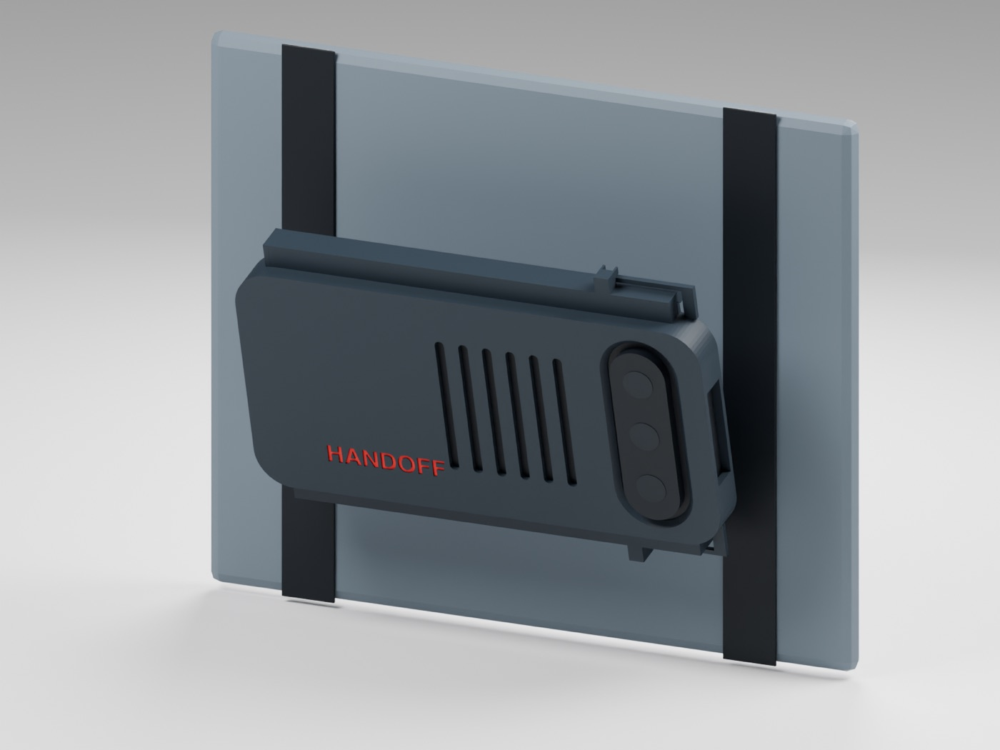

*Bodycam: Pixel 9 Pro in the printed case on a GoPro-style chest harness.*

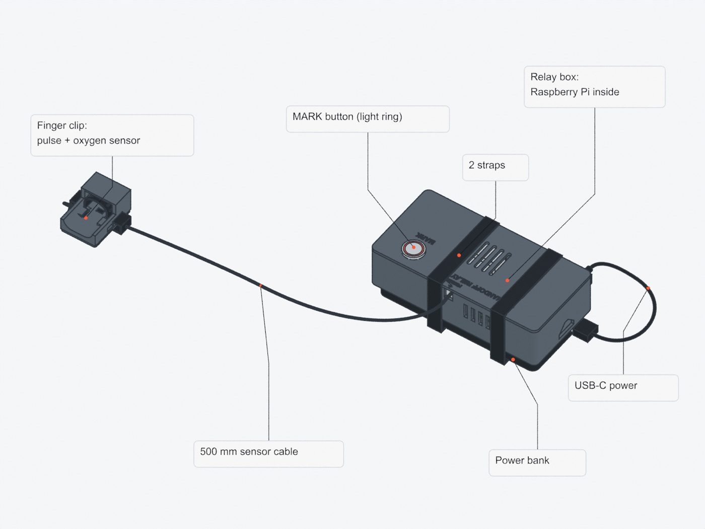

*Vitals relay: Pi 4 in the printed box, MARK button, finger clip, power bank and straps.*

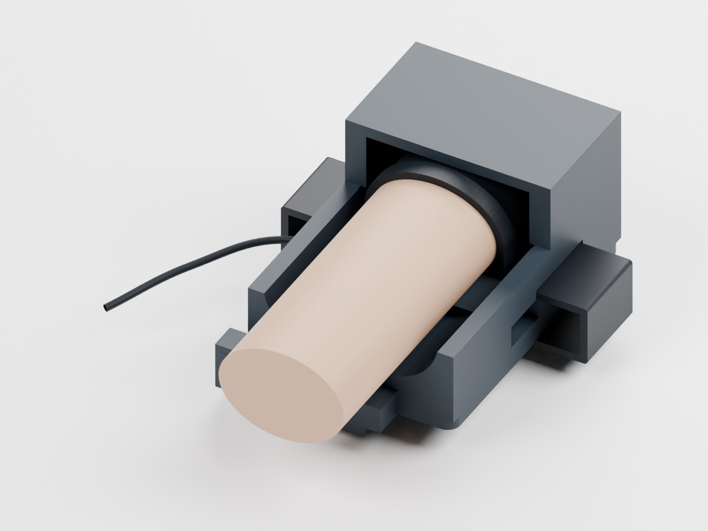

*Finger clip: MAX30101 pulse and oxygen sensor in the printed clip.*

## 2. Users

| User | Context | Needs | Must never get |
| --- | --- | --- | --- |
| **Paramedic** | Wears the bodycam. Hands on the patient. | Short spoken coaching; charting that happens by itself; nothing to read (the bodycam speaks everything); a glance at the LCD on the relay box for the key numbers | Chatter, long sentences, the same callout every second, being talked over |
| **ER charge nurse or physician** | At the hospital, preparing the bay. | An early alert and a live picture; the patient's history (allergies, medications) before arrival; a report they can trust | Invented facts |
| **Judges** | At the table for three to five minutes. | A clear story with real hardware; AI reasoning they can see happening | A demo that depends on luck |

## 3. Goals and non-goals

**Goals for the weekend**

1. One cardiac-arrest incident runs end to end, live, with real hardware where that is safe.
2. Every action is captured automatically from at least one source, and the sources fuse into one timeline.
3. The ER is alerted, sees the patient's record pulled from the EHR, and receives a sourced report.
4. The hospital watches continuous live video from the bodycam.
5. Any device can be missing and the demo still runs.

**Non-goals (say so if asked)**

- Not a medical device. No diagnosis, no treatment orders, no accuracy claims.
- No compression depth. We measure rate and pauses only.
- No real patient data. The EHR is a mock server with synthetic patients in the standard FHIR format; connecting
  to a real hospital or health information exchange is a next step.
- No mass-casualty mode (cut with the State Farm track).
- No smart glasses.

**Parked ideas (not in the MVP; 19:31 meeting).** Revisit only after the core flow works.

- **Stroke detection from the face** (the camera spotting a drooping face). It conflicts with "never diagnoses".
  If it ever comes back, it has to be an observation plus a protocol reminder, for example "Facial droop seen.
  Consider a stroke assessment.", never "probably a stroke".
- **Buttons on the harness, remote control of the relay box, and a volume control.** Raised alongside the ModRetro
  handheld, with no clear use case yet. The relay's MARK button already has a job (§9): a press marks the
  timeline, and a 2 s hold starts or stops the incident.
- **The ModRetro handheld itself is no longer parked.** The meeting parked it ("no use case yet, it gets in the
  way"), but kgand built it after the meeting (20:59, `chromatic/` on `main`): a Bluetooth heart-rate and SpO₂
  receiver with a vitals screen and a QR page. Its role in the demo is open (§28).

---

## Part B · How it fits together

## 4. System map

Where each physical part sits is in §5. This map shows how the devices talk.

Everything shares one live record in SpacetimeDB. Browsers use its TypeScript SDK; the Pi (and the med kit, if
it gets built) call it over plain HTTP. The agent workflows and the voice agent worker are just more clients
that read state and write results.

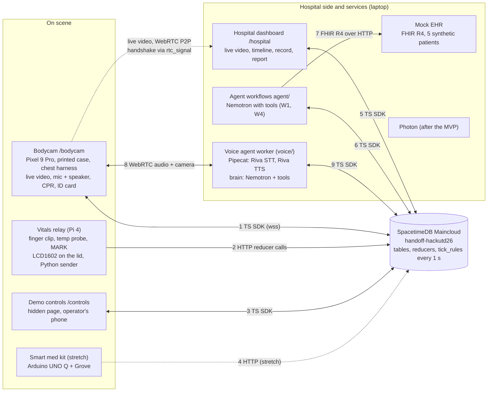

| # | Between | How | What flows (↑ into the database, ↓ out of it) |
| --- | --- | --- | --- |
| – | Relay → its own LCD | I2C, 4 wires | The Pi draws HR, SpO₂, temperature and link status on the LCD1602 on its lid. Works with no network. |
| 1 | Bodycam ↔ SpacetimeDB | TypeScript SDK (wss) | ↑ CPR state twice a second, MARK/LOOK, identify/read-back events, WebRTC handshake messages, transcript lines in degraded mode · ↓ callouts to speak in degraded mode, handshake replies, patient record |
| – | Bodycam → hospital dashboard | WebRTC video, handshake through SpacetimeDB | Continuous live video, peer to peer. SpacetimeDB carries only the handshake (offer, answer, ICE, request). |
| – | Phone video → vision sampler (laptop) | frames | About one frame a second from the phone's WebRTC link to the voice worker (link 8: the camera track rides along with the mic), skipped while the previous vision call is still running; one at once on "Handoff, look". Fallback: the Pi hub's newest frame. Not stored in SpacetimeDB; evidence frames stay on the laptop (`voice/pipecat/evidence/`). Decision 20. |
| 2 | Relay → SpacetimeDB | HTTP reducer calls | ↑ vitals once a second, waveform batches 5 times a second, MARK, incident start/stop |
| 3 | Demo controls ↔ SpacetimeDB | TypeScript SDK | ↑ start, simulated arrest, CPR overrides, epi due now, identify patient, reset |
| 4 | Med kit ↔ SpacetimeDB (stretch) | HTTP (reducers + SQL) | ↑ slot changes, storage temperature every 10 s · ↓ epi countdown, read once a second |
| 5 | Hospital ↔ SpacetimeDB | TypeScript SDK | ↓ everything · ↑ Generate Handoff (`request_report`), WebRTC handshake |
| 6 | Agent workflows ↔ SpacetimeDB | TypeScript SDK | ↓ triggers (status, transcript, patient identified, report requested) · ↑ events, destination, alert, trace steps, report |
| 7 | Agent ↔ mock EHR | FHIR R4 over HTTP | ↓ the identified patient's record: allergies, medications, conditions, code status |
| 8 | Bodycam ↔ voice agent worker | WebRTC, one connection | ↑ mic audio (echo cancellation on) and the camera track for the vision sampler · ↓ the agent's voice. Contract in §22.6 |
| 9 | Voice agent worker ↔ SpacetimeDB | TypeScript SDK | ↓ a compact state summary and new events (never raw 25 Hz waveforms) · ↑ transcript, events, trace steps |
| – | Photon (after the MVP) | Photon API | Not wired in the MVP |

**Web app.** One Vite + React + TypeScript project with three routes (`/bodycam`, `/hospital`, `/controls`),
hosted over HTTPS so the phone can use its camera, mic and motion sensor (they need a secure context).
SpacetimeDB runs on Maincloud, which gives the phone the secure `wss://` connection it needs. The bodycam is this
web page in Chrome on the Pixel, not a native app (Expo vs web page is still [OPEN] in §28; the recommendation is
the web page).

**Live video** is WebRTC straight from the bodycam page to the hospital page: about 480p–720p, 15–30 fps, a few
hundred milliseconds of delay. SpacetimeDB carries only the handshake, in the `rtc_signal` table, so the
database is still the backbone. If the link can't be made (venue Wi-Fi often blocks device-to-device traffic),
switch to the phone hotspot, then a TURN relay. There is no low-frame or snapshot video mode. The vision sampler
on the laptop takes about one frame a second from the camera track on the phone's link to the voice worker (§19,
decision 20); the phone uploads nothing to SpacetimeDB.

**Voice.** The bodycam streams mic audio to the voice agent worker on the laptop and plays back its voice, over
WebRTC. The worker runs STT → Nemotron → TTS and decides what to say from the live data (§19). If the pipeline
drops, the phone falls back to on-device speech (§23).

**Network.** Maincloud needs internet. Hotspot vs venue Wi-Fi is [OPEN]. Every link needs reconnect and
buffering.

### Feature → source of truth

| Feature | Comes from |
| --- | --- |
| Live video | Bodycam rear camera, WebRTC to `/hospital`. Fallbacks: hotspot, then TURN |
| Transcript | The voice agent worker's streaming STT. Degraded mode: Web Speech API on the phone |
| Heart rate, pulse waveform | Relay finger clip (MAX30101), real |
| SpO₂ | Relay, **experimental**. Not labelled on the hospital dashboard (decision 10); say so if asked |
| Temperature | Relay 18B20 probe, every 2 s |
| CPR rate, count, pauses | Bodycam motion sensor. **No depth claims.** Override: "CPR slow / CPR good" on `/controls` |
| Medication logging | Voice read-back. Stretch: the camera seeing the drug given (label and the push) fuses into the same event, and a drug seen but not said is still logged (RB8). No taps; the med kit adds a source if built |
| Medication read-back | The voice agent, with deterministic dose and allergy tools (the brain's parser is the first hop; no model call, decision 18). Degraded mode: the phone-side parser and on-device voice |
| Callouts (CPR, timers, vitals) | The voice agent decides when to speak, inside the §15 policy. `tick_rules` in SpacetimeDB is the safety net and the degraded-mode source. Mac speakers are the last fallback |
| Patient identification | Vision model reads the ID card (name + birth date), or the medic says them; the agent decides to search the EHR. Fallback: "Identify patient" on `/controls` |
| Patient record | W6 (bodycam lane) pulls it from the mock FHIR R4 EHR; every field marked "from EHR" (or "cached") |
| Scene understanding | Vision on about one frame a second from the phone's video to the voice worker, and at once on "Handoff, look": AED pads, airway device, IV/IO, a medication being given (label + action; stretch), ID card. Logged only at confidence ≥ 0.7 (`voice/pipecat/vision.py`, hosted Nemotron Omni) |
| Timeline marks | Relay MARK button, voice "Handoff, mark" |
| Destination, ETA, pre-arrival alert | Agent W1 (`choose_hospital` from the seeded hospitals); the alert is display-only |
| Handoff report | Agent W4, MIST format; drops any sentence without a source; template fallback |

## 5. Every part and where it goes

Every part from the Harp and MLH pickups, plus what was already built. Each one sits at one of five places.
Status: **core** (new, in the demo), **built** (already built), **stretch** (only if time), **not used**.

### A · On the medic (chest harness)

| Part | Status | Notes |
| --- | --- | --- |
| Pixel 9 Pro | built | In the printed case, rear camera |
| Chest harness | built | GoPro-style mount |

No new parts here. The phone gains live video, the WebRTC audio link to the voice agent, CPR detection and the
on-device fallback voice in software.

### B · Relay box (beside the patient)

| Part | Status | Notes |
| --- | --- | --- |
| Raspberry Pi 4 in the box | built | With breadboard and power bank. Clips to the jump bag by its carry loop (carabiner) |
| Finger clip (MAX30101) | built | Qwiic SHIM, pins 1–6 |
| MARK button | built | In the lid, breadboard rows 3–13 |
| I2C LCD1602 (GeeekPi) | core | In the printed LCD pod on the lid. I2C at 3.3 V. Leads through lid vent 3 |
| 18B20 temperature probe | core | Taped to the patient teammate's wrist. Pin 7. Leads out through lid vent 2 |
| Raspberry Pi Camera Module | stretch | Patient cam clipped near the relay. Camera port. Ribbon through vent 1 |

### C · Med kit tray (stretch, only if there's time after the core works)

| Part | Status | Notes |
| --- | --- | --- |
| Arduino UNO Q | stretch | Under or behind the tray. Wi-Fi. USB-C power |
| IR sensor (Grove) | stretch | Under the EPI slot. D2 |
| Light sensor (Grove) | stretch | Under the AMIO slot. A0 |
| Temperature/barometer (Grove) | stretch | Inside the tray. I2C |
| Alphanumeric display (Grove) | stretch | Front edge, facing the medic. I2C |
| 7 Color Flash | stretch | On the tray. Lights when a dose is due. D6 |

### D · On the patient (a teammate lying on a mat)

| Part | Status | Notes |
| --- | --- | --- |
| Patient ID card | core | Printed name, birth date and a photo, like a driver's licence. Synthetic. In the patient teammate's pocket |
| GY-521 module | not used | No manikin, no contact |
| ESP32 S3 DevKitC | stretch | Med-kit backup host only (no CPR puck) |

The finger clip and the temperature probe also go on the patient (from the relay box, place B). CPR is mimed
above the chest, so the phone on the judge measures it.

### E · Hospital table (a few steps away)

| Part | Status | Notes |
| --- | --- | --- |
| MacBook | built | Dashboard, agent workflows and the voice agent worker |
| Mock EHR server | core | On the laptop. FHIR R4. Five synthetic patients |

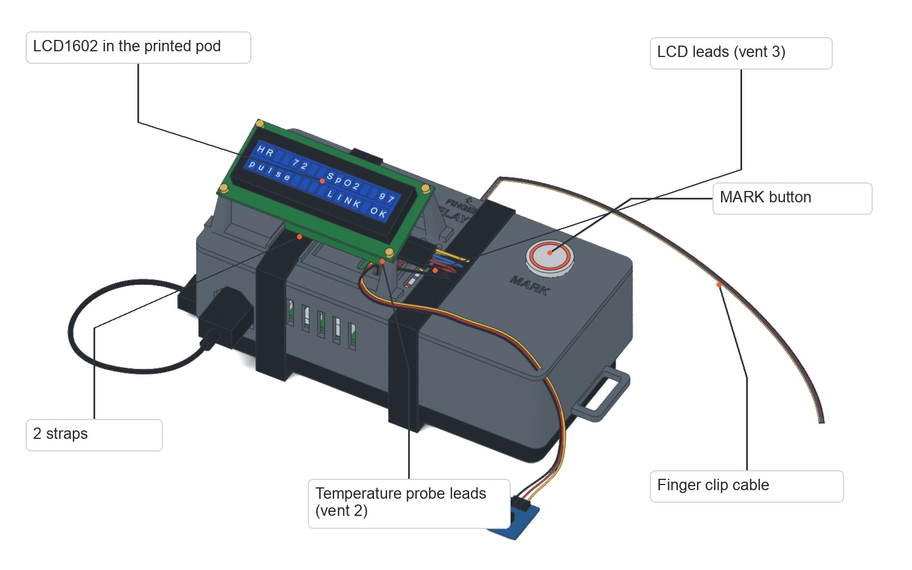

*Place B. The relay box with the LCD1602 in its printed pod on the lid. LCD leads go in through vent 3, the
temperature probe leads come out of vent 2, and the left strap passes over the pod's spine. Concept render.*


*Place C (stretch). The med kit: sensors at each vial slot, the countdown display facing the medic, a bare UNO Q
(no shield) and a small breadboard that shares 3.3 V, ground and I2C. Concept render: tray and boards are
approximate.*

### Staying in the bag

| Part | Why |
| --- | --- |
| HC SR04 | No job; its 5 V echo pin would need a voltage divider |
| HC SR501 | No reliable job; it fires on anyone walking by |
| Metal Touch | No job |
| Digital Temperature | The 18B20 does this better; the Pi can't read analog |
| Soil moisture sensor | No job |
| LED Lights | The button ring and the display already show status |
| LCD 1602 (bare 16-pin) | Needs about 12 wires and 5 V; we use the I2C version instead |
| Pi 5 camera cable | Doesn't fit a Pi 4; use the cable in the camera box |

### The full list

| Part (as on the list) | Status | Plugs into | Its job in the demo | Code to write | Effort |
| --- | --- | --- | --- | --- | --- |
| **I2C LCD1602** (GeeekPi, 16×2, blue backlight, 4-pin backpack) | core | Pi pins 3 and 5 via breadboard rows 16 and 17 · row 7 (3.3 V) · row 5 (GND) · I2C 0x27 or 0x3F | Small vitals screen on the relay box, in the printed LCD pod | Exists: `lib/lcd1602.py` and `test_lcd.py`; add temperature and link status | 30 min |
| **Patient ID card** (synthetic) | core | None: the vision model reads the printed name and birth date from a bodycam frame | Identifies the patient so the record can be pulled | A card with name, birth date and a photo; the agent decides when to search the EHR | 30 min |
| **Mock EHR server** | core | Laptop, HTTP | Returns the patient's FHIR record (allergies, medications, history) | Small FHIR R4 server + five synthetic patients | 2 h |
| **18B20 Temp** | core | Pi pin 7 · row 7 (3.3 V) · row 5 (GND) | Third live vital: temperature | Read the 1-Wire file in the relay sender | 45 min |
| **Arduino UNO Q** | stretch | USB-C power; Grove sensors | Brain of the med kit; sends slot events over Wi-Fi | Sketch (sensors, display) + Python (network) | 2–3 h |
| **IR sensor** (MLH, Grove) | stretch | UNO Q D2 | Sees when the EPI vial is lifted | In the med kit sketch | in the 2–3 h |
| **Light sensor** (MLH, Grove) | stretch | UNO Q A0 | Sees when the AMIO vial is lifted | In the med kit sketch | in the 2–3 h |
| **Temperature/barometer** (MLH, Grove) | stretch | UNO Q I2C | Drug-storage temperature warning | In the med kit sketch | in the 2–3 h |
| **Alphanumeric display** (MLH, Grove 0.54" quad) | stretch | UNO Q I2C | Shows `EPI`, the countdown and `DUE` | In the med kit sketch | in the 2–3 h |
| **7 Color Flash** | stretch | UNO Q D6 + GND | Flashes when a dose is due | One pin set HIGH | 15 min |
| **GY-521 Module** | not used | — | Not used (no manikin, no contact) | — | — |
| **ESP S3 DevKitC** | stretch | USB-C power bank | Med-kit backup host only (no CPR puck) | Same sketch | — |
| **Raspberry Pi Camera Module** + cable | stretch | Pi camera port (cable from the camera box) | A fixed second view for the hospital | A still every second, shown beside the live video | 1.5 h |
| HC SR04 · HC SR501 · Metal Touch · Digital Temperature · Soil moisture · LED Lights · LCD 1602 (16-pin) | not used | — | — | — | — |

### How each add-on gets built

#### Relay LCD in the printed pod (6 jumpers; code exists: `lib/lcd1602.py`)

1. Check the backpack is the 4-pin kind: GND, VCC, SDA, SCL (GeeekPi I2C 1602, blue backlight).
2. Seat the LCD on the pod's 4 pegs and put a tiny hot-glue cap on each of the 4 mounting holes. No glue on the
   Pi.
3. **VCC → row 7** (3.3 V) and **GND → row 5**. Never 5 V: the backpack pulls SDA and SCL up to its VCC, and the
   Pi's pins are not 5 V tolerant.
4. **SDA → row 16** with a second jumper from **Pi pin 3** into row 16; **SCL → row 17** with **Pi pin 5** into
   row 17. Pins 3 and 5 are reached above the SHIM. Exact holes: LCD VCC d7, LCD GND d5, LCD SDA h16, LCD SCL
   h17, Pi pin 3 g16, Pi pin 5 g17. Wire with the Pi off.
5. Leads down through **lid vent 3**. Set the pod at the lid's left end, display facing the USB-C side and tilted
   20°, and pass the left strap over the pod's centre spine.
6. Run `python3 i2c_scan.py`: it should list 0x57 (finger clip) and 0x27 (or 0x3F). Then `python3 test_lcd.py`.
   At 3.3 V it may look faint: turn the blue contrast screw (loosen the left strap and lift the pod). The best
   setting at 3.3 V is near one end of the screw's travel.

Works when: the relay's stream shows HR on the LCD. If it's unreadable at 3.3 V, swap in the 0.96" OLED (same
four wires, same rows; the code exists) or leave the screen out. Never switch to 5 V. If pins 3 and 5 don't show
about 4 mm of bare metal above the SHIM, use a second I2C bus on GPIO5/6 (one `config.txt` line plus a small code
flag).

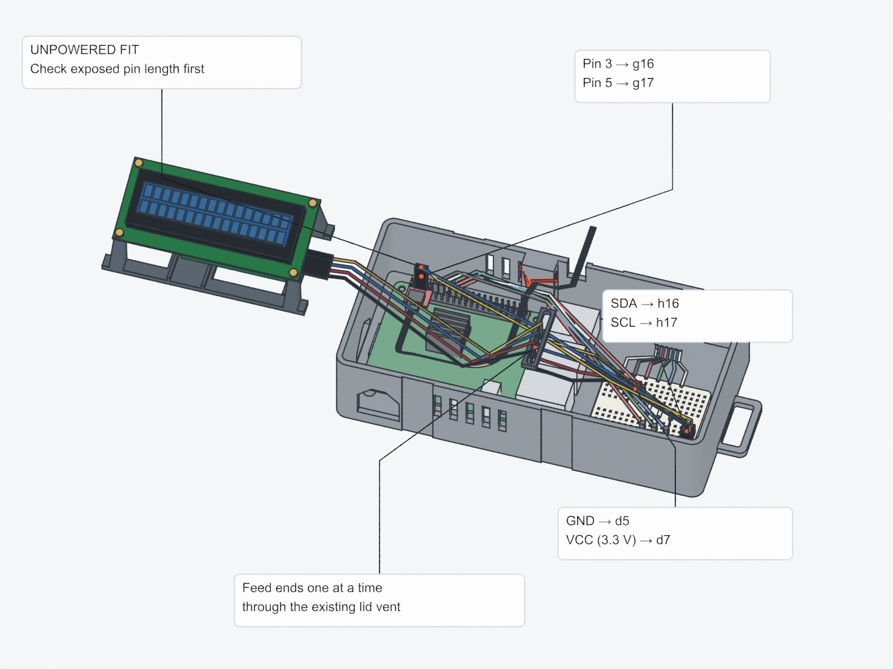

*LCD wiring: four leads through vent 3 to the breadboard and Pi pins 3 and 5, all at 3.3 V.*

#### Demo controls on a phone (no hardware; code: `/controls` page)

1. Use the demo operator's phone on the same Wi-Fi.
2. Open `/controls`. It is a hidden page, so no other page links to it.
3. A card at the top reads back what Maincloud holds now: status and elapsed time, the patient, whether CPR or
   vitals are overridden, demo or real timing. The last tap's result (sent, done, failed) shows under it.
4. Big buttons, grouped: **Incident** (Start, Arrest, ROSC, En route, Arrived, Close), **Overrides** (CPR slow
   90/min, CPR good 110/min, CPR live, Epi due now, Seizure on/off, Demo timing on/off), **Identify patient**
   (pick one of the five EHR patients), and **Reset for the next judge**, which needs a second tap within 4 s.
   Every button calls the existing `demo_control` or `synthesize_seizure` reducer; nothing new in the module.
5. The page keeps the screen awake while it's open.

Works when: Reset clears every screen in under 10 seconds.

#### Patient ID card and mock EHR (no wiring; code: vision read + FHIR server)

1. Make a synthetic ID card like a driver's licence: printed name, birth date and a photo. Print it, or show it
   on a spare phone like a digital ID. No QR code.
2. Tuck it in the patient teammate's pocket.
3. The vision sampler on the laptop takes about one frame a second from the live video, and one at once on
   "Handoff, look". The model reads
   the name and birth date, and the agent decides to search the EHR. Fallbacks: the medic says the name and birth
   date, or the demo operator picks the patient with "Identify patient" on `/controls`.
4. On the laptop, a small FHIR R4 server holds five synthetic patients: Patient, AllergyIntolerance,
   MedicationStatement and Condition records.

Works when: holding the card 20–50 cm from the chest camera shows "Jordan Avery, 58" with the allergy on the
hospital screen within about 5 seconds of showing the card (or of the spoken name).

#### Temperature probe (18B20; 3 jumpers; code: ~20 lines in the relay sender)

1. Three female–male jumpers, long enough to reach outside the box.
2. Module **S** → Pi **pin 7**. Module **middle (+)** → breadboard **row 7** (3.3 V). Module **−** → **row 5**
   (ground).
3. Leads out through **lid vent 2**; tape the module to the patient teammate's wrist, sensor side down.
4. Add `dtoverlay=w1-gpio` to `config.txt` and reboot. The probe appears as a folder starting `28-` under
   `/sys/bus/w1/devices`.

Works when: holding the probe warms the reading toward body temperature. No folder? Add a 4.7–5.1 kΩ resistor
between S and 3.3 V.

#### Smart med kit (stretch; code: sketch + Python)

1. Make a tray (cardboard or foam) with two vial holes; mark dummy vials "EPI DEMO" and "AMIO DEMO".
2. IR sensor under the EPI hole, light sensor under the AMIO hole, both facing up; temperature module inside the
   tray; display on the front edge.
3. No Base Shield, and the UNO Q has only one 3.3 V pin, so power goes through a small breadboard: one 3.3 V
   jumper and one GND jumper from the UNO Q to the breadboard.
4. Push male–male jumper pins into the free end of each Grove cable. All four modules' **red** (3.3 V) and
   **black** (GND) wires go to the breadboard.
5. IR sensor: **yellow → D2**. Light sensor: **yellow → A0**. Both go straight to the UNO Q, and their white
   wires stay unconnected.
6. The two I2C modules (temperature and display): join their **SDA (white)** and **SCL (yellow)** wires on the
   breadboard, then one jumper from the SDA row to the UNO Q's SDA and one from the SCL row to its SCL.
7. 7 Color Flash (optional): **S → D6**, **− → GND**, female–male jumpers straight onto the UNO Q's header pins.
   D6 HIGH = flashing; it cycles colours by itself.
8. Set up the UNO Q with Arduino App Lab, join Wi-Fi, load the sketch (sensors, display) and the Python part
   (sends to SpacetimeDB).

Works when: lifting the EPI vial logs a dose on the Mac and the display starts counting down. Timebox the UNO Q to
45 minutes; the ESP32-S3 can run the same sensors.

#### Patient cam (stretch, only after the core works; code: ~30 lines of Python)

1. Use the ribbon that came **in the camera box** (the Pi 5 cable doesn't fit a Pi 4).
2. Seat it in the Pi's camera port (between the HDMI ports and the audio jack), run it out through **lid vent 1**,
   and clip the camera beside the relay box, facing the patient.
3. A small script takes a still every second and sends it to be shown beside the live video.

Works when: the hospital screen shows the still beside the live video.

## 6. The demo station

The demo mixes explaining with hands-on. One judge becomes the paramedic and wears the harness; a teammate lies
on a mat as the patient. The ER host walks that judge through the hospital screen at the handoff. If more judges
come, they watch the hospital screen with the ER host. Each teammate has one job and one spot, and one of them
also lies down as the patient.

Layout from above (not to scale):

- **Scene (a mat).**
  - **Patient:** a teammate lying on the mat, finger clip on a finger, temperature probe on the wrist, ID card in a
    pocket. Both sensors go on before the arrest.
  - **Judge, the paramedic:** kneels beside the patient's chest, wears the harness (camera facing the patient),
    mimes CPR with hands above the chest (no contact), says the drug lines.
  - **Fitter:** beside the judge; harness and safety.
  - **Demo operator:** standing nearby with `/controls` on a phone; start, arrest, overrides, reset.
  - **Narrator:** facing the judge; pitch and cues.
  - **Relay box:** beside the patient, finger-clip cable to the patient's hand.
  - The med kit (stretch) would sit by the fitter if it gets built.
- **Hospital table (a few steps away).** The laptop on `/hospital` (live video, timeline, EHR record, Generate
  Handoff), the ER host, and a seat for extra judges, who watch the hospital screen.
- **"Transport":** the judge walks over to the hospital table for the handoff.

A CPR manikin could replace the teammate if one is available.


*The demo station: the patient is a teammate on a mat with the finger clip; the judge mimes CPR above his chest
(no contact); the demo operator holds the controls phone; the hospital dashboard runs on a laptop a few steps
away. Generated illustration.*

## 7. Demo storyboard

About three to five minutes. Each row is one beat. **Explain** beats: the team talks and shows. **Hands-on**
beats: the judge does it. ★ marks a wow moment.

> **Demo timing is compressed and says so.** Real epinephrine is every 3–5 minutes and CPR cycles are 2
> minutes. In demo mode the epi interval is 45 s and the cycle is 30 s; the narrator says so (the hospital
> dashboard no longer shows a "DEMO TIMING" tag, §14).

### In pictures

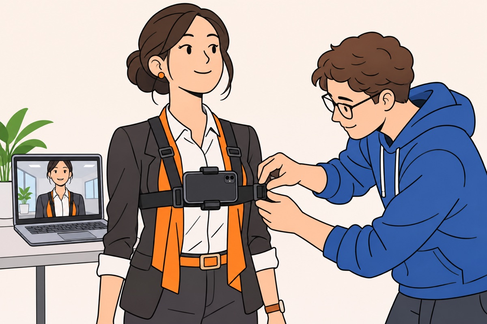

*1 · Suit up. A teammate fits the harness; the judge appears live on the hospital screen.*

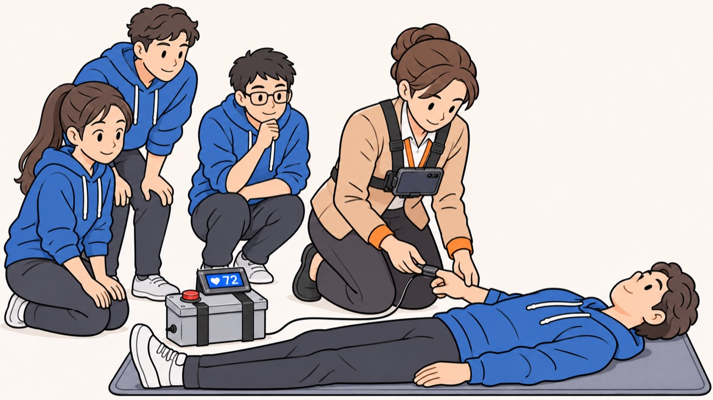

*2 · Your vitals. She clips the finger sensor onto the patient teammate's finger and tapes the probe to their
wrist; the heart rate appears on the relay's LCD.*

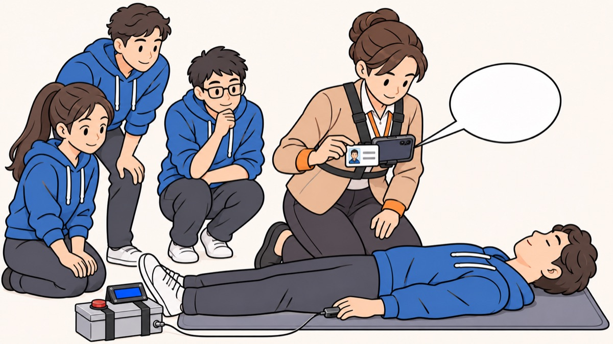

*3 · Who is it? She holds the patient's ID card to the chest camera; the AI reads the name and pulls the record.
Bodycam: "Record found. Jordan Avery, fifty-eight. Allergy: amiodarone."*

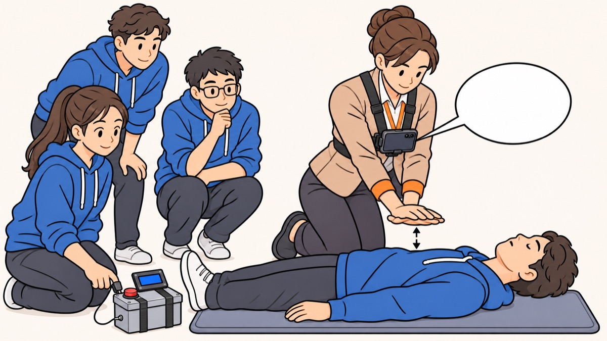

*4 · CPR. Mimed compressions: her hands hover above the teammate's chest, no contact. Bodycam: "Push faster."
Then the pause: "Resume compressions."*

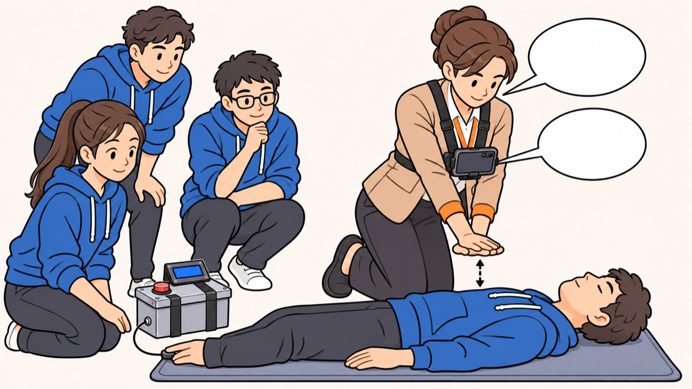

*5 · Drugs. Judge: "Administering one milligram of epi IO." Bodycam: "Copy. Epinephrine, one milligram, I-O."*

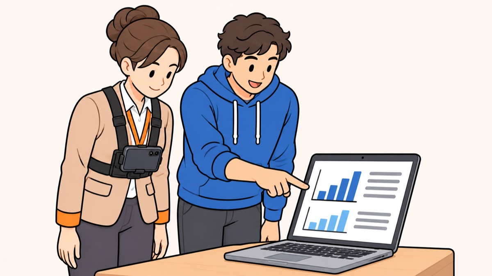

*6 · Handoff. At the hospital screen she reads her own handoff report, with her real CPR numbers and every line's
source.*

*Generated illustrations for the team; the speech bubbles are blank and the lines are in the captions.*

### Beat by beat (5-minute run)

| Beat | Kind | Team | Judge | Bodycam | Relay LCD | Hospital screen | Agent |
| --- | --- | --- | --- | --- | --- | --- | --- |
| 0:00 Hook | Explain | Narrator: the handoff problem and Handoff in one breath. Shows the harness and the relay box. "Today you're the paramedic." | Listens and looks at the harness. | | | Dashboard waiting. | |
| 0:40 Suit up | Hands-on | Patient teammate lies down on the mat. Fitter puts the harness on the judge. Demo operator starts the incident from `/controls`. | Wears the harness; the hospital screen shows live video from the chest camera. | Goes live; video flows to the hospital. | | Status ON SCENE. Live video from the chest camera starts. | |
| 1:00 Your vitals | Hands-on | Fitter hands the judge the finger clip and the temperature probe. | Clips the finger sensor onto the patient teammate's finger and tapes the temperature probe to their wrist. The patient's real heart rate appears on the LCD and the hospital screen within about 10 s. | | Shows the patient's HR, SpO₂ and temperature, with LINK OK. | Vitals tiles fill with the patient's real numbers. | |
| 1:20 Who is it? | Hands-on | Narrator: "Find out who your patient is: check their pocket, show the card to your camera, and say 'Handoff, look'." | Takes the ID card from the patient teammate's pocket, holds it 20–50 cm from the chest camera and says "Handoff, look" (or reads the name and birth date aloud). Hears the record summary. | ★ After about 3 s: "Record found. Jordan Avery, fifty-eight. Allergy: amiodarone. On warfarin." | | ★ The patient section fills from the EHR: name, age, allergies, medications, history, code status. | Reads the name and birth date off the card (or hears them), decides to search the EHR, pulls the record and queues the spoken summary; asks if more than one patient matches. |
| 1:45 Arrest and CPR | Hands-on | Demo operator triggers the simulated arrest from `/controls`. Narrator: "Your patient's heart just stopped. Hands above the chest, don't touch. Start compressions." | Kneels beside the patient and mimes compressions: stacked hands hover a few centimetres above the chest, no contact. | ★ "Push faster" if under 100/min; silent if in range. | | Status ARREST; CPR rate live in the vitals grid. The pre-arrival alert and the destination appear in the event timeline. | Picks the hospital, posts the alert. |
| 2:10 Pause | Hands-on | Narrator: "Stop, check for a pulse." | Stops and lifts their hands away. | ★ After 10 s: "Resume compressions." | | Timeline: "Compressions paused 10 s". | |
| 2:20 Drugs | Hands-on | Narrator hands over the line card. | Says "Administering one milligram of epi IO." Then "Giving three hundred milligrams of amiodarone." | ★ "Copy. Epinephrine, one milligram, I-O." Then: "Amiodarone, three hundred milligrams. Warning: the record lists an amiodarone allergy. Say confirm or correction." | | Next epi starts counting down when the dose is logged. The epi event appears in the timeline; the amiodarone attempt is flagged in soft red. | Logs the read-back (merging the camera's finding if the stretch is built); logs the allergy flag. |
| 2:40 Hospital screen | Explain | Narrator: "Transport." ER host walks the judge through the screen: the live video, the patient panel from the EHR, the vitals and the event timeline with the pre-arrival alert. Then points out the CPR numbers, the record's history and the source chips on the report. | ★ Clicks Generate Handoff and reads their own report on the hospital screen. | "Epi due" when the 45 s DEMO TIMING countdown ends. | | Status ARRIVED. The report shows the judge's own CPR numbers and the record's history, with a source chip on every line. | Writes the sourced report, with the EHR as a source. |
| 3:30 How it works | Explain | Narrator shows the system map: SpacetimeDB as the live backbone, the Nemotron voice agent and workflows, the mock FHIR EHR. | Listens. | | | Stays on the event timeline. | |
| 4:15 Q&A | Buffer | Narrator takes questions. | Asks questions. | | | | |

The 3-minute Standard cut runs Explain 0:00–0:25, Hands-on 0:25–2:05 (every beat, just faster), Hospital screen
2:05–2:40 and Q&A 2:40–3:00. It drops the "How it works" segment. The 5-minute run keeps it.

## 8. Running the demo

### Roles

| Role | Job |
| --- | --- |
| **Narrator** | Stands facing the judge. Tells the story in plain words, explains the system, and gives the cues ("Check their pocket", "Hands above the chest, don't touch", "Start compressions", "Stop, check for a pulse", "Transport"). Keeps time. |
| **Fitter and spotter** | Puts the harness on the judge in under 30 seconds (pre-sized to medium). Keeps the judge safe: CPR is mimed above the patient's chest and never touches it; harness off right away if it's uncomfortable. |
| **Demo operator** | Holds a phone with the hidden `/controls` page and runs the demo controls: Start, the simulated arrest, CPR overrides, identify patient, epi due now and reset. Quietly rescues any beat that misfires. Does not play a paramedic. |
| **Patient (a teammate)** | Lies on a mat with the finger clip on a finger, the temperature probe on the wrist and the ID card in a pocket. Can stop the demo at any time. Any free teammate, or the fitter once the harness is on. |
| **ER host** | Sits at the hospital table. Walks the judge through the hospital screen at the handoff: the live video, the record pulled from the EHR, the vitals and the event timeline with the alert. If more judges come, plays host to them and any extra ER role. |

### Versions

| Version | When | What happens |
| --- | --- | --- |
| **Full** (5 min) | The judge has time | The whole storyboard: explain, hands-on, hospital screen, how it works, then Q&A. |
| **Standard** (3 min) | The judge has about three minutes | Explain 0:00–0:25 (problem and product in one breath), hands-on 0:25–2:05 (suit up, vitals from the patient teammate, the ID card with "Handoff, look" and the EHR pull, mimed CPR with "Push faster", pause, epi read-back and amiodarone warning: nothing dropped, just faster), hospital screen 2:05–2:40 (record, live video, Generate Handoff), then Q&A 2:40–3:00. No architecture segment. |
| **Quick** (60 s) | The judge is rushed | A teammate already wears the harness. The judge shows the ID card and says "Handoff, look", hears the record, says the amiodarone line, hears the allergy warning, then clicks Generate Handoff. |
| **Hands-off** | A judge declines the harness | A teammate wears it; the judge watches the hospital screen with the ER host and clicks Generate Handoff. |

### Line card for the judge

Say these, in order:

- "Handoff, look." (after showing the ID card)
- Or say: "Patient is Jordan Avery, born March 14, 1968."
- "Administering one milligram of epinephrine IO."
- "Giving three hundred milligrams of amiodarone." (then say "Correction")

Bonus lines:

- "Giving ten milligrams of epinephrine." (dose check)
- "Shock delivered, two hundred joules."

Say the full drug names, slowly, with a short pause before and after the line. Live test Sat ~22:05: Riva heard
"epi" as "FEIO", "EBI" and "FPIO" and split "amiodarone" into "amino dirone"; the parser maps the known
mishearings and matches long names fuzzily, but "epinephrine" and "amiodarone" spoken in full are recognised
first time. The agent asks "Say again the drug." when it heard a dose but no drug it knows.

### What this adds to the build

| ID | Requirement | Done when |
| --- | --- | --- |
| D1 | Hidden demo controls page (`/controls`) on the demo operator's phone: Start, simulated arrest, ROSC, en route, arrived, close, CPR slow / CPR good / live, epi due now, seizure, demo timing, identify patient manually, **Reset for the next judge** (two taps). Built Sun ~01:00 | Reset clears every screen in under 10 s, devices stay connected |
| D2 | ~~Every spoken callout also appears in big text on the hospital screen~~ Dropped from the dashboard (Sat ~21:30, §14); callouts are spoken by the bodycam | — |
| D3 | The agent identifies the patient from the ID card or the spoken name and pulls the record (§17) | Record on the hospital screen within about 5 s of showing the card (or of the spoken name) |
| D4 | The report uses the judge's own run (average CPR rate, longest pause, compressions, doses) plus the record's history | Numbers match what the hospital screen showed |
| D5 | Demo timing switch: epi every 45 s, cycle 30 s | The narrator says it; no tag on the hospital dashboard (§14) |

Numbering note: the 15:36 copy and the old `AGENTS.md` had D1–D6, where D5 was a QR code on the report (dropped:
no QR codes) and D6 was demo timing (now D5). ROSC, Transport and Arrived are not on the D1 list (§28).

Built so far: the `demo_control` reducer already supports `start`, `arrest`, `rosc`, `en_route`, `arrived`,
`close`, `reset`, `cpr_slow` (forces 90/min), `cpr_good` (forces 110/min), `cpr_clear`, `epi_due_now`,
`identify` (default `pt-0001`) and `demo_timing` (`on`/`off`). Reset deletes every incident and its rows and
re-seeds the hospitals; `device` rows stay, so devices stay connected.

### Reset between judges (60 seconds)

1. The demo operator opens `/controls` and taps **Reset for the next judge**.
2. Put the ID card back in the patient teammate's pocket.
3. Wipe the harness straps with alcohol wipes.
4. Loosen the harness back to medium.
5. Phone: bodycam page full screen, volume up, battery above 50% (charge between groups).
6. `/controls` open on the operator's phone, laptop on `/hospital`, mock EHR and voice agent worker running, every
   page connected (`/hospital` shows "Connecting…" only while it isn't).

### Packing list

- Harness with the Pixel case; Pixel, charger, long cable
- Relay box, power bank, wall charger, finger clip
- Laptop and charger; power strip
- A mat (and a pillow) for the patient teammate; a mat for the judge's knees; the patient ID card (and a spare)
- Alcohol wipes, gloves, line cards, a "Prototype · synthetic data" sign
- Optional: a JBL Go 3 Bluetooth speaker from the MLH hardware lab, clipped to the harness, so callouts are loud
  enough in the hall

### If something misfires during a demo

| What happens | Who fixes it | How |
| --- | --- | --- |
| The AI can't read the card | Demo operator | Hold it closer and still, or say the name and birth date; last resort: Identify patient on `/controls`. |
| The mock EHR doesn't answer | Demo operator | The agent falls back to the cached copy of the synthetic record; say so honestly if asked. |
| The judge's CPR is already in range, so "Push faster" never fires | Narrator | That's fine: "you're in range, it stays quiet". The pause beat always triggers "Resume compressions". |
| Speech-to-text misses a drug line | Demo operator | Ask the judge to repeat once. If the camera-drugs stretch is built, the camera seeing the push still logs the dose. |
| CPR isn't detected (phone loose, or the mimed motion is too small) | Demo operator | Ask the judge for bigger movements, or use the CPR override on `/controls` ("CPR slow" or "CPR good"); the fitter tightens the harness. |
| The voice agent goes quiet or lags | Nobody (automatic) | Degraded mode takes over: rule callouts and the phone read-back (§23). Say so honestly if asked. |
| The hall is too loud to hear the bodycam | Narrator | Point at the big callout text on the hospital screen; use the Bluetooth speaker. |
| Wi-Fi drops | Demo operator | Switch to the hotspot; if it's still down, play the backup demo video. |

## 9. Incident lifecycle

The incident's status decides which rules are active, so the bodycam never coaches CPR when nobody is doing it.

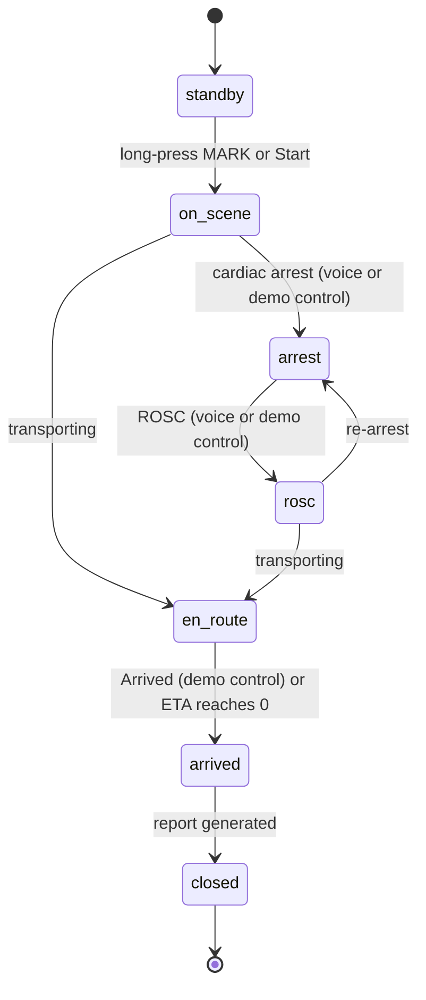

| Status | Active rules and timers | ER messaging |
| --- | --- | --- |
| `standby` | None. Screens show "no incident". | None |
| `on_scene` | Vitals alarms (SpO₂, HR), finger-sensor check | None yet |
| `arrest` | CPR rate and pause callouts, 2-minute cycle, epi timer. Vitals alarms off (no pulse expected). | Destination chosen, pre-arrival alert |
| `rosc` | Vitals alarms back on; CPR rules off | ROSC update |
| `en_route` | Vitals alarms; ETA countdown | Update if ETA moves by more than 3 minutes |
| `arrived` | None; report generation | Report summary |
| `closed` | None; the record is read-only | None |

As built: `standby` means there is no active incident (no row). Starting an incident (`start_incident`, demo
Start, or the relay's 2 s hold) creates one in `on_scene` with DEMO TIMING on. Entering `arrest` starts the cycle
timer and resets the CPR stats for this arrest; leaving it cancels the timers. `set_status` and `demo_control`
allow any transition, so the demo can force every beat. `tick_rules` moves `en_route` to `arrived` when the ETA
reaches 0. `save_report` closes the incident.

---

## Part C · The pieces

## 10. Bodycam

A web page in Chrome on the Pixel 9 Pro, in the printed case on the chest harness. It sees, hears, feels the
rescuer's compression motion through the phone's motion sensor, and talks with the medic through the voice
agent.

| Phone part | On the phone | Goes to |
| --- | --- | --- |
| Camera | Live video (WebRTC, peer to peer to `/hospital`); the same camera also rides on the link to the voice worker | Video: the hospital page, handshake in `rtc_signal`. Vision: the worker's sampler takes ~1 frame/s from its link (§19, decision 20) |
| Microphone | WebRTC audio to the voice agent worker, echo cancellation on. Degraded mode: Web Speech API, continuous, restarts itself on end or error, one row per sentence | Voice agent worker → `transcript`. Degraded mode: `add_transcript` from the phone |
| Motion sensor | CPR detector (self-tested, in `web/src/cpr/`): band-pass, peak timing → rate, count, paused; plus timing against the metronome beat (decision 21) | `cpr_state`, written twice a second (`push_cpr`, `push_cpr_assist`) |
| Speaker | Plays the voice agent's audio. Degraded mode: phone read-backs first, then `callout` rows by priority, one at a time, with on-device TTS or cached audio | `callout_spoken` after a rule callout is spoken |

**Screen (mockup), readable at arm's length:**

- Top bar: green dot "LIVE · Medic 12" on the left, "ARREST 06:42" on the right.
- Camera preview.
- CPR panel: "CPR RATE" with a large green number (112) and "in range · 1:34 into the cycle".
- Amber card: what is being spoken now, e.g. "Speaking: 'Epi due'". Read-backs get a big card (RB6).
- One line of transcript: "Heard: '…one milligram epi in through the IO…'".
- Two big buttons: MARK and LOOK.

| ID | Requirement | Done when |
| --- | --- | --- |
| B1 | Tap-to-start grants camera, mic and motion, then holds a screen wake lock | One tap; screen stays on 10 min |
| B2 | Streams continuous live video to the hospital (WebRTC). The camera also rides on the WebRTC link to the voice worker, which samples it for vision (§19, decision 20); the phone uploads no frames to SpacetimeDB | Video plays on the dashboard within 3 s of tap-to-start; under 1 s delay |
| B3 | Mic audio goes to the voice agent worker over WebRTC with echo cancellation on; its streaming STT writes transcript lines. Degraded mode: continuous Web Speech STT with auto-restart on the phone | A sentence appears on the dashboard within 3 s (both paths) |
| B4 | CPR rate, count and pause from the rescuer's own motion, so mimed compressions count. If the mimed motion is too small to detect, the demo operator uses the CPR override on `/controls` | Within ±5/min of a 110 metronome |
| B5 | Plays the voice agent's speech. Degraded mode: speaks unspoken `callout` rows (lowest priority number first) with on-device TTS or cached audio, then calls `callout_spoken` | "Push faster" heard within 2 s of the rule firing |
| B6 | Voice shortcuts "Handoff, mark" and "Handoff, look" (heard by the voice agent; by the phone in degraded mode) | Creates a MARK event, or makes the vision sampler grab a frame at once |
| B7 | Glanceable screen (mockup above) | Readable at arm's length |
| B8 | Rear camera (decided 15:00); front camera stays as a fallback | The case is set up for rear |
| B9 | Survives network drops: queues writes, reconnects | 30 s with Wi-Fi off loses no transcript lines |
| B10 | Medication read-back (§16): spoken by the voice agent with deterministic dose and allergy checks (the brain's parser is the first hop, decision 18); the phone-side parser is the degraded-mode path | "Copy. Epinephrine, one milligram, I-O." within 1 s on the phone path; within about 1.2 s on the agent path |
| B11 | Switches to on-device mode when the voice pipeline drops (network, STT, LLM or TTS) and back when it recovers. Trigger: the phone speaks `callout` rows itself whenever its audio link to the voice worker is down (decision 18) | Stop the worker mid-demo: the next "Push faster" is still heard within 2 s |

Reference code to port lives on the `hardware` branch in `hardware/software/phone/` (camera enumeration and zoom
probe, the CPR detector with self-tests in `dsp_selftest.js`, a Web Speech speaker test, wake lock, a 100–120/min
metronome). Detector output contract: §22.4.

## 11. Vitals relay and wiring

The printed box beside the patient: a Raspberry Pi 4 with the finger clip, a new temperature probe, the MARK
button and its light ring. Its existing sensor code stays; a small new sender batches readings to SpacetimeDB. An
I2C LCD1602 in a printed pod on the lid shows the vitals right on the box.

**Everything on the Pi runs at 3.3 V. Nothing in the build uses the 5 V pins.**

### The box from above: what goes in and out

The box is 158 × 78 mm (to scale from the CAD). Every new wire leaves through a vent that is already printed, so
nothing gets reprinted.

- **Rear (finger side):** the FINGER notch, where the finger-clip cable leaves. Two straps cross the box.
- **Front (USB-C side):** the USB-C opening for power in.
- **Inside:** the Pi 4 on the left half (header along the rear edge with the Qwiic SHIM on pins 1–6; USB and
  Ethernet at the right end of the Pi; camera port near the front); the mini breadboard on the right (rows 3–13
  for the button and ring, plus rows 16–17 for the LCD).
- **In the lid:** the MARK button above the breadboard, and four vents in a row above the Pi.
- **LCD pod** (87 × 46 mm) on the lid's left end, under the left strap, which passes over the pod's spine. Glue
  caps hold the board.

| What leaves the box | Through |
| --- | --- |
| LCD leads (4) | Vent 3 |
| Temperature probe leads (3) | Vent 2 |
| Camera ribbon (stretch) | Vent 1 |
| Finger cable | FINGER notch |
| (nothing) | Vent 4 stays open for air |
| Power | USB-C opening |

Port positions are approximate; box, vents and straps are to scale.

### Pi header: every pin we use

The Qwiic SHIM covers pins 1–6; the pins still poke through. Pin 1 is the square pad at the microSD end of the
header. Odd pins are on the inner row, even pins on the board edge.

| Pin | Signal | Goes to |
| --- | --- | --- |
| 1 | 3.3 V | Qwiic SHIM |
| 2 | 5 V | Unused: nothing needs 5 V |
| 3 | SDA (GPIO2) | SHIM + breadboard row 16 (LCD SDA) |
| 4 | 5 V | Unused |
| 5 | SCL (GPIO3) | SHIM + breadboard row 17 (LCD SCL) |
| 6 | GND | SHIM |
| 7 | GPIO4 | Temperature probe S (1-Wire data) |
| 9 | GND | Breadboard row 5 (ground) |
| 11 | GPIO17 | Row 3 → MARK switch |
| 15 | GPIO22 | 220 Ω → ring red |
| 16 | GPIO23 | 220 Ω → ring green |
| 17 | 3.3 V | Row 7 → ring common +, probe +, LCD VCC |
| 18 | GPIO24 | 220 Ω → ring blue |

| Device | Wiring |
| --- | --- |
| Finger clip (MAX30101) | SHIM socket → 500 mm Qwiic cable → MAX30101. I2C **0x57**. Shares the bus with the LCD |
| Temperature probe (18B20 module) | S → pin 7 · middle (+) → row 7 · − → row 5. Turn on 1-Wire with `dtoverlay=w1-gpio` (GPIO4 is the default). No reading? Add a 4.7–5.1 kΩ resistor from S to 3.3 V |
| LCD1602 (PCF8574 backpack), I2C **0x27** or **0x3F**, in the printed `lcd1602_pod` | VCC → row 7 (3.3 V only, never 5 V) · GND → row 5 · SDA → row 16 (with pin 3) · SCL → row 17 (with pin 5). Holes: VCC d7, GND d5, SDA h16, SCL h17, Pi pin 3 → g16, pin 5 → g17 |
| OLED fallback (0.96", GME12864, SSD1306), I2C **0x3C** (scripts also try 0x3D) | Same four wires and rows as the LCD |
| RGB ring | Common + to 3.3 V (pin 17 via row 7); red/green/blue through 220 Ω to pins 15/16/18. Driven **LOW to light** |

**Check before wiring the LCD:** pins 3 and 5 sit under the SHIM. A female jumper needs about 4 mm of bare metal
above it. If not, use a second I2C bus on GPIO5/6 instead. `i2c_scan.py` should list 0x57 and 0x27 (or 0x3F).

### Mini breadboard row map

The breadboard has two halves (holes a–e and f–j) split by a centre gap. Holes in the same row and half are
connected. Exact holes are in manual step 5.25.

| Row | Left half (a–e) | Across the gap | Right half (f–j) | Meaning |
| --- | --- | --- | --- | --- |
| 3 | Button switch wire · Pi pin 11 | — | — | GPIO17 · MARK |
| 5 | Button switch wire · Pi pin 9 · probe − · LCD GND | — | — | ground |
| 7 | Button ring common + · Pi pin 17 · probe + · LCD VCC | — | — | 3.3 V |
| 9 | Button ring red | 220 Ω resistor | Pi pin 15 | red |
| 11 | Button ring green | 220 Ω resistor | Pi pin 16 | green |
| 13 | Button ring blue | 220 Ω resistor | Pi pin 18 | blue |
| 16 | — | — | LCD SDA · Pi pin 3 | I2C data |
| 17 | — | — | LCD SCL · Pi pin 5 | I2C clock |

### Light ring and button

| Ring | Meaning |
| --- | --- |
| Blue, pulsing | Connecting |
| Green | Streaming |
| Amber | No finger in the clip |
| Red flashes | Alarm or error |
| White blink | MARK registered |

- Short press: MARK (a timestamped flag; say what it was for).
- Hold 2 s: start or end the incident.
- Works with the lid closed.

| ID | Requirement | Done when |
| --- | --- | --- |
| R1 | HR and SpO₂ from the finger clip; SpO₂ is treated as experimental (no label on the hospital dashboard, decision 10) (optical sensors like ours read less accurately on darker skin, which the team noticed) | HR within ±5 bpm of a fingertip oximeter |
| R2 | Temperature from the probe every 2 s | Within ±0.5 °C of a reference |
| R3 | Sender batches to SpacetimeDB: numbers once a second, waveform in 200 ms batches | Waveform scrolls smoothly with under 1 s lag |
| R4 | No valid reading sends an empty value plus a status, never a stale number | Finger off: the hospital vitals show "—" (no data) within 5 s |
| R5 | MARK short press and 2 s hold as above | Both work with the lid on |
| R6 | Ring colours as above | Visible from 2 m |
| R7 | Simulated mode (exists today) | The demo runs with no Pi |
| R8 | The existing WebSocket stream to `receiver.py` keeps working for bring-up (§22.3) | Old tools still pass |

Relay contracts: HTTP to SpacetimeDB in §22.2, WebSocket bring-up format in §22.3. Pi setup and gotchas: §24.4.

## 12. Relay screen (LCD1602)

The relay box has one small screen: an I2C LCD1602 (16 characters by 2 lines) in a printed pod on its lid. It
gives the paramedic a quick readout of the key numbers, even with no network. The hospital screen is the big
display, and the bodycam speaks everything else. There is no tablet and no monitor page.

```
HR  72  SpO2  97
pulse    LINK OK
```

Blue backlight, about 64 × 14 mm of visible screen on an 80 × 36 mm board.

| ID | Requirement | Done when |
| --- | --- | --- |
| L1 | Shows HR, SpO₂, temperature or status, and link; updates twice a second and rewrites only the lines that changed | Numbers change within 1 s of the sensor |
| L2 | Wiring at 3.3 V: VCC to row 7, GND to row 5, SDA to row 16 and SCL to row 17 (Pi pins 3 and 5); leads through lid vent 3 | `i2c_scan.py` shows 0x27 (or 0x3F) |
| L3 | Fallback: the 0.96-inch OLED on the same four wires, or leave the screen out. Never 5 V | The relay still runs without a screen |

The monitor-page requirements M1–M6 from the 15:36 copy are retired (no monitor page). Wiring is in §11 and the
build card in §5. Existing code on the `hardware` branch: `lib/lcd1602.py`, `test_lcd.py`, and
`test_max30101.py --lcd` / `stream_test.py` already show live HR on the LCD; `lib/oled.py` and `test_oled.py` for
the fallback.

## 13. Smart med kit (stretch)

A tray with two vial slots that documents medication draws on its own. Lifting a vial is the event; nobody
touches a screen. It also watches drug-storage temperature, a real problem in hot ambulances, and counts down to
the next dose.

> **Stretch goal: only if there's time.** Decided Sat 15:55. Without the kit, every dose is still logged by the
> spoken read-back and the camera reading the label. Build it only after the core demo works end to end.

Layout and wiring:

| Tray position | Sensor (Grove) | UNO Q pin | Detects |
| --- | --- | --- | --- |
| Under the EPI slot | IR reflective | D2 | Vial present? |
| Under the AMIO slot | Light sensor | A0 | Vial present? |
| Inside the tray | Temperature + barometer | I2C | Storage temperature |
| Front edge, facing the medic | 0.54" quad alphanumeric (HT16K33, I2C) | I2C | Shows the countdown (minutes and seconds) and `DUE` |
| On the tray (optional) | 7 Color Flash | D6 + GND | Flashes when a dose is due |

The UNO Q has no Base Shield; it uses jumpers and a small breadboard (shared 3.3 V, GND, I2C), Wi-Fi from its
Linux side, and power from a USB-C bank.

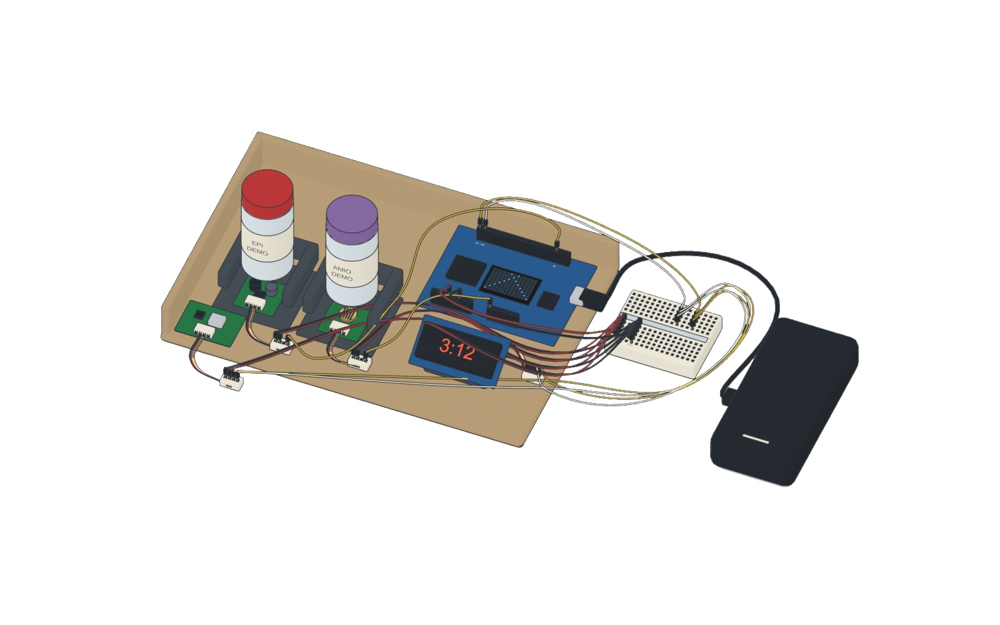

*Concept render of the med kit. The countdown shows minutes and seconds.*

> **No Base Shield (confirmed).** The UNO Q has only one 3.3 V pin, so power goes through a small breadboard: one
> 3.3 V jumper and one GND jumper from the UNO Q to the breadboard. Push male–male jumper pins into the free end
> of each Grove cable. Grove wire colours: black = GND, red = power (use 3.3 V), yellow = signal (SCL on I2C),
> white = second signal (SDA on I2C). All four modules' red and black wires go to the breadboard. The IR and
> light sensors connect their yellow wire straight to D2 and A0, and their white wire stays unconnected. The
> temperature module and the display (both I2C) join their SDA (white) and SCL (yellow) wires on the breadboard,
> with a single jumper each to the UNO Q's SDA and SCL.

### How a slot decides "dose drawn"

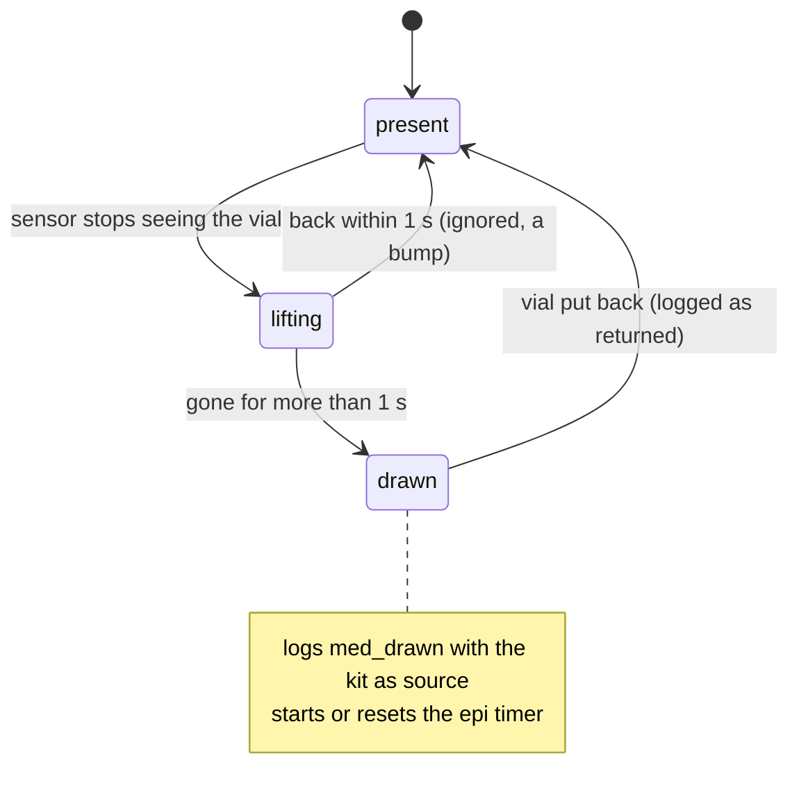

| ID | Requirement | Done when |
| --- | --- | --- |
| K1 | EPI slot: vial lifted for more than 1 s logs "Epinephrine 1 mg drawn" (source: kit) | Logged within 2 s; putting it back logs "returned", not a second dose |
| K2 | AMIO slot: same (amiodarone 300 mg first, 150 mg second) | Same |
| K3 | Storage temperature every 10 s; outside 15–30 °C shows a warning on the dashboard (not spoken) | Warming the sensor in a hand triggers it |
| K4 | Display shows the shared epi countdown (`3:12`), `DUE` when due, `----` with no incident | Matches the hospital screen |
| K5 | Dose due: display blinks `DUE`. Optional: the 7-colour flash LED on a free port | — |
| K6 | If offline, buffers events and replays them with their original times | 20 s with no network: events still land at the right times |
| K7 | Fallback host: ESP32-S3 if the UNO Q setup stalls for more than 45 min | — |

Physical build: a cardboard or foam tray, two dummy vials marked "DEMO", sensors under the slots, the display
facing the medic. The `kit_slot` table and `kit_update` reducer are not built (§22).

## 14. Hospital dashboard

What the ER sees, on the Mac and any second screen. Judges see the agent act through the event timeline. Its only button
is **Generate Handoff**. No demo controls here.

**Layout (five panels, Sat ~21:30; Alan's sketch; the code in `web/src/routes/hospital/` is the reference):** fits
1440×900 without scrolling. Dark, quiet panels in the style of the Pipecat Playground; Inter.

| Left | Right |
| --- | --- |
| **Live view** (large): the bodycam video, click to enlarge. Before the first frame, a halftone heart floats slowly in the panel (Canvas UI's Dithered Object, loaded only then); on stale the last frame stays under the Stale badge. When the report is ready it opens here, with a Live view / Report switch | **Status:** the status word, centred, on a tint of the status colour (soft red arrest, blue on scene / en route, green ROSC) |
| | **Vitals:** a 2×3 grid of centred stat cards (big number, small spaced monospace caption under it, after canvasui.dev): heart rate, SpO₂, temperature, CPR rate, next epi, elapsed. HR and SpO₂ show "—" during an arrest (§9); CPR rate and next epi show "—" outside one. Out-of-range values in soft red (§15 thresholds) |
| **Event timeline:** newest first, time and label; flagged events in soft red; the alert sent to the ER is a row. **Generate Handoff** (the only action) sits in this panel's header | **Patient** ("from EHR" or "cached copy" in the title): name and age, the allergy on a soft red tint, then code status, medications, history |

Panel titles use the same small monospace caption style. Nothing explains itself on screen, and nothing moves
except clocks, live values and the placeholder heart before video. Not on the dashboard any
more (the data is unchanged): route and ETA, the agent's tool-level trace, source chips (still in the report),
trend lines and the pulse waveform, the big spoken-callout text, and the simulated / demo-timing marks.

| ID | Requirement | Done when |
| --- | --- | --- |
| H1 | Status, coloured by state, top right | — |
| H2 | Continuous live video from the bodycam with a "live / stale" indicator; on stale it asks the bodycam for a fresh offer (§22.5) | Shows stale after 3 s without video |
| H3 | Vitals grid: heart rate, SpO₂, temperature, CPR rate, next epi, elapsed | A missing reading shows "—", never a stale number; "Epi due" matches the bodycam to the second |
| H4 | Event timeline, newest first; source chips with evidence on hover live in the report (§20) | Every demo event appears; the epi event has its read-back source in the report (a second, `seen`, only if the camera-drugs stretch is built) |
| H5 | Agent trace: not on the dashboard; the agent's results (destination, alert) appear as timeline rows | Judges can see the agent act from the timeline |
| H6 | Pre-arrival alert, display-only, as a timeline row (a typed ER chat is optional) | Alert appears within 20 s of the arrest |
| H7 | Generate Handoff opens the report (§20) | Full report within 30 s |
| H8 | Demo controls (the `/controls` page, not this dashboard): start, simulated arrest or deterioration, ROSC, en route, arrived, reset | Every demo beat can be forced if a sensor fails |
| H9 | Patient panel: name, age, allergies (highlighted), code status, medications, history; the title says "from EHR" or "cached copy" | Fills within about 5 s of showing the ID card |

---

## Part D · The intelligence

## 15. Callout rules

Callouts are **agent-driven, with rules as the policy layer and the safety net.** The voice agent (§19) watches
the live state and decides when to speak. Every rule below still runs inside SpacetimeDB once a second
(`tick_rules`), as plain code, not an AI call, and queues a `callout` row when it fires. Those rows are the safety
net (a rule callout must be heard even if the agent stays quiet) and the only source in degraded mode, when the
phone speaks them itself. The agent's speech goes into the same `callout` queue, so one spacing policy covers both
(§0.1 decision 18). These thresholds are proposed defaults to tune with a mimed run.

**Example (illustrative data, first 40 s of an arrest):** the rate dips below 100 at about 7 s; the rule waits 5 s
so a single slow beat doesn't trigger it, and "Push faster" fires at 12 s. The medic corrects, so the 10-second
repeat never fires. Compressions stop at 28 s; after 10 s of pause, "Resume compressions" fires at 38 s. Target
band: 100–120/min.

| When | Spoken | Priority | Repeat no sooner than |
| --- | --- | --- | --- |
| Medication or shock statement heard (§16) | "Copy. Epinephrine, one milligram, I-O." | P0 | once per statement |
| Patient record pulled (§17) | "Record found. Jordan Avery, fifty-eight. Allergy: amiodarone. On warfarin." | P2 | once |
| Arrest and CPR rate under 100 for 5 s | "Push faster" | P1 | 10 s |
| Arrest and CPR rate over 120 for 5 s | "Slow down" | P2 | 10 s |
| Arrest and no compressions for 10 s | "Resume compressions" | P1 | 10 s |
| Arrest, the phone's CPR assistance is armed but waiting for the finger sensor, for 3 s (decision 21) | "Place the finger sensor" | P2 | 20 s |
| Arrest, rate 100–120 but under 60 % of compressions on the metronome beat, for 5 s (decision 21) | "Follow the beat" | P2 | 15 s |
| Two-minute cycle elapsed | "Two minutes. Rhythm check, switch compressors." | P2 | once per cycle |
| Epi timer due (4 min default, 3–5 settable; 45 s in demo mode) | "Epi due" | P2 | 60 s |
| Not in arrest, SpO₂ under 90 for 10 s | "Oxygen saturation eighty-eight" | P2 | 30 s |
| Not in arrest, HR under 50 or over 150 for 10 s | "Heart rate one fifty-five" | P2 | 30 s |
| Finger clip off while monitoring | "Check finger sensor" | P3 | 60 s |
| ER asks something the record can't answer (optional ER chat) | "ER asks: allergies?" | P3 | once |

**Across all rules and the agent (the policy layer):** at most one callout every 4 seconds (read-backs are
exempt); P1 jumps the queue but never cuts off another P1; the same words are never queued twice; never talk over
the medic. Numbers are spoken in words. Callouts also appear on the bodycam screen;
the hospital screen no longer shows them (D2). The Mac speakers are the last fallback if the phone can't speak.

As built in `spacetime/src/rules.ts`: one callout per tick at most, lowest priority number first; the 4 s spacing
counts every queued callout except P0; CPR data counts only if the bodycam reported in the last 3 s (or a demo
override is on); vitals count only if the relay reported in the last 5 s with status `pulse`; vitals alarms run in
`on_scene`, `rosc` and `en_route`; "Check finger sensor" needs 5 s of `no finger` after a pulse was seen in this
incident; the two CPR-assistance rules need a `push_cpr_assist` from the last 3 s (`cpr_state.assistAt`) and no
override (armed but `assist` false = waiting for the sensor); unspoken callouts older than 20 s are deleted so stale words are never spoken; a fired CPR or vitals
rule also writes a timeline event (cited as `demo` and labelled "(SIMULATED)" when it came from an override or
simulated data, §28). The "ER acknowledged" callout does not exist.

## 16. Medication read-back

When the paramedic says a medication out loud, the bodycam repeats it back right away, like a "roger that".
Resuscitation teams already do this with each other (closed-loop communication): it catches wrong drugs, wrong
doses and milligram/microgram mix-ups before they're charted.

"Administering one milligram of epi IO." → **"Copy. Epinephrine, one milligram, I-O."** Units are always said in
full and numbers in words, so "micrograms" can never sound like "milligrams".

### How it runs now (voice agent)

The medic's speech reaches the voice agent worker over the WebRTC audio link. As built (`voice/`, decision 18),
the brain's deterministic parser recognises the medication statement as soon as the final transcript arrives,
runs `check_dose_range` and `check_allergy`, speaks the read-back (or the warning) and logs the event. No model
call is in that path; Nemotron never logs a medication. Voice-to-voice latency is the STT end-of-turn plus TTS.

**Guardrail 1: doses and allergies are deterministic.** `check_dose_range` (RB4) and `check_allergy` (RB7) are
tools with fixed answers from a fixed table and the pulled record. The model only speaks their result. It never
freelances a clinical judgement like "that's fine".

**Guardrail 3: read-back latency.** On the agent path the read-back starts after about 1 s (streaming STT
end-of-turn, then TTS), instead of ~0.6 s on the phone. Decided (decision 18): the brain is the first hop and the
phone parser is the degraded fallback, so there is one read-back, not two. The echo guard (RB5) is needed either
way, on top of WebRTC echo cancellation.

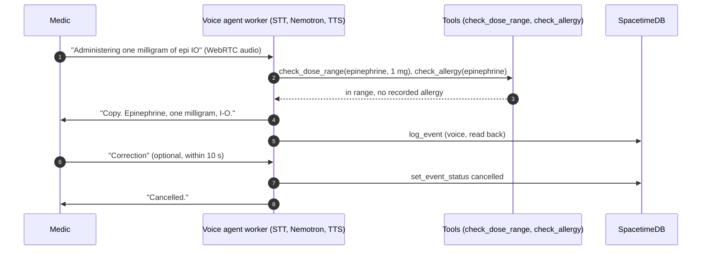

### The phone-side path (degraded mode, and the possible first hop)

Used when the voice pipeline is down, and possibly as an instant first hop (see above).

- Runs entirely **on the phone**: a small built-in parser, no AI call and no server round trip before speaking.
- Speaks with the phone's **on-device voice**, warmed up at tap-to-start.
- Fires as soon as the recognizer's words have been stable for 0.4 s with a full drug + dose match, instead of
  waiting for it to finish.
- Saving the event and the agent's checks happen **after** it speaks.

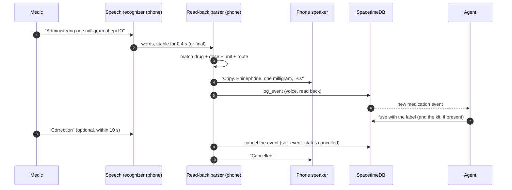

**Latency budget, phone path** (estimates from the end of the medic's sentence; measure them on the Pixel):

| Step | Time |
| --- | --- |
| Recognizer settles | 0.3–0.7 s (varies with network) |
| Parse on the phone | under 5 ms |
| On-device voice starts | 0.1–0.25 s after the parse; audio by ~0.6 s |
| "Copy. Epinephrine, one milligram, I-O." | about 2 s of speech |
| In parallel: saved, hospital sees it | ~0.3–0.5 s |
| Target | read-back audio starts within 1 s |

If the recognizer is too slow on the hotspot, a streaming STT service with short end-of-speech detection can
replace it; the parser and voice stay the same.

### Examples (both paths)

| Medic says | Bodycam says | Logged |
| --- | --- | --- |
| "Administering one milligram of epi IO" | "Copy. Epinephrine, one milligram, I-O." | Epinephrine 1 mg IO (read back) |
| "Giving three hundred of amio" | "Copy. Amiodarone, three hundred milligrams." | Amiodarone 300 mg (unit assumed) |
| "Pushed point four of Narcan intranasal" | "Copy. Naloxone, zero point four milligrams, intranasal." | Naloxone 0.4 mg IN |
| "Shock delivered, two hundred joules" | "Copy. Shock, two hundred joules." | Shock 200 J |
| "Giving three hundred milligrams of amiodarone" | "Amiodarone, three hundred milligrams. Warning: the record lists an amiodarone allergy. Say confirm or correction." | Flagged until "confirm" or "correction" |
| "Epi ten milligrams" | "Epinephrine, ten milligrams. Outside the protocol range. Say confirm or correction." | Flagged until "confirm" |
| "Giving epi" | "Epinephrine. Say again the dose." | Nothing yet |
| "Did we give epi yet?" · "Get the epi ready" | (silent: a question or a plan, not a dose) | Nothing |
| "Correction" (within 10 s) | "Cancelled." | The last read-back is cancelled (kept in the audit trail) |

### The parser (phone path) and the matching rules (both paths)

- **Verb:** administering, giving, given, gave, pushing, pushed, "… in" ("epi in").
- **Drug list with nicknames:** epi/adrenaline → epinephrine, amio → amiodarone, Narcan → naloxone, nitro, D50,
  bicarb, and so on. Common mishearings map too.
- **Dose:** digits or words ("one", "point four", "three hundred").
- **Unit:** mg, micrograms, grams, mL, units, joules. If missing, the drug's usual unit is assumed and said aloud
  so the medic can correct it.
- **Route (optional):** IV, IO, IM, intranasal, sublingual.
- Questions ("did", "should", "do we") and plans ("get ready", "draw up") never trigger.

### Guards

- **Echo guard:** while the bodycam is speaking and for 0.7 s after, it only listens for "correction", "cancel"
  and "confirm", so it never logs its own read-back. WebRTC echo cancellation stays on as well.
- **Dose check** against a small demo table (epinephrine 0.3–1 mg, amiodarone 150–300 mg). Outside it, the
  read-back asks for confirm or correction. Other drugs are read back without a check.
- **Priority:** read-backs jump the callout queue and skip the 4-second spacing, but never cut off a "Push
  faster".
- **Kit cross-check** (only if the med kit is built; agent, after the fact): voice says amiodarone but the kit saw
  the EPI vial lifted → a quiet flag on the dashboard.

### Drugs the camera sees

**Stretch** (§0.1 decision 16, since the 19:31 meeting). The MVP logs medications from the voice read-back.
Build the camera side only after the core flow works. When built, medications are logged from what the camera sees
as well as from what the medic says.

- **What counts as "given":** the vision model reads the drug on a vial or syringe label (and the dose if it's
  printed, e.g. a prefilled "1 mg/10 mL" syringe) **and** sees it being given: a push into an IV/IO line, an
  injection, or a nebuliser mask going on. A vial that is only held or drawn up is not a dose; its label alone
  just adds a `label` source to a spoken dose inside the merge window (§18).
- **Seen and said:** the camera finding fuses with the read-back event inside the merge window. One event, with
  chips for read-back and `seen`.
- **Seen, not said:** the event is still logged with the frame as evidence (label = the drug name, status
  `flagged`). The dose comes only from the label; it is never guessed. The voice agent asks once, "Saw
  epinephrine. What dose?" (P2, 8 words or fewer, keeps the 4 s spacing). A spoken dose within 30 s merges in and
  confirms it. Otherwise the event stays flagged, and the report says "dose not stated".
- **Safety checks still run:** a drug the camera sees goes through the same deterministic `check_allergy` and
  `check_dose_range` tools. Seeing amiodarone given to a patient with an amiodarone allergy triggers the RB7
  warning even if nobody spoke.
- **Timing:** vision samples the live stream about once a second, so a push that lasts a few seconds is caught.
  "Handoff, look" grabs a frame at once.
- **Props:** dummy vials and syringes carry large printed labels, e.g. "EPINEPHRINE 1 mg · DEMO", so the camera
  can read them at chest distance.

| ID | Requirement | Done when |
| --- | --- | --- |
| RB1 | Detects medication statements (verb + drug + dose), ignores questions and plans | 9 of 10 test sentences trigger; 0 of 10 questions do |
| RB2 | Reads back: "Copy. Drug, dose in words, unit in full, route." On the phone path, with no network wait | Phone path: audio starts within 1 s of the sentence ending (Wi-Fi off still works if recognition already returned). Agent path: within about 1.2 s (the brain's parser, no model call; measure with the Riva pipeline) |
| RB3 | "Correction", "cancel that" or "scratch that" within 10 s cancels; "confirm" confirms | Spoken "Cancelled." / "Confirmed." |
| RB4 | Dose check for epinephrine and amiodarone, deterministic (`check_dose_range` tool on the agent path, the same table on the phone) | "Epi ten milligrams" asks for confirm |
| RB5 | Echo guard | The read-back never creates a second event |
| RB6 | Shows a big read-back card on the bodycam screen and a "read back" chip on the hospital timeline | Visible on both within 1 s |
| RB7 | Allergy check against the pulled record, deterministic (`check_allergy` tool; the same check on the phone): if the drug matches a recorded allergy, the read-back says so and asks for confirm or correction | The amiodarone line triggers the warning |
| RB8 | Stretch. Logs a medication the camera sees being given (label + action, confidence ≥ 0.7), with the frame as evidence, even if nobody says it | Giving the "EPINEPHRINE 1 mg · DEMO" syringe in silence logs an epinephrine event with a `seen` chip within about 3 s |
| RB9 | Stretch. Seen but not said: logged as `flagged` with no guessed dose; the agent asks "Saw epinephrine. What dose?" once; a spoken dose within 30 s merges and confirms it | Report shows "dose not stated" until a dose is spoken; never an invented number |
| RB10 | Stretch. Drugs the camera sees run the same deterministic allergy and dose checks (RB4, RB7) | The camera seeing amiodarone given to Jordan Avery triggers the allergy warning with no words spoken |

## 17. Pulling the patient's record (EHR)

Paramedics often arrive knowing nothing about the patient. Handoff identifies the patient from their ID card or
the spoken name and birth date, and pulls their record from an electronic health record (EHR): allergies,
medications, history and code status. The medic hears the key facts, the ER sees the record before arrival, and
the read-back checks every drug against the allergy list. The whole path runs in the voice worker (`voice/`,
decisions 18 and 20): its vision sampler reads the ID card, its brain searches the EHR, calls `identify_patient`
(method `ID card` or `voice`), pulls and saves the record and speaks the summary; the spoken name and birth date
take the same route.

> **What's real and what's mock.** The EHR is a small server we run on the laptop, holding five synthetic patients
> in FHIR R4, the standard format real EHRs exchange. The query and the data shapes are the ones a real
> integration would use. In real life this would go through a hospital or a regional health information
> exchange, which some EMS agencies can already query.

```mermaid
sequenceDiagram
  autonumber
  participant J as Judge (bodycam)
  participant W as W6 (voice worker: vision sampler + brain)
  participant X as Mock EHR (FHIR R4)
  participant S as SpacetimeDB
  participant H as Hospital screen
  J->>J: holds the ID card 20-50 cm from the chest camera
  J->>W: live video frame (sampled about 1 per second on the laptop, or at once on "Handoff, look")
  W->>W: vision finding "ID card: Jordan Avery, 1968-03-14"; decides to search the EHR
  W->>X: ehr_search (Jordan Avery, 1968-03-14)
  X-->>W: one match: pt-0001
  W->>S: identify_patient (pt-0001, "ID card")
  W->>X: GET AllergyIntolerance, MedicationStatement, Condition for pt-0001
  X-->>W: amiodarone allergy, warfarin + metoprolol, CAD and prior MI, full code
  W->>S: save_patient_record (source: EHR)
  S-->>H: patient section (name, allergy, record)
  W->>S: add_callout "Record found. Jordan Avery, fifty-eight. Allergy: amiodarone. On warfarin."
  S-->>J: spoken on the bodycam
  J->>S: later: "Giving three hundred milligrams of amiodarone"
  S-->>J: read-back warns about the recorded allergy (check_allergy)
```

Alternate paths: the medic says "Patient is Jordan Avery, born March 14, 1968"; the words arrive in the
transcript and W6 searches the same way. Or the demo operator taps "Identify patient" on `/controls`, which sets
`incident.patientRef` directly. W6 pulls the record whenever `incident.patientRef` changes, not only after its own
`identify_patient` call. If several patients match, the agent asks for confirmation instead of guessing.

**The demo patient (synthetic):** **Jordan Avery**, 58, born 1968-03-14, ID `pt-0001`. Allergy: amiodarone.
Medications: warfarin, metoprolol. History: coronary artery disease, heart attack in 2021. Code status: full code;
emergency contact on file. Four more synthetic patients make the search real (and let a judge pick a different
card).

**How the patient is identified:**

1. **ID card seen by the camera:** the vision sampler takes a frame from the live video (about once a second) and
   the vision model reads the printed name and birth date.
2. **Name and birth date spoken** ("Patient is Jordan Avery, born March 14, 1968"): the words arrive in the
   transcript.
3. **Manual backup:** "Identify patient" on the `/controls` page.

From either of the first two, the agent decides to call `ehr_search`. No QR codes.

| ID | Requirement | Done when |
| --- | --- | --- |
| X1 | The vision model reads a printed name and birth date from a card held 20–50 cm from the chest camera, or the spoken name and birth date are parsed from the transcript | Name and birth date found within about 5 s of showing the card (at once on "Handoff, look") |
| X2 | The mock EHR answers FHIR R4 queries for Patient, AllergyIntolerance, MedicationStatement and Condition; five synthetic patients | Responds locally in under 300 ms |
| X3 | The agent (W6) pulls and summarizes the record into `patient_record`, every field marked "from EHR" | Record on the hospital screen within about 5 s of showing the card (or of the spoken name) |
| X4 | Spoken summary: name, age, allergies, one key medication; facts only, under 12 words after the name | Heard on the bodycam |
| X5 | The read-back checks each drug against the allergy list (RB7) | Amiodarone triggers the warning |
| X6 | The report's history lines cite the EHR as their source | "EHR" chips in the report |
| X7 | If the EHR doesn't answer, use a cached copy of the synthetic record and label it "cached" | The demo never stalls on the EHR |
| X8 | The agent only searches when it has a name and birth date; with multiple matches it asks, and never guesses | Two patients with the same name: the agent asks which one |

## 18. Event fusion

The same intervention can arrive from several places: the medic says it, the camera sees it given (or reads the
label; stretch, RB8), and the med kit can add the vial lift. Handoff keeps one event and attaches every source, which is what makes the report
trustworthy.

Example: VOICE "administering one milligram epi IO" (read back) at 14:04:31, then LABEL (camera reads
"Epinephrine") at 14:04:44. Both fall inside the merge window, so the timeline shows one event, **Epinephrine 1 mg
IO · 14:04:31**, with two sources (voice, label). The event's time is the earliest source.

The first source opens the window; a later report of the same `kind` inside it attaches to the same event.
As built: the window is 60 s, or 20 s with DEMO TIMING on, so two demo epi doses 45 s apart stay separate.
Cancelled events never merge. The merged event keeps the more specific (longer) label. Real epinephrine doses are
minutes apart, so a real second dose never falls inside the window. The med kit (lifting the vial) can add a third
source. A drug the camera sees given but nobody says is still its own event (one `seen` chip, `flagged` until a
dose is spoken, RB9). Event kinds and source chips: §22.7.

## 19. AI agent

Rules handle the time-critical safety net. The agent handles judgement, language, speaking and paperwork. Every
step it takes is written to `agent_step`; its results (destination, alert) show as rows in the dashboard's event timeline. Model: Nemotron through NVIDIA's API,
which supports tool calling. The agent decides for itself when to call a tool, such as the EHR search.

There are two parts:

- **The voice agent** (real-time): talks with the medic and speaks proactively. Alan's lane, `voice/`
  (§0.1 decision 18, contract in `voice/README.md`).
- **Workflows** (event-triggered): W1 and W4 (hospital lane, `agent/`, its own process), W6 and W2 (inside the
  voice worker's process, `voice/`), W3 (no owner, optional).

### The voice agent

- **Transport:** the bodycam page sends mic audio and receives the agent's audio over WebRTC (§22.6). Echo
  cancellation must be on: the speaker sits on the chest next to the mic.
- **Worker (as built, `voice/`):** two processes on the laptop. The **brain** (`voice/src`, Node) subscribes to
  SpacetimeDB, runs the deterministic paths and the Nemotron turns, and speaks through `add_callout`. The
  **Pipecat worker** (`voice/pipecat`, Python) is the ear and mouth: WebRTC (or the laptop mic for solo testing)
  → Silero VAD → NVIDIA Riva STT → `POST /transcript` to the brain; brain `WS /mouth` → Riva TTS → the phone.
  Pipecat handles barge-in and turn-taking. Expected voice-to-voice: read-backs well under 1 s plus the database
  round trip (no model call); Nemotron answers 1–3 s more.
- **What it sees:** a plain-text state summary of about 250 tokens, rebuilt every turn: incident and status,
  patient record, latest valid vitals (or "no valid reading"), CPR rate/count/pause, timers, the last 8 events
  with chips, recent speech, the last 6 transcript lines. Format in `voice/README.md`. Never raw waveforms.
- **Proactive speech:** the deterministic triggers always speak (record found, "Saw epinephrine. What dose?",
  allergy warnings). Nemotron advisories are optional (`VOICE_PROACTIVE`): one model call when the state changed,
  every 20 s at most, 8 words or fewer, "Consider…" wording. The policy layer (`voice/src/policy.ts`) keeps §15:
  one callout per 4 s across rules and agent (read-backs exempt), P0–P3, the server drops identical unspoken
  words, never talk over the medic (the mouth reports `user_speaking`). `tick_rules` stays the safety net.
- **Tools (as built):** `get_state`, `get_recent_transcript`, `get_timeline`, `log_event` (airway, procedure,
  finding, mark only; `med_*` refused), `set_status` (arrest, rosc, en_route), `check_dose_range`,
  `check_allergy`, `search_ehr`, `pull_record`, `speak` (through the policy layer; numbers must appear in the
  state or tool results). W1/W4's `set_destination`, `post_er_message` and `save_report` stay in `agent/`.
- **Models:**
  - Voice turns: `nvidia/nemotron-3.5-lightning-30b-a3b` (fast 30B MoE; tool calling per third-party listings,
    untested), thinking off; falls back to `nvidia/nemotron-3-ultra-550b-a55b` if the slug is rejected.
    Alternative with NVIDIA-documented tool calling: `nvidia/nemotron-nano-3-30b-a3b` (that is the API id;
    the build.nvidia.com page slug has the words in another order). `GET /v1/models` lists the ids without a key. Speech: NVIDIA Riva on the same key
    (Pipecat `pipecat-ai[nvidia]`: `NvidiaSTTService` with nemotron-asr-streaming or Parakeet, `NvidiaTTSService`
    with Magpie voices). Verified to exist; audio quality and latency untested until a key is on the laptop.
  - Fallback: Deepgram STT + Cartesia or ElevenLabs TTS (swap the two Pipecat services).
  - **Rejected:** speech-to-speech models (OpenAI Realtime, Gemini Live). They are faster (~300–500 ms) but are
    not Nemotron, which weakens the NVIDIA track.
  - ElevenLabs could be a sponsor tie-in; check it against the 3-track limit (§25).
  - **Rate limit:** NVIDIA's free tier is about 40 requests/min per key (forum, unofficial). The voice turns
    use one call per medic sentence; budget the vision sampler (§19 Vision) against the same key.
- **Degraded mode:** if the pipeline drops (network, STT, LLM or TTS), the phone's on-device rule callouts, cached
  audio and read-back parser take over (B11, §23). Trigger: the bodycam speaks callout rows itself whenever its
  audio link to the worker is down (§0.1 decision 18).

### Workflows

| Workflow | Trigger | Steps (tools) | Done when |
| --- | --- | --- | --- |
| W1 | Status becomes arrest or en route | `get_incident` → `choose_hospital` (capability, ETA, beds) → `set_destination` → `post_er_message`. As built: Nemotron calls `get_incident` and `list_hospitals` and picks; the agent refuses a non-cath-lab hospital during an arrest and an alert before the destination; the rule (`choose_hospital`) and a template finish anything the model didn't | The alert appears on the hospital dashboard within 20 s |
| W2 | Each final transcript line that isn't a read-back, inside the voice worker's Nemotron turn (`voice/`) | state summary → `log_event` for procedures and findings (airway, procedure, finding, mark; medications come from the read-back and from vision, RB8) and `set_status` when the medic states arrest, ROSC or transport | "One milligram epi in" becomes one event, not a duplicate |
| W6 | A vision finding of an ID card, a spoken name and birth date in the transcript, or `incident.patientRef` set by "Identify patient"; the agent decides to search | `ehr_search` (name + birth date; several matches → ask for confirmation, never guess) → `identify_patient` → `ehr_get_record` (allergies, medications, conditions, code status) → summarize → `save_patient_record` → `add_callout` ("Record found…") | Record on screens within about 5 s of showing the card (or of the spoken name); spoken summary is facts only |
| W3 | Optional: the ER doctor types a question in the ER chat | `get_timeline`, `get_vitals_summary` → answer in two sentences, facts and times only → `post_er_message`; unknown → "Not documented yet, asking crew" + `add_callout` | Answer within 20 s; nothing invented |
| W4 | Generate Handoff (a `report` row with status `requested`), or status arrived | gather → draft MIST → self-check drops any sentence without a source → `save_report` → `post_er_message` | No uncited claims in the report |
| W5 | After the MVP, with Photon | The same alerts and answers to a real phone; then a 30-second spoken MIST report → `place_er_call` | The phone rings and hears it |

### W1 · Destination and pre-arrival alert

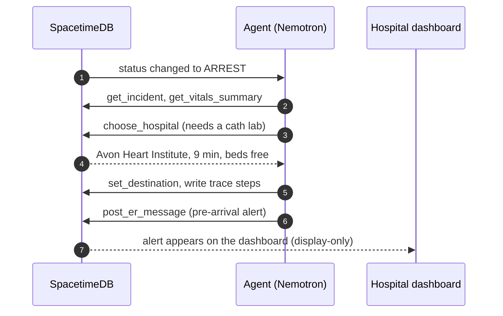

### W3 · Optional: the ER asks, the agent answers

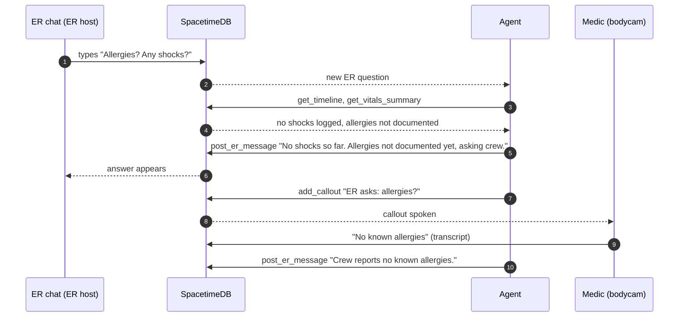

The inbound ER message reducer is not built (§22.8); build it only if the optional ER chat is built. The 19:31
meeting noted that the hospital has no way to reach the paramedic. W3 is the answer the spec has for that; whether
it goes in the demo is in §28.

### W4 · Generate Handoff

```mermaid
sequenceDiagram
  autonumber
  participant H as Hospital dashboard
  participant S as SpacetimeDB
  participant A as Agent
  H->>S: Generate Handoff (request_report: report.status = requested)
  S-->>A: trigger
  A->>S: read timeline, vitals, events, transcript, patient record
  A->>A: draft MIST report, every sentence tagged with source ids
  A->>A: self-check, drop sentences without a source
  A->>S: post_er_message "Handoff report ready…" (E4, before closing)
  A->>S: save_report (status ready; closes the incident)
  S-->>H: report renders with source chips
```

### Agent rules

- Uses only facts stored in SpacetimeDB. Never invents vitals, times, names, allergies or doses.
- Dose and allergy answers come only from the deterministic tools; the model speaks their result.
- Its own unprompted advisory callouts are 8 words or fewer, at most one every 20 s, and always inside the §15
  policy layer.
- Advisory, protocol wording ("Epi due", "Consider…"), never orders.
- Never claims compression depth.
- Every step goes to the trace (`log_agent_step`).
- If Nemotron is slow or down, the rules still speak and the report falls back to a template filled from the
  tables.

### Vision

As built (`voice/pipecat/vision.py`, decision 20; ported from Devin's PR #6):

- Takes about one frame a second (`VISION_INTERVAL_S`) from the phone's video on the voice worker's WebRTC link,
  and skips frames while the previous call is still running, so it never falls behind. "Handoff, look" grabs a
  frame at once and the result is spoken through the brain's queue. With `HUB_URL` set, the Pi hub's newest frame
  is the fallback when no WebRTC video arrives. The phone uploads nothing to SpacetimeDB.
- Looks for AED pads on, an airway device, IV/IO, a medication being given (the label's drug, and dose if
  printed, plus the push, injection or nebuliser), and an ID card (it reads the printed name and birth date).
- Returns findings with a confidence; only 0.7 or higher is acted on, with the frame kept as evidence under
  `voice/pipecat/evidence/` (the file name is the event's source detail).
- Findings go to the brain (`POST /seen`, `voice/README.md`), which owns the database: an ID card runs the W6
  search and `identify_patient` (method `ID card`); a medication becomes `log_event({kind: "med_<drug>",
  sourceKind: "seen"})` with the printed dose in the label and never a guessed one, then `check_allergy` and
  `check_dose_range`, and it fuses with the read-back inside the merge window (RB8–RB10, §18; still a stretch for
  the demo until tried on real frames); AED pads, airway and IV/IO become `procedure` / `airway` rows.
- Model: `nvidia/nemotron-3-nano-omni-30b-a3b-reasoning` on NVIDIA's hosted API (the same key); alternative
  `nvidia/nemotron-3.5-super-vl-120b-a12b`. Both read a synthetic ID card correctly in 1.4–2.2 s (Sat ~23:20).
- Cost: about 300 vision calls in a 5-minute demo, against roughly 40 requests/min per key on the free tier.
  `VISION_INTERVAL_S=2`, a second key in `VISION_API_KEY`, or `VISION=off` if it bites (§28).

## 20. Handoff report

MIST is a common EMS handover structure: Mechanism, Injuries or information, Signs, Treatment. Every line carries
its sources. The header always says it's a prototype. No QR code.

**HANDOFF** · Medic 12 → Avon Heart Institute · 14:15 · *Prototype · synthetic data · not for clinical use*

| | Line | Sources |
| --- | --- | --- |
| **M** | Jordan Avery, 58 (identified by ID card). Witnessed collapse at home, unresponsive on arrival. | ID card · EHR · voice 14:01:48 |
| **I** | History from the record: coronary artery disease, prior MI; takes warfarin and metoprolol; **allergy: amiodarone** (amiodarone was not given). | EHR · read-back flag |
| | Pill bottle found by the bed (MARK). | MARK 14:06:02 · voice 14:06:04 · frame #14 |
| **S** | Arrest 14:02. ROSC 14:11. After ROSC: HR 104 (live), SpO₂ 93 (experimental), temperature 36.4 °C. | relay HR · relay SpO₂ · relay temp |
| **T** | CPR 14:02–14:11, average rate 111/min, longest pause 7 s. | bodycam motion |
| | Epinephrine 1 mg IO at 14:04 and 14:08. | read-back · seen |
| | Airway: i-gel at 14:05. | voice · frame |
| **!** | Outstanding: on warfarin per the record; family bringing the current medication list. | EHR · voice 14:09:30 |

Example content from a synthetic run. In the demo, the numbers come from the judge's own CPR (D4). Shown on the
hospital screen. Stored as JSON in `report.contentJson` (MIST lines with source ids); the format and source ids are
in `agent/README.md`. Once it's ready, the dashboard opens it in the live-view panel, with a Live view / Report switch.

## 21. Pre-arrival alert (ER chat optional)

The hospital learns about the patient before the doors open. For the MVP the alert appears on the hospital
dashboard, **display-only**: there is no Acknowledge button. A typed ER chat, where the ER can ask questions and
the agent answers, is optional. Photon (the same alerts on a real phone) is paused until after the MVP.

| ID | Requirement | Done when |
| --- | --- | --- |
| E1 | Pre-arrival alert (display-only): unit, patient name and age from the record, problem, key treatments, ETA | Appears within 20 s of the arrest |
| E2 | Updates only on big changes (ROSC, ETA moves 3+ min, re-arrest); one every 2 min at most | No spam |
| E3 | Optional: a text box for the ER; W3 answers from the record only | Answer within 20 s |
| E4 | The report summary posts when the handoff is generated | — |
| E5 | After the MVP: Photon sends the same alerts to a real phone, then a voice call (W5) | Paused |

---

## Part E · Data

## 22. Data model and contracts

Everything lives in SpacetimeDB tables, written through reducers (functions that run inside the database). Rules
and timers run in a scheduled reducer, which is what qualifies us for the Spacetime track: the database runs the
logic, not just stores it.

This section describes the **built** module in `spacetime/src` (database `handoff-hackutd26` on Maincloud).
**`spacetime/README.md` is the detailed contract and wins for exact reducer signatures.** Only the hospital lane
changes the module (§0.2).

### 22.1 Tables (as built)

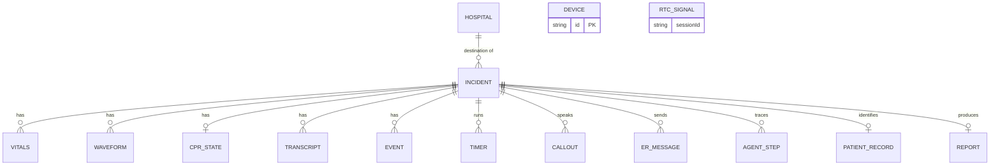

Column names are camelCase in TypeScript and snake_case in SQL (`incidentId` → `incident_id`; SpO₂ is `spo_2`
in SQL). `u64` values are `bigint` in TS; optional values are `T | undefined`. Rows written when no incident is
active get `incidentId = 0`.

| Table | Columns | Notes |
| --- | --- | --- |
| `incident` | `id` u64 PK auto, `unit`, `status`, `startedAt`, `updatedAt`, `arrestStartedAt?`, `destinationId?` u64, `etaAt?` timestamp, `patientRef?`, `demoMode` bool | `status`: standby, on_scene, arrest, rosc, en_route, arrived, closed. The active incident is the newest one not `closed`. `etaAt` is the arrival time (remaining minutes = `etaAt` − now). New incidents start with `demoMode` on |
| `device` | `id` PK, `kind`, `lastSeen` | Who's connected and when last seen (`heartbeat`, and relay/bodycam writes) |
| `vitals` | `id`, `incidentId` (index), `ts`, `device`, `hr?`, `spo2?`, `tempC?`, `status`, `simulated` | About once a second. `hr`/`spo2` stored only when `status` is `pulse`. Kept 30 min |
| `waveform` | `id`, `incidentId`, `ts`, `device`, `samples` f32[], `rateHz`, `simulated` | Raw `ir` batches, about 5 per second, up to 200 samples each. Kept 30 s |
| `cpr_state` | `incidentId` PK, `rate?`, `count`, `sinceLastS`, `paused`, `compressing`, `source` (motion or override), `updatedAt`, `cycleStartedAt?`, `countBase`, `rateSum`, `rateSamples`, `longestPauseS`, `assist`, `bpm`, `onBeatPct?`, `phaseErrMs?`, `onBeatSum`, `onBeatSamples`, `assistAt?` | One row per incident. Compressions this arrest = `count − countBase`; average rate = `rateSum / rateSamples`; average % on the beat = `onBeatSum / onBeatSamples` (counted only in an arrest, while compressing, with beat data, not under an override). The last seven are written by `push_cpr_assist` (decision 21) |
| `transcript` | `id`, `incidentId` (index), `ts`, `text` | One row per sentence, up to 500 characters |
| `rtc_signal` | `id`, `ts`, `sessionId`, `sender`, `kind`, `payload` | WebRTC video handshake (§22.5). Keyed by session, not incident. Kept 10 min |
| `event` | `id`, `incidentId` (index), `ts`, `kind`, `label`, `sources` (array of `{kind, detail, ts}`), `mergedCount`, `status` | The timeline. `status`: logged, flagged, confirmed, cancelled. Merging in §18, kinds in §22.7 |
| `timer` | `id`, `incidentId` (index), `kind` (epi or cycle), `dueAt`, `state` (running, due, cancelled) | Epi 4 min (45 s DEMO TIMING); cycle 2 min (30 s). A new `med_epinephrine` event restarts the epi timer |
| `callout` | `id`, `incidentId`, `text`, `priority` u8, `createdAt`, `spokenAt?` | Priority 0 read-back, 1 urgent, 2 normal, 3 low. Unspoken rows older than 20 s are deleted |
| `er_message` | `id`, `incidentId`, `direction` (to_er or from_er), `text`, `ts` | The pre-arrival alert (display-only) and the optional ER chat W4's E4 summary is also `to_er` and starts with "Handoff report ready"; don't show or speak it as an alert |
| `agent_step` | `id`, `incidentId`, `ts`, `workflow`, `tool`, `summary` | The agent trace |
| `hospital` | `id` PK, `name`, `capabilities` (comma-separated), `driveMin`, `bedsFree` | Seeded, fictional: 1 Avon General (ed, 6 min, 4 beds), 2 Avon Heart Institute (ed, cath_lab, 9 min, 2 beds), 3 Northside Community (ed, 12 min, 6 beds) |
| `patient_record` | `incidentId` PK, `patientRef`, `name`, `birthDate`, `allergies` string[], `medications` string[], `conditions` string[], `codeStatus`, `source` (EHR or cached), `updatedAt` | The record pulled from the mock EHR |
| `report` | `incidentId` PK, `status` (requested, ready, failed), `requestedAt`, `readyAt?`, `contentJson` | Generate Handoff sets `requested`; W4 saves `ready` |
| `vitals_override` | `key` PK (always `vitals`), `scenario` (e.g. `seizure`), `startedAt` | A row means a synthetic scenario replaces the relay's data (§0.1 decision 15). While on, `tick_rules` writes one `vitals` row and one `waveform` batch per second with device `sim-seizure` and `simulated = true` |
| `rule_state`, `tick_schedule` | private | Rule bookkeeping (hold timers, last fired) and the 1 s schedule |

**Not built** (in the earlier spec sketch, deliberately left out or not yet needed):

- `frame` / `snapshot` tables and `push_frame` / `save_snapshot`: not needed. There is no snapshot video, and the
  vision sampler takes frames from the phone's WebRTC link to the voice worker (§19). Evidence frames are files
  on the laptop (`voice/pipecat/evidence/`, decision 20); how the hospital shows them is in §28.
- `er_message_in`: only needed for the optional ER chat.
- `kit_slot` / `kit_update`: only if the med kit is built.
- `timer_fire` is part of `tick_rules`; `agent_step` the reducer is `log_agent_step`.
- Added beyond the sketch: `toggle_incident`, `heartbeat`, `set_event_status`, `request_report`,
  `synthesize_seizure` and its `vitals_override` table.

### 22.2 Reducers (as built)

Most reducers act on the active incident. `identify_patient`, `log_event`, `monitor_tap`, `set_status`,
`set_destination` (and `demo_control identify`) **throw when no incident is active**, so catch the rejected
promise. `save_report` closes the incident; after that its events are read-only. In the TS SDK, reducers are
camelCase (`conn.reducers.pushCpr({...})`).

| Caller | Reducer (args) | Notes |
| --- | --- | --- |
| Relay (HTTP) | `push_vitals(device, json)` | See below |
| Relay (HTTP) | `push_waveform(device, json)` | See below |
| Relay / bodycam | `mark(device, json)` | json `{}` or `{"note":"…","source":"voice"}`; relay default source `MARK` |
| Relay (HTTP) | `toggle_incident(device)` | 2 s hold: starts an incident if none is active (unit "Medic 12"), else closes it |
| Any | `start_incident(unit)` | No-op if one is active; status `on_scene`, DEMO TIMING on |
| Any | `set_status(status, sourceKind, sourceDetail)` | Any transition allowed; the source becomes the timeline chip, e.g. `("arrest", "voice", "her heart stopped")` |
| Any | `heartbeat(device, kind)` | Keeps `device.lastSeen` fresh |
| Bodycam | `push_cpr({rate?, count, sinceLastS, paused, compressing})` | About 2×/s (§22.4). Ignored while a demo override is on |
| Bodycam (CPR assistance, HTTP) | `push_cpr_assist({assist, bpm, onBeatPct?, phaseErrMs?})` | About 2×/s, right after `push_cpr` (§22.4); no-op until a `cpr_state` row exists |
| Bodycam / voice worker | `add_transcript({text})` | One row per sentence |
| Bodycam (W6) | `identify_patient({patientRef, method})` | method `ID card`, `voice` or `manual`; sets `incident.patientRef` and logs `patient_identified` |
| Bodycam / agents | `log_event({kind, label, sourceKind, sourceDetail})` | Read-backs, findings, procedures (§22.7) |
| Bodycam / agents | `set_event_status({eventId, status})` | `cancelled` on "Correction", `confirmed`, `flagged`. Cancelling an epi event cancels the epi timer |
| Bodycam | `callout_spoken({calloutId})` | After speaking a callout |
| Bodycam (W6) / agents | `add_callout({text, priority})` | Queue words; same words never queued twice |
| Bodycam (W6) | `save_patient_record({patientRef, name, birthDate, allergies, medications, conditions, codeStatus, source})` | source `EHR` or `cached` |
| Agents | `log_agent_step({workflow, tool, summary})` | Trace step |
| Bodycam / hospital | `send_rtc_signal({sessionId, sender, kind, payload})` | §22.5 |
| Controls | `demo_control({action, arg})` | Actions in §8 |
| Hospital | `request_report()` | The Generate Handoff button; works on the newest incident even after close |
| Agent (W1) | `set_destination({hospitalId, etaMin})` | Sets `destinationId` and `etaAt`; logs a `destination` event |
| Agent (W1, W4) | `er_message_out({text})` | Display-only alert |
| Agent (W4) | `save_report({incidentId, contentJson})` | Status `ready`; closes the incident |
| Controls (Seizure button); other callers open (§28) | `synthesize_seizure({active})`; over HTTP the body is `[true]` or `[false]` | Hardcoded seizure overrides the relay's data (§0.1 decision 15). `true` while on is a no-op; closing the incident or reset ends it |
| (dropped page) | `monitor_tap({button})` | Left from the monitor page; nothing should call it (§28) |
| Scheduled | `tick_rules` every 1 s | Prunes old rows, runs §15 rules and timers, moves `en_route` → `arrived` at ETA 0 |

### 22.2a Relay → SpacetimeDB over HTTP (app path)

Every call is `POST /v1/database/<db>/call/<reducer>` with the arguments as a JSON array. Relay reducers take
`[device, json]`, where `json` is a JSON **string**. Vitals about once a second, waveform in 200 ms batches.
As built, the Pi's sensor posts to its hub, and `bridge/hub_bridge.py` makes these calls (`push_vitals` 1/s, `mark` per
press). The hub has no waveform or temperature, so neither is sent yet. See `bridge/README.md`.

```bash
B=https://maincloud.spacetimedb.com; DB=handoff-hackutd26
TOKEN=$(curl -s -X POST $B/v1/identity | python3 -c 'import sys,json; print(json.load(sys.stdin)["token"])')
H=(-H "Authorization: Bearer $TOKEN" -H "Content-Type: application/json")

# vitals, about once a second. null (or leaving the key out) = no reading.
# hr/spo2 are dropped unless status is "pulse". "simulated" is REQUIRED (true for --simulate).
curl -X POST $B/v1/database/$DB/call/push_vitals "${H[@]}" \
  -d '["relay-1", "{\"hr\":72,\"spo2\":97.5,\"temp_c\":36.4,\"status\":\"pulse\",\"simulated\":false}"]'

# waveform batch, about every 200 ms (raw ir values; up to 200 per batch)
curl -X POST $B/v1/database/$DB/call/push_waveform "${H[@]}" \
  -d '["relay-1", "{\"samples\":[109876,109901,110012],\"rate_hz\":25,\"simulated\":false}"]'

# MARK (short press)
curl -X POST $B/v1/database/$DB/call/mark "${H[@]}" -d '["relay-1", "{}"]'

# 2 s hold: starts an incident if none is active, otherwise closes it
curl -X POST $B/v1/database/$DB/call/toggle_incident "${H[@]}" -d '["relay-1"]'

# med kit (stretch, not built): read the epi countdown once a second
curl -X POST $B/v1/database/$DB/sql -H "Authorization: Bearer $TOKEN" \
  -d "SELECT due_at FROM timer WHERE kind = 'epi' AND state = 'running'"
```

- `spo2` is also accepted as `spo2_exp`, so the relay's existing field works as-is.
- No valid reading → send null plus a status, **never a stale number** (R4).
- A bad JSON string, or one without `"simulated"`, returns an error status with the error text.
- One identity token per device is fine; keep it.
- Endpoint shapes follow SpacetimeDB's HTTP API; confirm them against the CLI version you install.

### 22.3 Relay → Mac WebSocket (bring-up path, must keep working, R8)

`ws://<mac-ip>:8765`, one JSON object per text message, version `v: 1`:

```json
{"type":"hello","device":"handoff-relay","fs":100,"rate_hz":25,"simulate":false,"v":1}
{"type":"vitals","seq":17,"ts":1234.567,"ir":109876,"red":79123,"hr":72.1,"finger":true,"spo2_exp":98.4,"status":"pulse","n":4}
{"type":"button","seq":18,"ts":1234.612,"event":"press","held_s":0.21}
```

- About 25 Hz. `ir`/`red` are the mean of `n` raw samples, so the pulse **waveform** is `ir` over time.
- `hr` and `spo2_exp` are `null` unless a beat was seen in the last 5 s. `status`: `calibrating`, `no finger`,
  `saturated`, `acquiring`, `pulse`, `sensor error` (the sensor isn't answering). The same vocabulary applies to the
  HTTP `push_vitals` calls in §22.2a. Only `pulse` means `hr` is valid.
- `event` is `press`, `release` or `hold`. Short press = MARK; hold 2 s = start or end the incident.
- `ts` is the **Pi's monotonic clock**, not wall time. Stamp arrival time on the receiver for anything that must
  line up with video or transcript. `seq` lets you detect drops.
- Reference (on the `hardware` branch): sender `hardware/software/pi/stream_test.py`, receiver
  `hardware/software/mac/receiver.py`. `python3 stream_test.py <mac-ip> --simulate` emits realistic fake vitals
  with no Pi.

### 22.4 Phone CPR detector output → `push_cpr`

The detector in `hardware/software/phone/` (on the `hardware` branch) reads
`DeviceMotionEvent.accelerationIncludingGravity`, band-passes it, detects peaks, and outputs
`{rate, count, sinceLast, paused, compressing}` (rate is the median interval of recent compressions; `paused`
after a gap). Self-tests in `dsp_selftest.js`.

The port in `web/src/cpr/dsp.ts` keeps the algorithm unchanged, with the same self-tests (`cd web && npm run
test:cpr`). CPR assistance (decision 21, `hub/cpr.js` in `hub/phone.html`) sends about twice a second, over HTTP,
in this order: `push_cpr [rate?, count, sinceLastS, paused, compressing]`, then
`push_cpr_assist [assist, bpm, onBeatPct?, phaseErrMs?]`.
- `rate` may be undefined. Before the first compression, `sinceLastS` = seconds since the page started; the
  server caps pauses at the time since the arrest began. `count` may reset on page reload (the server tracks
  `countBase`).
- `assist` = the metronome is on (mode active or paused; false while waiting for the finger sensor); `bpm` 0 = off.
- `onBeatPct` = % of the last ~8 compressions within 120 ms of the beat; `phaseErrMs` = mean signed error
  (+ = late). Both are none ("no data", never 0 %) while not compressing, and reset after a pause.
- The page also runs `SELECT id, status FROM incident WHERE status != 'closed'` once a second (newest = active).

### 22.5 WebRTC video signaling (`rtc_signal`)

Live video only, never snapshots. The camera lane owns the sender; the hospital lane owns the receiver tile.

`rtc_signal {sessionId, sender: "bodycam" | "hospital", kind: "offer" | "answer" | "ice" | "request", payload}`.
`payload` is `JSON.stringify(description)` or `JSON.stringify(candidate)` (empty for `request`).

1. The bodycam makes a new `sessionId` on each tap-to-start and sends `offer`, then its `ice` rows.
2. The hospital answers the newest bodycam offer with `answer`, then sends its `ice` rows for that session.
3. When the hospital page loads (or the video goes stale), it sends `request` with `sessionId` `""`. The bodycam
   replies with a fresh `offer`, which is how a reloaded dashboard gets video back. (Built: the dashboard marks
   the tile stale after 3 s without frames and re-requests every 10 s.)
4. Each side ignores rows from itself and from other sessions.

If the peer connection can't be made: phone hotspot, then a TURN relay. No low-frame fallback.

### 22.6 Bodycam ↔ voice agent worker audio and video link

- **Transport:** one WebRTC connection, separate from the video connection to the hospital. Up: mic audio with
  echo cancellation on (the speaker is next to the mic) and the camera track for the vision sampler (decision 20).
  Down: the agent's voice.
- **Endpoint:** the voice agent worker on the laptop (`voice/pipecat/`, Pipecat with its SmallWebRTC transport).
- **Signaling:** served by `voice/pipecat/run.py` on the laptop, port 7860. The phone page (`hub/phone.html`,
  opened with `?voice=https://<laptop>:7860`) does `GET /api/ice` then `POST /api/offer` with `{sdp, type}`; the
  prebuilt test page at `/client` does `POST /start` then `POST`/`PATCH /sessions/<id>/api/offer`. `--ssl` serves
  https with a self-signed cert so the phone's mic works off-localhost; `ICE_SERVERS` or `TURN_URL`/`TURN_USER`/
  `TURN_PASS` add a TURN relay for both peers. With `HUB_URL` set, the worker also serves the phone page at
  `/phone.html` and proxies its hub calls, so one https URL carries the whole bodycam. One bodycam at a time. No
  `rtc_signal` change (§0.1 decision 18). Details: `voice/pipecat/README.md`.
- **Network:** the phone must reach the laptop. Venue Wi-Fi may block device-to-device traffic; same fallbacks as
  video (hotspot, then TURN).
- **Data:** the worker reads state from SpacetimeDB (compact summary, never raw 25 Hz waveforms) and writes
  through existing reducers only. No new tables without the hospital lane.
- **Failover:** when the link or pipeline drops, the bodycam switches to on-device mode (B11).

### 22.7 Event kinds and source chips

`kind` decides merging (§18).

- Medications: `med_<generic name>`, e.g. `med_epinephrine`, `med_amiodarone`, `med_naloxone`. A new
  `med_epinephrine` event starts the epi timer.
- Others: `shock`, `airway`, `mark`, `finding`, `procedure`, `patient_identified`, `destination`,
  `status_<status>`. Rules also write `cpr_coached`, `cpr_paused`, `cpr_sensor`, `cpr_offbeat` (decision 21), `vitals_alarm_hr` and `vitals_alarm_spo2`
  (a merged alarm shows the newest number). `synthesize_seizure` writes `simulation` and `simulation_end`.
- `sourceKind` is the chip: `voice`, `read-back`, `label`, `seen` (the camera saw it given), `tap`, `MARK`, `motion`, `callout`, `EHR`, `ID card`,
  `agent`, `relay`, `demo`. `sourceDetail` is the evidence text, such as the transcript line.

### 22.8 Browser clients (TS SDK)

```tsx
import { useSpacetimeDB, useTable } from 'spacetimedb/react';
import { tables } from '../../module_bindings';

const { getConnection } = useSpacetimeDB();
const [callouts] = useTable(tables.callout);           // live rows
getConnection()?.reducers.pushCpr({ rate: 104, count: 30, sinceLastS: 0.5, paused: false, compressing: true });
```

The connection is built once in `web/src/db/connection.ts` (host and database in `web/src/db/config.ts`,
overridable in `web/.env.development.local`). Pages only use the hooks.

---

## Part F · Running it

## 23. When things fail

Every input has a fallback so the demo never depends on one device. Targets: sensor to screen under 1 s, live
video under 1 s, voice-to-voice about 1.2 s or less, rule to spoken under 2 s, ER question to answer under 20 s,
report under 30 s.

| If this fails | You'll see | Keep going by |
| --- | --- | --- |
| Live video won't connect | "connecting…" on the video tile | Switch to the hotspot, then a TURN relay. No snapshot video |
| Voice agent pipeline drops (network, STT, LLM or TTS) | The agent's voice stops or lags | **Degraded mode** (B11): the phone speaks `tick_rules` callouts with on-device TTS or cached audio, the phone parser does read-backs, Web Speech does STT. Trigger: the bodycam's audio link to the worker is down (§0.1 decision 18) |
| Phone can't reach the voice agent worker (venue Wi-Fi) | No agent voice from the start | Hotspot or TURN; degraded mode meanwhile |
| Wi-Fi or hotspot drops | "Connecting…" in the `/hospital` event timeline header, "stale" on the live view | Clients buffer and reconnect (B9: 30 s offline loses no transcript lines); switch networks; demo controls force the next beat |
| Finger clip gives no reading | "—" (no data) in place of the number | Switch the relay to simulated vitals |
| Phone motion misreads CPR | CPR rate shows "—" (no data) | Demo control "CPR slow / CPR good" |
| Speech-to-text misses words | No voice chips on events | The camera and MARK still log events |
| Nemotron slow or down | "No reply from the agent" in the timeline header after 30 s | Rules still speak; the report falls back to a template filled straight from the tables |
| The AI can't read the card | "Scanning…" on the bodycam | Say the name and birth date, or "Identify patient" on `/controls` |
| Mock EHR down | "Pulling the record…" stays in the patient panel | Use the cached synthetic record, labelled "cached" |
| Med kit not built (stretch) | No "kit" chips | Expected: the read-back and the camera log every dose |
| No phone free for the demo operator | — | Open `/controls` on the laptop; the relay LCD still shows the numbers |
| LCD unreadable at 3.3 V | Faint or blank screen | Contrast screw; else the OLED on the same wires; else no screen. Never 5 V |
| Pi dies | Relay offline | Run the relay in simulated mode on the Mac |
| SpacetimeDB not syncing by 18:00 Saturday | — | Switch to a plain Node WebSocket server and drop the Spacetime track |

## 24. Safety and honesty

### 24.1 Honesty (judges will probe this)

- All patient data is synthetic. The EHR is a mock. Hospitals are fictional. Not a medical device.
- A missing reading shows "—" (no data). Never show a stale or made-up number.
- SpO₂ is experimental. The hospital dashboard no longer labels it (decision 10), so say it out loud if asked: fingertip oxygen readings are less accurate on darker skin, a known problem
  with pulse oximeters.
- No compression-depth claims.
- Demo timers are compressed. The hospital dashboard doesn't label them (§14); say so if asked.
- Which data is live vs simulated, and whether and how it's labelled SIMULATED, is an open decision (§28).
- Never say "clinically accurate", "HIPAA compliant", anything about the FDA, or a number we didn't measure.

### 24.2 Voice agent guardrails

1. **Doses and allergies are deterministic.** `check_dose_range` and `check_allergy` (RB4, RB7) are tools with
   fixed answers. The model only speaks the result and never freelances a clinical "that's fine".
2. **Degraded mode.** If the pipeline drops, the on-device rule callouts and cached audio take over (B11). The
   trigger is the phone's audio link to the worker being down (decision 18).
3. **Read-back latency.** The agent path is about 1 s (no model call: the brain's parser is the first hop,
   decision 18; the phone parser is the fallback). The echo guard (RB5) is needed either way.
4. **Never invent facts.** Claims come only from SpacetimeDB. Compression depth is never claimed.

### 24.3 Physical safety

- CPR in the demo is mimed: hands hover above the teammate's chest and never touch or press. The teammate can stop
  the demo at any time.
- Everything on the Pi runs on 3.3 V. Nothing in the build uses its 5 V pins. The LCD is powered at 3.3 V only.
- Dummy vials marked DEMO; no real drugs.
- API keys live in gitignored env files and never enter the public repo.
- No faces of the public in saved frames.

### 24.4 Gotchas

**Hardware (don't fry the Pi):**

- Never connect 5 V to SDA/SCL or any GPIO. The SunFounder kit docs wire the LCD at 5 V; that is wrong for this
  build.
- Pins: MAX30101 via Qwiic SHIM on pins 1–6 (I2C 0x57); MARK switch GPIO17 (pin 11) + GND (pin 9); RGB ring common
  to 3.3 V (pin 17) with 220 Ω to pins 15/16/18, driven LOW to light. Full map in §11.
- The OLED can latch up: power-cycle the Pi. If its picture is shifted with a noise band, it has an SH1106
  controller: `HANDOFF_OLED_DRIVER=sh1106`.
- Parts are printed PLA/PETG. Be gentle, there are no spares.

**Software:**

- Pi: host `handoff-relay.local`, user `handoff`, setup via `bash setup_pi.sh` (as the normal user, not sudo),
  then `source ~/handoff-venv/bin/activate`. The password is in `hardware/software/README.md` (hardware branch).
- iPhone hotspot: names with a curly apostrophe break Wi-Fi joins; turn on "Maximize Compatibility".
- Browsers need a user tap before camera, mic, motion and audio work: one tap-to-start screen, then hold a wake
  lock. Camera, mic and motion need a secure context: `cd web && npm run dev:https` (self-signed; tap Advanced →
  Proceed once). That mode uses `web/.env` (Maincloud), not `.env.development.local`.
- Chrome on Android doesn't always expose the Pixel's ultra-wide rear camera to web pages; test with the phone
  page before relying on it.
- Venue Wi-Fi often blocks device-to-device traffic, which breaks WebRTC (video and the voice link): use the
  hotspot or a TURN relay.
- The relay's `ts` is the Pi's monotonic clock, not wall time.
- Reducers that need an active incident throw; catch the rejected promise.

## 25. Sponsor tracks (limit 3)

| Track | Prize | What qualifies us | Show the judges |
| --- | --- | --- | --- |
| **Spacetime** | $2,048 / $1,024 / $512 | All state, rules (`tick_rules`), timers and live sync run in SpacetimeDB. Public GitHub repo. | Several devices and a phone updating one record in real time; a rule firing from inside the database |
| **NVIDIA Nemotron** | 2× RTX 5080 | A real-time voice agent on Nemotron that watches the live data, decides when to speak and calls tools; triggered multi-step workflows: the agent decides when to search the EHR from a vision finding or a spoken name (W6), then destination and alert (W1) and report (W4). That is agentic tool use | The voice agent on scene; the event timeline during the EHR pull and the alert |
| **Photon** (paused) | $700 track · $400 voice | Not in the MVP. If we add it after the core works, the alerts also go to a real phone, then a voice call | A judge's own phone, later |

General tracks (Hardware, Design) don't count toward the limit. With Photon paused, the third slot stays open
until submission: Photon if it gets built, otherwise leave it empty rather than chase a track we don't fit.
**ElevenLabs** is a possible TTS (the fallback stack) and could be a sponsor tie-in; check whether it is a
separate track and whether it would use the third slot [OPEN]. Using speech-to-speech models instead of Nemotron
would weaken the NVIDIA track (§19). Still to confirm at the help desk: whether MLH prizes count. State Farm is
the backup only if Spacetime is dropped.

## 26. Schedule and work board

The team works flexibly. Whoever is free picks up the next item on the work board. There are no fixed owners for
packages; the lanes in §0.2 decide which folders each person may change. Claude and the coding agents write code
for every package in parallel, and Astra does renders.

### Work board

Rows are in priority order.

| Package | What "done" means | Needs first |
| --- | --- | --- |
| **SpacetimeDB module and seed data** | Tables, reducers, rules and timers run; hospitals are seeded; one client syncs live. (Built, published 17:26) | Nothing. Start here. |
| **Bodycam page (live video sender, WebRTC audio link, CPR; on-device STT, TTS and read-back only as the degraded-mode fallback)** | Streams video and audio, detects CPR, plays the agent's voice, and falls back to on-device speech; each works on the Pixel. | SpacetimeDB module |
| **Vision sampler (laptop)** | Takes about one frame a second from the phone's video and skips when busy; logs findings at confidence ≥ 0.7 (ID card, airway, AED pads; drugs given is stretch); "Handoff, look" grabs a frame at once. (Built in `voice/pipecat/vision.py`, decision 20; verified on a synthetic card; real frames next) | The phone's WebRTC link to the voice worker, or the Pi hub |
| **Voice agent worker** | Voice-to-voice ≤ ~1.2 s; barge-in works; the fallback engages when the pipeline drops. (Built in `voice/`, live mic test done ~22:15; next: the phone on `hub/phone.html?voice=`) | SpacetimeDB module, `hub/phone.html`, NVIDIA key on the laptop |
| **Live video (WebRTC + SpacetimeDB handshake + fallback)** | Video plays on the dashboard within 3 s of tap-to-start, under 1 s delay; falls back to the hotspot, then a TURN relay. | SpacetimeDB module (`rtc_signal`), bodycam page |
| **Hospital dashboard (live view, record panel, alert, report)** | Shows live video, timeline, patient record, pre-arrival alert and the report. (First version built) | SpacetimeDB module, live video |
| **Nemotron agent (spots the patient on a card or by voice, EHR search, alert, report)** | Pulls the record, posts the alert, writes a sourced report, and logs each step to `agent_step`; its results show in the event timeline. | SpacetimeDB module, mock EHR |
| **Mock EHR (five synthetic FHIR patients)** | Answers FHIR R4 queries locally in under 300 ms. | Nothing |
| **Relay software (LCD, temperature probe, SpacetimeDB sender)** | Sender pushes real vitals once a second; the LCD shows them. | SpacetimeDB module; relay hardware for real data |
| **Relay hardware (LCD pod and wiring, temperature probe, button)** | Button plug works and the relay boots; the LCD shows HR; the probe reads within ±0.5 °C. | Nothing |
| **Demo controls page (`/controls`) and reset** | Big buttons for start, simulated arrest, CPR overrides, identify patient, epi due now and reset; every demo beat can be forced; reset clears every screen in under 10 s. | SpacetimeDB module |
| **Devpost, demo video, README** | Initial draft by 23:00 Saturday; final write-up and video by the 11:30 Sunday submit. | A working path end to end |
| **Stretch, in order: polish → camera-seen drugs (RB8–RB10) → Photon → med kit → patient cam** | Each one is cuttable without breaking the demo. | The core demo works end to end |

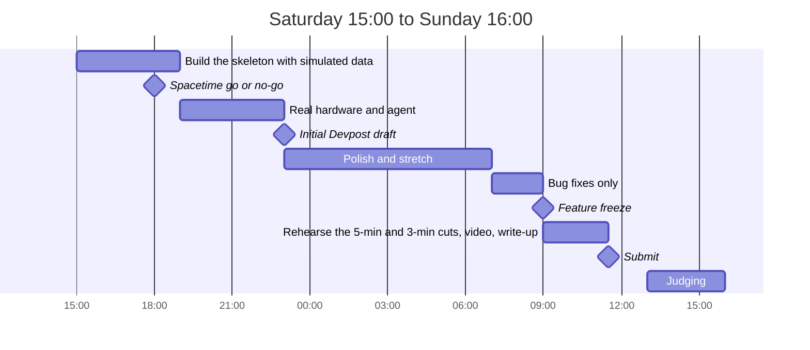

Rehearse with stand-in judges: both the 5-minute and the 3-minute cut.

> **Hard deadlines.** Spacetime go/no-go 18:00 Saturday (not syncing → plain Node WebSocket server, drop the
> Spacetime track). Initial Devpost draft by 23:00 Saturday. Feature freeze 09:00 Sunday. Submit by 11:30 (closes
> 12:00). Judging 13:00–16:00.

## 27. Judge Q&A: questions to expect

Short, honest answers. If the true answer is "we didn't test that", say so; judges respect it more than a guess.

### The problem and the product

| They ask | We say |
| --- | --- |
| Why does the handoff matter? | Details get lost when the paramedic recites from memory while the ER takes over, so Handoff writes every detail down, timed and sourced, as it happens. The ER usually learns about the patient at the door, so live video, live vitals, the record from the EHR and a pre-arrival alert reach it during the call. Paramedics are trained generalists and the specialists are at the hospital, so those specialists can see the patient early, and the bodycam gives protocol reminders on scene (rate, pauses, dose timers, read-back, allergy checks), never a diagnosis. |
| Who would use or buy this? | EMS agencies (the crews) and the hospitals receiving them. It runs on a phone the medic already carries plus a small relay box. |
| Don't ambulances already have software for this? | They have patient care report apps, usually filled in after the call, and some defibrillators give CPR feedback. Handoff does the documentation live, hands-free, from voice, sensors and the camera, and streams it to the hospital as it happens. |
| Why a phone on a harness and not smart glasses or a real bodycam? | Every medic has a phone: camera, mic, speaker and motion sensor in one. Glasses fall off and aren't issued. A production version could use agency bodycams. |
| What did it cost? | The relay is roughly $100 of parts (Raspberry Pi, pulse sensor, button, cables) plus 3D-printed PLA. The phone is the medic's own. |
| What's next? | Testing with EMS instructors on real CPR training equipment; connecting to a real health information exchange; exporting to the national EMS data standard (NEMSIS); Photon alerts to the ER's phones. |

### Safety, accuracy and honesty

| They ask | We say |
| --- | --- |
| Is this a medical device? | No. It's a prototype that documents and reminds. It doesn't diagnose or order treatment. A real product would need regulatory review. |
| What if speech recognition gets the dose wrong? | That's why it reads back: the medic hears exactly what was logged, units spelled out, and can say "correction" within 10 seconds. Unusual doses and recorded allergies ask for confirmation, and those checks are fixed rules, not the model's opinion. Nothing is acted on automatically. |
| What if the AI makes something up? | The agent may only use facts stored in the database. Dose and allergy checks are deterministic tools. Time-critical callouts also exist as plain rules inside the database, so they fire even if the AI is down. The report drops any sentence without a source, and every line shows where it came from. |
| Is the CPR real? | No, it's mimed above a teammate's chest, no contact. The bodycam reads the rescuer's movement, so the rate and pause coaching still work. |
| How accurate is the CPR rate? | Only quote what we measured against a metronome this weekend. We measure rate and pauses; we don't claim compression depth. |
| Is the heart rate real? | Yes, from the patient's finger. The oxygen reading is experimental: fingertip sensors like ours are less accurate on darker skin, a known problem, so we label it. |
| Is the patient record real? | No. The EHR is a mock with synthetic patients, but it speaks FHIR, the format real EHRs use. |

### Privacy and security

| They ask | We say |
| --- | --- |
| HIPAA? Recording patients? | Everything here is synthetic. Production would need patient-data agreements, role-based access, audit logs and retention rules; many agencies already run bodycams under such policies. We keep frames only as evidence for logged events. |
| Where does the data and the AI live? | For the demo: a hosted SpacetimeDB, NVIDIA's API and hosted speech services. SpacetimeDB can be self-hosted and Nemotron is an open model, so a hospital or the ambulance laptop could keep the database and the model local. The on-device fallback (speech, read-back, rule callouts) already runs on the phone. |
| Is it encrypted? | Connections use HTTPS, secure WebSockets and WebRTC (encrypted by default). Deeper security work is a next step; we focused on the clinical flow. |
| How do paramedics get access to an EHR? | Through hospitals or regional health information exchanges, which some EMS agencies can already query. We mocked that endpoint with the standard FHIR format. |

### How it's built (and for sponsor judges)

| They ask | We say |
| --- | --- |
| Spacetime: what does SpacetimeDB do that a normal database wouldn't? | It's the whole backend. The phone, the Pi, the controls page, the voice agent and the hospital screen all subscribe to the same live incident. Our callout rules and dose timers run inside it as scheduled functions, so there's no separate server for them. |
| NVIDIA: how is this "beyond a chatbot"? | It isn't a chat window. It listens on scene, watches the live data, decides for itself when to speak and which tools to call (EHR search, dose and allergy checks, hospital choice, report writing), and logs every step to `agent_step`, with the results in the hospital's event timeline. That is agentic tool use. |
| How fast is it? | Voice-to-voice is about a second (quote what we measured); sensor to screen is under a second; the record pull is a few seconds. Quote measured numbers only. |
| Why does the voice take about a second? Why not a speech-to-speech model? | Each turn goes speech-to-text, then Nemotron with tools, then text-to-speech, all streaming; that costs roughly 0.7–1.2 s. Speech-to-speech models answer in ~0.3–0.5 s, but they can't run our model, and we wanted Nemotron calling our tools with deterministic dose and allergy checks. (If we kept the instant phone "Copy", say so.) |
| How does it know who the patient is? | The agent reads the name and birth date off the ID card with the camera, or hears the medic say them, and decides to search the EHR. If it isn't sure, it asks. |
| How does the live video work? | WebRTC, the same tech as video calls, straight from the phone to the hospital screen. SpacetimeDB carries the connection handshake. |
| What happens without internet? | The phone falls back to on-device speech: rule callouts, read-back and cached audio keep working. Devices buffer and catch up, and real ambulances have cellular. The AI voice and the hospital link need a connection. |
| What did you build this weekend? | All the software. We designed and printed the enclosures and bought the parts before the event. Say this plainly. |
| Who did what? | Four of us worked across hardware, the backend and agent, the phone pages and demo controls, and the hospital dashboard and EHR, picking up whatever was next on our work board. (Say who led what, honestly.) |

**Say with confidence:** real heart rate from the finger sensor · dose and allergy checks are fixed rules, not the
model · every report line has a source · the patient and the EHR are synthetic.

**Don't say:** "clinically accurate", "HIPAA compliant", "FDA"-anything · any accuracy or latency number we didn't
measure · that it measures compression depth · that it diagnoses or decides treatment.

## 28. Open questions

| Question | Who |
| --- | --- |
| **Voice STT/TTS quality:** Pipecat's NVIDIA services exist (`pipecat-ai[nvidia]`, Riva streaming ASR and Magpie TTS on the same key) and `voice/pipecat/` is built on them, but nobody has heard them yet. Test with a key; if the TTS sounds poor or lags, swap in Deepgram + Cartesia/ElevenLabs | Alan |
| **Exact Nemotron model slugs.** Workflows (`agent/`): `nvidia/nemotron-3-ultra-550b-a55b`, verified Sat ~19:00 with a real key (tool calling works; thinking off, W1 alert in about 5 s, W4 report in about 7.5 s). Voice turns (`voice/`): `nvidia/nemotron-3.5-lightning-30b-a3b`, from the catalog, **not yet run with a key**; falls back to the ultra automatically. Vision: `nvidia/nemotron-3-nano-omni-30b-a3b-reasoning` hosted, verified ~23:20 on a synthetic ID card (decision 20) | Team |
| **Voice agent in practice:** measured Sat ~21:30 with a real key on a local DB, `nemotron-3.5-lightning-30b-a3b`, thinking off: a procedure line → `log_event` in 1.0 s; a question → spoken answer in 2.5–4.1 s; small talk → SILENT in 0.25 s; "no pulse, starting compressions" → `set_status arrest` in 0.4 s. Tool calling works on Lightning. Still open: whether the proactive advisories (`VOICE_PROACTIVE`) help the demo; Riva audio quality | Alan |
| **Phone ↔ laptop audio at the venue:** the Pipecat WebRTC endpoint needs the phone to reach the laptop (hotspot or TURN, same as video) and HTTPS for the mic off-localhost | Voice agent and camera lanes |
| **ElevenLabs** as a sponsor tie-in: is it a track, and would it take the third slot? | Team, help desk |
| **Live vs simulated, and SIMULATED labelling.** Which data is live and which is simulated in the demo, and how the screens show it. Decide at the end. Note: the voice brief says "anything simulated is labelled SIMULATED", which conflicts with this deferral; it stays open. Current state: the backend labels events from demo overrides and simulated relay data "(SIMULATED)", the dashboard shows a SIMULATED tag on simulated vitals, and `push_vitals` requires a `simulated` flag | Team |
| During the mock arrest the patient teammate's real heart rate keeps showing a normal pulse (the dashboard hides HR during an arrest today). Decide with the live-vs-simulated question at the end | Team |
| **Relay `simulated` flag:** the module requires `"simulated"` in every `push_vitals`/`push_waveform` JSON (§22.2a). Keep it required, or default it to false? Until decided, the relay sends it | Josh, relay lane |
| The `/monitor` route is gone (replaced by `/controls`, Sun ~01:00); the `monitor_tap` reducer from the dropped monitor page is still in the module — hospital lane to remove. | Josh |
| **D1 list gap:** `/controls` now has ROSC, En route, Arrived and Close (in H8 and the module), plus CPR live, Seizure and Demo timing (Alan, Sun ~01:00). Team to confirm the wider D1 list | Team |
| **Vision sampler:** settled (decision 20): the voice worker samples the phone's video from its own WebRTC link, with the Pi hub's frame as the fallback; evidence frames are files under `voice/pipecat/evidence/`, named in the event's source detail. Still open: how the hospital's H4 chips and the report show those frames (a small static server from the laptop, or copy the frame into the event detail as a data URL; Josh's call) | Camera lane, Josh |
| **`synthesize_seizure`:** `/controls` now has a Seizure on/off button (Sun ~01:00); whether the agent or a hotkey also calls it, and whether its hardcoded numbers change, is open. The relay LCD keeps showing the real pulse while it's on unless the relay reads `vitals_override` | Team |
| Owner of `/controls` (`web/src/routes/controls/`) and the optional W3/ER chat (needs an inbound ER message reducer). W2 now runs inside the voice worker's Nemotron turn (`voice/`) | Team |
| **Hospital → paramedic channel (W3).** Raised at the 19:31 meeting: the hospital can see everything but has no way to reach the paramedic. A QR code was suggested and ruled out (decision 8). The spec's answer is W3 (§19): the ER host types a question, the agent answers from the record and the timeline, and asks the crew through a spoken callout when it doesn't know. Open: is it in the demo or a pitch-only "next step"? If it's in, it needs an inbound ER message reducer (§22.8, Josh's lane), a text box on `/hospital` (which decision 3 would need to allow, since Generate Handoff is the only button today), and an owner | Team, Josh |
| **The Chromatic handheld and its QR page.** The 19:31 meeting parked the ModRetro handheld and kept "no QR codes" (decision 8). After the meeting, kgand built it (20:59, `chromatic/` on `main`): Chromatic firmware that receives heart rate and SpO₂ over Bluetooth, shows a vitals screen, and has a QR page (button A) encoding a short readable summary. Open: (1) is it in the demo, and as what (a second vitals screen beside the relay LCD, decision 6, or the paramedic's display)? (2) Is its QR page an allowed exception to decision 8, or removed? (3) Does it take its data from SpacetimeDB or straight from the Pi over Bluetooth, and who owns `chromatic/` and `hub/` in §0.2? | Team, kgand |
| **Vision cost vs the NVIDIA rate limit:** about 40 requests/min per key on the free tier (unofficial). 1 frame/s vision is up to 60/min on its own (in practice fewer: a call takes 0.6–2.2 s and frames are skipped while one runs). Knobs in `voice/.env.local`: `VISION_INTERVAL_S=2`, a second key in `VISION_API_KEY`, `VISION=off`. Decide after the first full run with the mic and the camera on one key | Alan |
| Do MLH prizes count toward the 3-track limit? (General tracks don't.) | Team, help desk |
| Photon after the MVP (account is done): add only once the core demo works | Team |
| Hotspot or venue Wi-Fi for the demo | Team |
| **Judging format:** how long per team, and do judges come to the table? It decides the 5-minute, 3-minute or quick demo. Ask the help desk | Team |
| Who plays which demo role (narrator, fitter, demo operator, ER host, patient) | Team |
| **Phone: Expo app or the web page?** Recommendation: keep the web page. It already has a tested camera, CPR detector, speech and wake lock, and WebRTC audio works in Chrome with no build step. Expo Go has camera, motion and text-to-speech, but speech-to-text needs a custom native build (20–40 minutes per build and an Android toolchain). Switch only if you need the ultra-wide lens or screen-off recording | Team, before the bodycam work starts |
| **Which display goes where?** The I2C LCD1602 on the relay. The Grove quad alphanumeric only matters if the med kit gets built; the bare 16-pin LCD stays in the bag | Team |
| **Privacy story ("keep it local"):** Pi and Arduino can't run an AI model. For the demo, the agent calls NVIDIA's API (and hosted speech) from a laptop. Pitch line: open-weight Nemotron and self-hosted SpacetimeDB can both run on the ambulance laptop, and the on-device fallback runs on the phone. Hosted STT/TTS weakens "keep it local". Optional: try a small Nemotron model locally on a Mac and check tool calling first | Team |
| **EHR demo patient:** Jordan Avery with the amiodarone allergy is settled (decision 19). Still open: print the ID card at the help desk, or show it on a spare phone? | Team |
| UNO Q or ESP32-S3 for the med kit (only if it gets built) | Whoever builds it, after a 45-minute UNO Q try |
| Do pins 3 and 5 show about 4 mm of bare metal above the SHIM for the LCD jumpers? If not: second I2C bus on GPIO5/6 | Alan |
| Is the LCD readable at 3.3 V? If not, swap in the OLED | Alan |
| `hardware/` lives on the `hardware` branch. Does any of it join `main` (the relay lane's `relay/` sender will need the Pi libs)? | Alan, relay lane |

## 29. Glossary

| Term | Meaning |
| --- | --- |
| CPR rate | Chest compressions per minute. Guidelines target 100–120. |
| ROSC | Return of spontaneous circulation: the heart is beating on its own again. |
| Epi (epinephrine) | Drug given every 3–5 minutes during cardiac arrest. |
| Amio (amiodarone) | Drug for certain shockable heart rhythms: 300 mg, then 150 mg. |
| IO | Intraosseous: giving drugs through a needle into the bone when a vein is hard to reach. |
| SpO₂ | Blood oxygen saturation from the finger sensor. Ours is experimental. |
| Pleth waveform | The pulse wave the finger sensor sees with each heartbeat. |
| i-gel | A common airway device placed in an unconscious patient's throat. |
| Cath lab / PCI | Hospital room for opening blocked heart arteries. Why the agent picks Avon Heart Institute. |
| MIST | EMS handover structure: Mechanism, Injuries or information, Signs, Treatment. |
| MARK | Our button and voice command for a timestamped flag on the timeline. |
| EHR / FHIR R4 | Electronic health record; FHIR R4 is the standard format EHRs exchange. Ours is a mock. |
| Reducer | A function that runs inside SpacetimeDB and changes its tables. |
| Scheduled reducer | A reducer SpacetimeDB runs on a timer; our rules and dose timers (`tick_rules`). |
| Maincloud | SpacetimeDB's hosted service. Code HACKUTD2026 gives credit. |
| WebRTC / TURN | Real-time audio/video between browsers; TURN is a relay server used when devices can't reach each other directly. |
| STT / TTS | Speech-to-text / text-to-speech. |
| VAD / barge-in | Voice activity detection (is someone speaking?) / the medic interrupting the agent mid-sentence. |
| Pipecat / LiveKit Agents | Frameworks for real-time voice agents (STT → LLM → TTS with turn-taking). |
| Degraded mode | The on-device fallback when the voice pipeline drops: rule callouts, cached audio, phone read-back, Web Speech. |
| DEMO TIMING | Compressed timers for the demo: epi every 45 s, CPR cycle 30 s. Labelled everywhere except the hospital dashboard (decision 10). |
| Qwiic / Grove | Two plug-in connector systems for sensors. Qwiic on the Pi, Grove on the med kit. |
| I2C / 1-Wire | Ways sensors talk to a board: I2C for the finger clip and the LCD, 1-Wire for the temperature probe. |
| LCD1602 | A 16-character by 2-line text screen, here on I2C at 3.3 V. |
| OLED | The fallback screen: 0.96 inch, 128 × 64 pixels, on I2C. |

---

## 30. Developer reference

### 30.1 Repo map

`main` (this repo):

```
hackutd26/
  AGENTS.md                     pointer to this file
  README.md
  .claude/agents/spec-checker.md   run after every feature (§0.4)
  spacetime/                    SpacetimeDB module (hospital lane; README = detailed contract)
    src/schema.ts               tables
    src/index.ts                reducers
    src/rules.ts                §15 callout rules (tick_rules)
    src/helpers.ts              shared helpers, seed data, merge window, timers
  web/                          Vite + React + TS app
    src/db/                     connection + config (hospital lane)
    src/module_bindings/        generated by `npm run generate`; don't edit by hand
    src/routes/hospital/        hospital lane
    src/routes/bodycam/         chest-camera lane (placeholder)
    src/routes/controls/        /controls demo-controls page (D1, H8; owner open, §28)
    src/cpr/                    CPR assistance source + tests (decision 21); `npm run build:hub-cpr` → hub/cpr.js
  ehr/                          mock FHIR R4 EHR, synthetic patients, port 4100 (hospital lane; README)
  agent/                        workflow agent W1 + W4, Nemotron with template fallback (hospital lane; README)
    src/module_bindings/        second copy of the generated bindings (`cd agent && npm run generate`)
  voice/                        voice agent worker (Alan's lane; README = contract)
    src/                        the brain: read-back + checks, W6, camera-seen drugs, Nemotron turns, policy, local API
    src/module_bindings/        third copy of the bindings (`cd voice && npm run generate`)
    mock/                       terminal bodycam, fake relay, §7 storyboard runner
    pipecat/                    Python worker: Riva STT/TTS (laptop mic or WebRTC), vision sampler, /api/ice, phone page + hub proxy, test_client.py
    test/                       node --test unit tests
  docs/context/
    SPEC.md                     this file (source of truth)
    img/                        images used here
    2026-10-29-ideation-meeting.md   history only
    chatgpt-requirements-doc.md      history only
```

Planned folders, not created yet: `relay/` (relay lane).

`hardware/` is **not on `main`**. It lives on the `hardware` branch:

```
hardware/
  software/pi/       Pi setup + bring-up scripts, DSP/driver libs (lib/lcd1602.py, lib/oled.py, lib/max30101.py), pytest suite
  software/mac/      receiver.py (WebSocket receiver), serve_phone_test.sh (HTTP/HTTPS for the Pixel)
  software/phone/    phone test page + compression detector + selftest
  software/README.md exact setup steps and expected outputs
  cad/               OpenSCAD sources + STLs (verified, printed). Don't touch unless asked
  manual/  guide/    assembly manual / guide (HTML). Don't touch unless asked
```

### 30.2 SpacetimeDB pointers

- Database `handoff-hackutd26` on Maincloud (published 17:26); dashboard https://spacetimedb.com/handoff-hackutd26.
  HTTP base `https://maincloud.spacetimedb.com`, TS SDK `wss://maincloud.spacetimedb.com`.
- `spacetime/README.md` is the detailed contract and wins for exact reducer signatures; §22 summarises it.
- Only the hospital lane publishes. After every schema change: `cd web && npm run generate` and
  `cd agent && npm run generate`, commit the bindings, announce it.

### 30.3 Cheat sheet

```bash
# Web app (main)
cd web && npm install
npm run dev            # http://localhost:5173/hospital (connects to Maincloud)
npm run dev:https      # HTTPS for the bodycam phone (camera, mic, motion)
npm run typecheck
npm run generate       # regenerate TS bindings after a schema change, then commit them

# Mock EHR and the workflow agent (hospital lane; run ONE agent per database)
cd ehr && npm start                                  # http://localhost:4100/fhir
cd agent && npm install && cp .env.example .env.local   # add NVIDIA_API_KEY (gitignored)
#   local server on another port if 3000 is taken: spacetime start --listen-addr 127.0.0.1:3001
#   then publish with --server http://127.0.0.1:3001 and use ws://127.0.0.1:3001 in the env files
npm start                                            # W1 + W4; template fallback without a key

# Voice agent worker (Alan's lane; ONE per database, test on a local db)
cd voice && npm install && cp .env.example .env.local   # add NVIDIA_API_KEY; point at the local db for testing
npm start                                            # the brain + local API on :8787
npm run mock:relay -- --scenario normal              # fake relay vitals over HTTP
npm run mock:bodycam -- --say                        # terminal bodycam: type what the medic says, hear the agent
npm run scenario -- --fast                           # plays the §7 storyboard end to end
npm test                                             # parser and checks
cd voice/pipecat && uv run run.py --transport local  # real audio with the laptop mic (needs the key; see its README)

# SpacetimeDB (setup once; publishing is hospital lane only)
curl -sSf https://install.spacetimedb.com | sh && export PATH="$HOME/.local/bin:$PATH"
cd spacetime && npm install && spacetime login
spacetime publish handoff-hackutd26 --module-path . --yes
# breaking schema change during the hackathon: add --delete-data=always (wipes all rows)
# local server instead: spacetime start; spacetime publish handoff-local --server local --module-path . --yes
#   then web/.env.development.local: VITE_SPACETIMEDB_HOST=ws://127.0.0.1:3000, VITE_SPACETIMEDB_DB_NAME=handoff-local

# Relay HTTP smoke test: see §22.2a

# Hardware branch (git checkout hardware, or a worktree of it)
cd hardware/software/mac && python3 receiver.py --port 8765 --log stream.jsonl   # receive the relay stream
cd hardware/software/pi && python3 stream_test.py <mac-ip> --simulate           # fake relay data, no Pi
cd hardware/software/mac && bash serve_phone_test.sh --https                     # phone test page (needs mkcert)
rsync -av --exclude __pycache__ hardware/software/pi/ handoff@handoff-relay.local:~/handoff-pi/

# On the Pi
source ~/handoff-venv/bin/activate && cd ~/handoff-pi && python3 -m lib.selftest
python3 i2c_scan.py          # expect 0x57 (finger clip) and 0x27 or 0x3F (LCD)
python3 test_lcd.py          # LCD demo for 10 s (fallback screen: python3 test_oled.py, 0x3C/0x3D)
python3 test_max30101.py --lcd   # live HR and SpO2 on the LCD

# Pi unit tests (anywhere with the hardware branch)
cd hardware/software/pi && python3 -m pytest tests -q
```
