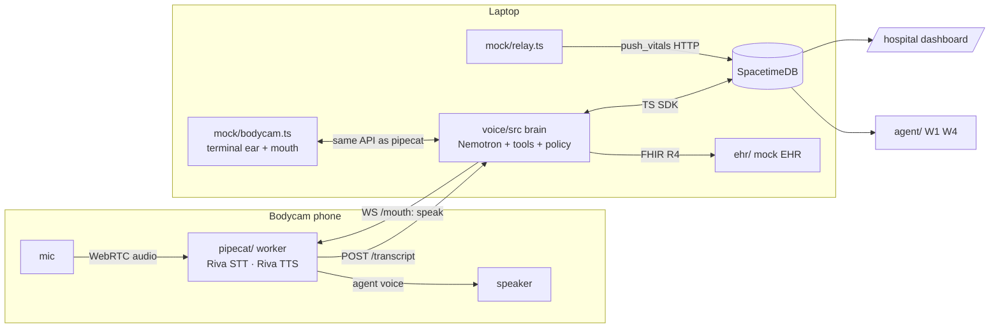

# Handoff voice agent worker (the Nemotron brain)

The voice agent from spec §19: it listens to the medic, speaks back, and does the judgement work the rules don't
(read-back with deterministic dose and allergy checks, W2 transcript → events, W6 EHR pull, answering the medic,
proactive advisories). It runs on the laptop as a Node process. Josh's `agent/` (W1 alert, W4 report) is a
separate process and stays untouched; this worker never runs W1 or W4.

```
voice/
  src/            the brain (TypeScript, Node 22.18+)
  mock/           a terminal bodycam and a relay pusher, so the brain can be tested with no phone and no Pi
  pipecat/        the real-time audio front end (Python): WebRTC or laptop mic → Riva STT → brain → Riva TTS
  test/           node --test unit tests (read-back parser, checks, policy)
```

## Run it locally (no phone, no Pi, no key needed for the deterministic parts)

```bash
# 0. one-time
cd voice && npm install && cp .env.example .env.local      # add NVIDIA_API_KEY=nvapi-… for Nemotron

# 1. a local database so you don't collide with the team on Maincloud (spec §0.1 decision 17)
spacetime start                                            # terminal A
cd spacetime && spacetime publish handoff-local --server local --module-path . --yes
#    then in voice/.env.local: SPACETIMEDB_HOST=ws://127.0.0.1:3000  SPACETIMEDB_DB_NAME=handoff-local

# 2. the mock EHR (W6 reads it)
cd ehr && npm start                                        # terminal B, http://localhost:4100/fhir

# 3. the brain
cd voice && npm start                                      # terminal C, local API on http://127.0.0.1:8787

# 4. a fake relay (vitals once a second over HTTP, spec §22.2a) and a terminal bodycam
cd voice && npm run mock:relay -- --scenario normal        # terminal D
cd voice && npm run mock:bodycam -- --say                  # terminal E: type what the medic says; hear the agent

# optional: the hospital dashboard pointed at the local db
#   web/.env.development.local: VITE_SPACETIMEDB_HOST=ws://127.0.0.1:3000 VITE_SPACETIMEDB_DB_NAME=handoff-local
cd web && npm run dev                                      # http://localhost:5173/hospital
```

To run against the shared Maincloud database instead, leave `SPACETIMEDB_HOST`/`SPACETIMEDB_DB_NAME` at their
defaults. Only one voice worker should watch a database at a time (same reasoning as decision 17: two workers
would read back and log everything twice).

## How it fits together



**One speech queue.** Everything the brain says goes through `add_callout`, the same `callout` table the §15 rules
write. The brain's *speaker* picks the next unspoken callout (lowest priority number, then oldest), sends it to
whichever "mouth" is connected on the local API (the Pipecat worker or the terminal bodycam), and calls
`callout_spoken` when the mouth reports it finished. That gives one queue, one spacing policy and one audit trail
for rule callouts and agent speech alike.

**Degraded mode (proposed failover contract, spec §23 B11):** when no mouth is connected to the brain, the
brain does not mark callouts spoken, so the bodycam page speaks them itself with on-device TTS, exactly as today.
The bodycam should stop speaking callout rows while its WebRTC audio link to the Pipecat worker is up, and resume
when it drops. That is the whole failover trigger.

## The brain, step by step

| Input | What the brain does | Speaks (priority) |
| --- | --- | --- |
| Transcript line (from Pipecat, the terminal bodycam, or a `transcript` row the bodycam wrote in degraded mode) | 1. **Echo guard:** drop it if it matches something the brain itself said in the last few seconds, unless it is confirm / correction / cancel. 2. **Read-back fast path (no model):** parser (§16) → `check_allergy` + `check_dose_range` → speak → `log_event` (kind `med_<drug>`, source `read-back`). 3. **Correction / cancel / confirm** within 10 s of the last read-back → `set_event_status`. 4. **Spoken identity** ("Patient is Jordan Avery, born March 14, 1968") → W6 search. 5. Otherwise a **Nemotron turn** with the state summary and tools; the model may stay silent | Read-back P0; answers to the medic P1 |
| `incident.patientRef` set (ID card via the bodycam, spoken name, or `/controls` Identify) and no record yet | **W6:** `GET Patient/<id>/$everything` → `save_patient_record` (source `EHR`, or `cached` from the built-in copy of pt-0001 if the EHR is down, X7) | "Record found. Jordan Avery, fifty-eight. Allergy: amiodarone. On warfarin." (P2, X4) |
| `event` with a `seen` source and no read-back source (the camera saw a drug given; the camera lane just calls `log_event` with source `seen`, label = the drug, plus the printed dose if it read one) | **RB9/RB10:** the event is flagged (seen but not said) and `check_allergy` → warning (P0); a printed dose gets `check_dose_range` → out-of-range warning (P0) or "Saw epinephrine, one milligram. Confirm?" (P2); no dose → "Saw epinephrine. What dose?" (P2). A spoken dose within 30 s (a full read-back, or just "one milligram") merges in and the brain marks the event `confirmed`; "confirm" confirms a printed or allergy-flagged dose but is not enough when no dose is known | "Saw epinephrine. What dose?" (P2) |
| `transcript` row the bodycam wrote itself (degraded mode) | The phone's parser already spoke the read-back and logged the event, so the brain skips the read-back and control paths for that line and only does W6 / Nemotron | — |
| State change (status, ROSC, timers), at most every 20 s, `VOICE_PROACTIVE=on` | Nemotron decides whether an advisory helps; the policy layer clamps it to 8 words, protocol wording, never an order | P2 |

Deadlines: the read-back path has no model call and speaks in well under a second plus the database round trip.
A Nemotron turn gets 6 s; if it runs out, the brain stays silent (the rules are the safety net).

### Nemotron tools (reconciled names; spec §19 "Tools (draft)")

| Tool | Does | Guardrail |
| --- | --- | --- |
| `get_state` | The compact state summary (below) | read-only |
| `get_recent_transcript(n)` | Last n transcript lines | read-only |
| `get_timeline` | Events this incident with status and sources | read-only |
| `log_event(kind, label, detail)` | `log_event` with source `voice`; kinds `airway`, `procedure`, `finding`, `mark` only | **`med_*` and `shock` are refused**: medications and shocks come only from the read-back parser or the camera |
| `set_status(status, detail)` | `set_status` with source `voice`; `arrest`, `rosc`, `en_route` only when the medic states it plainly | never `closed` |
| `check_dose_range(drug, dose, unit)` | Fixed table: epinephrine 0.3–1 mg, amiodarone 150–300 mg; other drugs "no range on file" | deterministic |
| `check_allergy(drug)` | Against the pulled record's allergy list | deterministic |
| `search_ehr(name, birth_date)` | FHIR `Patient?name=&birthdate=` → matches | with several matches the model must ask, never guess (X8) |
| `pull_record(patient_id)` | `identify_patient` (method `voice`) + `$everything` + `save_patient_record` | the spoken summary is built from the record, not by the model |
| `speak(text, priority)` | `add_callout` through the policy layer | ≤ 15 words for an answer, ≤ 8 for an unprompted advisory, no numbers the state doesn't contain |

The model never speaks a dose or allergy judgement of its own: it calls the check tools and the brain speaks their
fixed wording (§16 guardrail 1). Every tool call and decision is written to `agent_step` (workflow `voice`).

### State summary (what the model sees; proposed format for the §28 question)

Plain text, about 200–300 tokens, rebuilt for every turn:

```
INCIDENT Medic 12 · status ARREST (since 14:02, 3 min) · DEMO TIMING on · destination Avon Heart Institute, ETA 7 min
PATIENT Jordan Avery, 58 (EHR) · allergies: amiodarone · meds: warfarin, metoprolol · history: CAD, MI 2021 · full code
VITALS (relay, 2 s ago) HR 104 · SpO2 93 (experimental) · temp 36.4 — or "no valid reading (no finger)"
CPR rate 111/min · compressing · 142 compressions this arrest · longest pause 7 s
TIMERS epi due in 0:32 · cycle 1:10
EVENTS (last 8) 14:04 Epinephrine 1 mg IO [read-back, seen] · 14:05 Airway placed (i-gel) [voice] · 14:06 Amiodarone 300 mg [FLAGGED allergy] …
RECENT SPEECH 14:06 "Amiodarone, three hundred milligrams. Warning…" · 14:05 "Copy. Epinephrine…"
TRANSCRIPT (last 6) 14:05:58 "giving the i-gel now" · …
```

Never raw waveforms. Numbers are copied from the tables; missing readings say so.

## Local API (brain ↔ ear and mouth)

`http://127.0.0.1:8787` (`VOICE_API_PORT`). Both the Pipecat worker and `mock/bodycam.ts` use exactly this.

| Call | Body / messages | Notes |
| --- | --- | --- |
| `POST /transcript` | `{"text": "...", "source": "pipecat" \| "repl" \| "webspeech"}` → `202 {"id": "..."}` | The brain writes `add_transcript` and processes the line. Final utterances only, one sentence per call |
| `GET /state` | → the state summary as JSON and text | debugging |
| `GET /health` | → `{ok, db, mouth: true\|false, model}` | |
| `WS /mouth` | server → `{"type":"speak","id":"<calloutId>","text":"...","priority":0}` · client → `{"type":"spoken","id":"..."}` when playback finished, with optional `"interrupted": true` (the medic talked over it: it is retried once) or `"error": "..."` (not played: it stays unspoken; two errors in a row and the brain closes the mouth so the bodycam takes over) · client → `{"type":"user_speaking","active":true\|false}` | One `speak` at a time: the next is sent only after `spoken`. While `user_speaking` is true the brain holds (never talk over the medic), except that after 10 s of continuous "speaking" (hall noise) P0/P1 callouts go through. One mouth at a time; a second connection replaces the first (close 1000 "replaced by a new mouth": don't reconnect) |

Everything else (CPR, status, identify, demo controls) goes straight to SpacetimeDB through its reducers; the
mocks call those directly.

## Mocks

- `npm run mock:relay -- --scenario normal|deteriorate|arrest|seizure [--device relay-mock] [--hz 1]` posts
  `push_vitals` once a second and `push_waveform` five times a second over HTTP (spec §22.2a) with
  `"simulated": true`. `arrest` sends `status: "no finger"`/no pulse; `deteriorate` drifts HR up and SpO₂ down.
- `npm run mock:bodycam -- [--say] [--cpr 110]` is a terminal stand-in for the phone: anything you type is a
  transcript line (`POST /transcript`); it connects as the mouth and prints `🔊 …` (with macOS `say` when `--say`);
  `--cpr` pushes `push_cpr` twice a second at that rate (spec §22.4). Slash commands drive the demo through
  `demo_control`: `/start`, `/arrest`, `/rosc`, `/enroute`, `/arrived`, `/close`, `/reset`, `/identify [pt-0001]`,
  `/cpr 90|110|off|pause`, `/seen epinephrine` (pretends the camera saw a drug given: `log_event` source `seen`,
  then flagged), `/report` (Generate Handoff), `/state`, `/help`.
- `npm run scenario` plays the §7 storyboard through both mocks with the real timing, for regression and demo
  videos.

## Lessons from the first live audio test (Sat ~22:00, laptop mic, noisy room)

- **Say full drug names.** Riva heard "epi" as FEIO/EBI/FBI and split "amiodarone" into "amino dirone". The parser
  maps the mishearings it has seen, matches long names fuzzily (edit distance, single words and adjacent pairs),
  and asks "Say again the drug." when it heard a dose but no drug it knows (the answer, just the drug name, is
  combined with the dose). "Epinephrine" and "amiodarone" in full are recognised first time. The line card in
  SPEC §8 now uses them.
- **ASR model:** default is Parakeet CTC 1.1B with the clinical vocabulary boosted at weight 20
  (`voice/pipecat/config.py`); `RIVA_ASR_FUNCTION_ID`/`RIVA_ASR_MODEL` switch back to nemotron-asr-streaming.
- **Split sentences:** a pause after "Administering" makes two STT lines. A skipped fragment is stitched onto the
  next line, a dose with an explicit unit parses without the verb, and a line ending in "of" waits 2 s for the
  drug before asking.
- **Room chatter:** stricter VAD (confidence 0.85, 0.4 s, higher volume floor), transcripts never interrupt the
  agent (only sustained speech does), lines under 3 words are skipped, and Nemotron runs only for questions,
  "Handoff", or clinical vocabulary, at most 20 turns/min.
- **Barge-in:** an interrupted read-back is not replayed (the medic is answering it); only an interrupted P1 rule
  callout gets one more try, 1.5 s after the medic stops.
- **Guardrails that fired:** the model tried to log "FEIO administered" and "Shock delivered" as procedures; any
  line carrying a dose, or any medication/shock-shaped label, is refused. `set_status` needs the medic's literal
  words ("no pulse", "ROSC", "transporting").
- **Rule callouts are not the agent:** in ARREST the §15 rules say "Epi due" every 45 s and "Two minutes…" every
  30 s (DEMO TIMING). Say "ROSC" or reset between runs.

## Settings (`voice/.env.local`, gitignored)

| Setting | Default |
| --- | --- |
| `NVIDIA_API_KEY` | none: the deterministic paths (read-back, checks, W6, corrections) still run; Nemotron turns are skipped |
| `VOICE_MODEL` | see `.env.example`; a fast Nemotron with tool calling. Falls back to `nvidia/nemotron-3-ultra-550b-a55b` if the slug 404s |
| `NEMOTRON_THINKING` | `off` |
| `NVIDIA_BASE_URL` | `https://integrate.api.nvidia.com/v1` |
| `SPACETIMEDB_HOST`, `SPACETIMEDB_DB_NAME` | `wss://maincloud.spacetimedb.com`, `handoff-hackutd26` |
| `EHR_BASE_URL` | `http://localhost:4100/fhir` |
| `VOICE_API_PORT` | `8787` |
| `VOICE_W6` | `on`: this worker pulls the record when `patientRef` is set. Turn `off` if the bodycam lane runs W6 itself |
| `VOICE_PROACTIVE` | `off`: unprompted Nemotron advisories (8 words, every 20 s at most) |
| `DISPLAY_TZ` | `America/Chicago` |

## Honesty rules this code enforces (spec §19, §24)

- Facts only: the model sees the state summary and tool results; `speak` rejects any number not present in them.
- Doses and allergies: fixed tables and the pulled record, spoken verbatim. The model cannot log a medication.
- Unprompted advisories: 8 words or fewer, at most one per 20 s, "Consider…" wording, never an order.
- Never claims compression depth. Never speaks over the medic. Same words never queued twice (server-side).
- Every step is in `agent_step`, workflow `voice`, so the hospital trace shows it.
